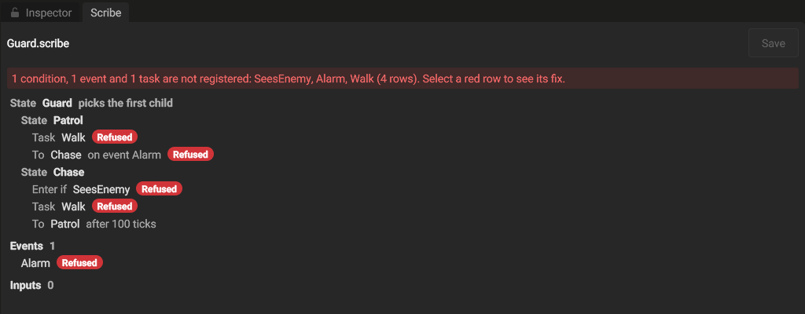
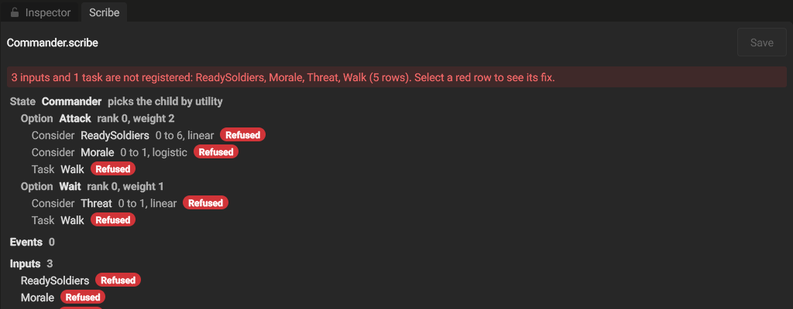

A **state tree** program does things in order and reacts. Each agent keeps an **active path**: the root state and, under it, one active child at each level. A state runs its tasks, and its transitions move the agent to another state. A program file (`.scribe`) holds the tree. The asset database finds the file, gives it a GUID, and loads it as an `AIECS::AiStateTreeAsset`. Loading compiles the file into an `AI::StateTreeProgram`. When you save the file, the asset loads the new program. A file that does not parse or compile logs one error that names the field and the fix, and the asset keeps the last program that loaded.

The file names tasks, conditions, events and inputs. It does not hold code. All times are AI ticks, at 20 ticks per second by default.

The loaded data (`AiStateTreeData`) keeps the file as you wrote it (`Source`, an `AiStateTreeSource`) beside the program:

- The states in the file's order: each state comes before its children. Each state keeps its `name` and, for a `utility` state, the curve of each consideration as you wrote it (the preset, `shape` and `midpoint`).
- The names, each one once, in the order of its first use in the file: task kind `k` is `TaskNames[k]`, condition `c` is `ConditionNames[c]`, event `e` is `EventNames[e]`, and input column `c` is `InputNames[c]`.

`AIECS::ParseAiStateTreeSource` reads a file into this form, and `AIECS::WriteAiStateTree` writes the form back as a file. The written file reads back to the same form. The writer refuses a number that is not finite (NaN or infinity) and names its state and field, because a file holds only finite numbers. It writes each field that does not have its default value, in the order of the tables below, so it does not keep the spacing or the field order of your file. A file that reads but does not compile still reads into this form; `AI::StateTreeProgram::Compile` then gives the reason with the state id, the item (a task, a transition, a modifier or an option) and its index in its list.

## An example

```json
{
  "root": {
    "id": 1, "name": "Guard", "policy": "utility",
    "utility": { "commitmentMargin": 0.1, "minimumTicks": 20 },
    "children": [
      { "id": 2, "name": "Patrol", "tasks": ["Walk", "LookAround"], "join": "all",
        "option": { "considerations": [ { "input": "Calm", "curve": { "preset": "linear" } } ] },
        "transitions": [ { "to": 3, "on": "condition", "condition": "SeesEnemy" } ] },
      { "id": 3, "name": "Chase", "tasks": ["Walk"], "enterIf": "SeesEnemy",
        "option": { "rank": 1, "considerations": [ { "input": "Threat", "curve": { "preset": "step" } } ] },
        "transitions": [ { "to": 2, "on": "timeout", "ticks": 100 } ],
        "modifiers": [ { "kind": "cooldown", "ticks": 40 } ] }
    ]
  }
}
```

## A state

| Field | Type | Default | Meaning |
|---|---|---|---|
| `id` | whole number | required | The stable id. No other state in the file can use it. Keep it when you rename or move the state: a reload keeps each agent in the states whose ids remain. |
| `name` | string | none | A name for the reader. It is not empty. The program does not use it. |
| `policy` | keyword | `first` | How the state chooses its active child (see below). |
| `join` | keyword | `sequence` | How its tasks run together (see below). |
| `enterIf` | condition name | none | A parent's policy chooses this state only when the condition is true. |
| `tasks` | list of task names | empty | The tasks of the state, in order. Up to 32. |
| `transitions` | list | empty | Checked in order at each step. The first that fires moves the agent. |
| `modifiers` | list | empty | Rules that hold while the state is active, or that guard its entry. |
| `weight` | number | 1 | The weight of this state when a `random` parent draws its child. A weight of 0 is never drawn. |
| `utility` | object | none | For a `utility` state: `commitmentMargin`, `minimumTicks` and `noiseMargin`, as in an [option set](./ai-option-sets.mdx). |
| `option` | object | weight 1 | For a child of a `utility` state: its `weight`, `rank` and `considerations`, as an option of an [option set](./ai-option-sets.mdx). |
| `children` | list of states | empty | The child states, in order. A path is at most 8 states deep. |

### Child policies

| Policy | The active child |
|---|---|
| `first` | The first child, in order, that can be entered. |
| `sequence` | The children in order. Each child starts after the one before it succeeds. When the last child succeeds, the state succeeds. When a child fails, the state fails. |
| `utility` | The child whose option scores best. The state scores its children again at each step. A higher rank wins at once; a challenger of the same rank must beat the active child by the commitment margin, after the minimum ticks. |
| `random` | A seeded draw among the children that can be entered, in proportion to their weights. The same agent, seed and tick always give the same child. |

A child can be entered when its `enterIf` is true and its cooldown is over. When no child can be entered, the state stays active without a child and tries again at the next step.

### Joins

| Join | The tasks | The state completes |
|---|---|---|
| `sequence` | One at a time, in order. | Succeeded when the last task succeeds; Failed when a task fails. |
| `all` | Side by side. | Succeeded when all tasks succeed; Failed when one fails. |
| `any` | Side by side. | With the result of the first task that stops. |
| `primary` | Side by side. | With the result of the first task in the list. |

A state with no tasks completes only through its children. When a state's child completes, a `sequence` parent starts its next child; other parents complete with the child's result. When the root completes, the program stops.

## Transitions

| Field | Type | Meaning |
|---|---|---|
| `to` | state id | The state the agent goes to. A transition to an active state starts that state again. |
| `on` | keyword | `condition`, `completion`, `timeout` or `event`. |
| `condition` | condition name | For `condition`: the transition fires when the condition is true. |
| `result` | keyword | For `completion`: `any` (default), `succeeded` or `failed`. The transition fires when the state completes with that result. |
| `ticks` | whole number | For `timeout`: the transition fires when the state has been active for this many ticks. |
| `event` | event name | For `event`: the transition fires on the step that gets the event. See [Events](#events). |

A `condition` transition needs `condition`, a `timeout` transition needs `ticks`, and an `event` transition needs `event`. A transition with a field that its `on` does not use is refused.

At each step the states on the active path are checked from the root down. A parent's transitions are checked before its children's, so a parent preempts its children. The first transition that fires ends the step: the states it enters run their first tick at the next step.

## Modifiers

| Kind | Field | Meaning |
|---|---|---|
| `abortIf` | `condition` | When the condition is true, the state stops and completes with Failed. |
| `cooldown` | `ticks` | After the state stops, no policy enters it for this many ticks. |
| `repeat` | `count` | After the state succeeds, it runs again, this many more times, before it completes. |

Each modifier needs its field and takes no other field. A modifier with a missing or other field is refused.

## Provide the names a program uses

A program names the tasks, conditions, events and inputs that it uses. The game's C++ code provides each name. Until loaded code provides a name, a program that uses it does not run.

:::steps

1. Add a C++ source file under the project's `Assets` folder, for example `Assets/Scripts/AI/GuardAiNames.cpp`. The editor builds the C++ files under `Assets` into the project's module, `UserScripts` (see [Native C++ scripting](../scripting/native-cpp-scripting.mdx)). A project with no `.h` or `.cpp` file under `Assets` builds no module, so it provides no names.
2. Include `GameSDK/AiNames.h` and register each name with its macro, one macro on each line, outside a function, in a `.cpp` file. Do not put a macro in a header: each file that includes the header registers the name again, and the registry refuses each registration after the first.
3. Save the file. The editor builds the code and loads it. The editor knows a name only after the code builds and loads: at project open, and after each change of a C++ file. A build that finishes in play mode loads when play ends.

:::

```cpp title="Assets/Scripts/AI/GuardAiNames.cpp"
#include <GameSDK/AiNames.h>

using namespace GameEngine;

// Sets out[i] to the distance in meters from agents[i] to its target.
void ReadThreatDistance(const ECS::World& world, std::span<const ECS::EntityHandle> agents, std::span<float32> out);
// Sets out[i] to 1 when agents[i] sees an enemy, else to 0.
void SeesEnemy(const ECS::World& world, std::span<const ECS::EntityHandle> agents, std::span<uint8> out);
AIECS::AiTaskStatus TickWalk(AIECS::AiTaskContext& context);

GE_REGISTER_AI_INPUT(ReadThreatDistance, JobThreads, "ThreatDistance", "Distance to threat", "m")
GE_REGISTER_AI_TASK(nullptr, TickWalk, nullptr, "Walk")
GE_REGISTER_AI_CONDITION(SeesEnemy, "SeesEnemy")
GE_REGISTER_AI_EVENT(kAlarmEvent, "Alarm")
```

| Macro | Registers | Arguments |
|---|---|---|
| `GE_REGISTER_AI_INPUT` | An input, a value that a consideration scores. | The function, `CallingThread` or `JobThreads` (`AiInputThreading`), the name, the caption and the unit. |
| `GE_REGISTER_AI_TASK` | A task, an action that an agent carries out. | The `Enter`, `Tick` and `Exit` functions (`AiTaskDefinition`), and the name. `Enter` and `Exit` can be `nullptr`. |
| `GE_REGISTER_AI_CONDITION` | A condition, a true or false value. | The function and the name. |
| `GE_REGISTER_AI_EVENT` | An event type, a message to an agent or a group. | The identifier of the event's id, and the name. The macro defines the identifier as a `const uint16` that your code posts the event with (see [Events](#events)). |

- **The name** is the text the program file gives. An empty name (`""`) stops the build with a message that names the macro. Two modules cannot register one task, condition, event or input name: the second registration logs an error and registers nothing. A program can name an event of another module with no registration of its own, and code of another module gets the id from `AiRegistry::FindEventType`.
- **The caption and the unit** of an input are text for a person: the caption says what the value is, for example "Distance to threat", and the unit is the unit of the value, for example "m". Either can be `""`. `AiRegistry::GetNamedInputs` returns each input's name with its caption and unit.
- **A change to the code**: when the editor loads the new build, a task, condition, event or input name that the new code does not register any more is removed. The log shows one warning that names each removed name.
- **The registry functions**: the macros call `AiRegistry::RegisterInput`, `RegisterTask`, `RegisterCondition` and `RegisterEventType`. A game module uses the macros. A call to these functions outside a module load, for example in a test, registers a name that no reload removes, and it does not register an event name that a reload removed.
- **At run time**, `LoadStateTree` refuses a program that names a task, condition, event or input that no loaded code provides. It logs the first missing name with the registered names and returns `AiAgent::kNoProgram`, and an agent with no program does not decide. When a new build removes a name that a running program uses, the agents of that program do not decide until code registers the name again.

## Run a program on agents

Register what the file names with the macros (see [Provide the names a program uses](#provide-the-names-a-program-uses)), then load the program from its asset. `AiRegistry::LoadStateTree` resolves each task, condition, event and input name to a registered id and returns the program id. The registry keeps the asset, so a saved edit of the file reaches the running agents (see [Reload a running program](#reload-a-running-program)). `AiRegistry::CompileStateTree` compiles loaded data with no asset; such a program does not reload. The id has bit `0x8000` set (`AiAgent::kStateTreeProgramBit`), so one `AiAgent::Program` field holds a utility program or a state-tree program. A name that no module registered refuses the program with an error that lists the registered names, and so does a state name that more than one state uses. `AiRegistry::CheckStateTreeNames` makes the same checks and adds nothing to the registry: it gives one refusal for each use of a name that no module registered, with its state and item, and one for each repeated state name, on the second state with that name.

```cpp
#include "AIECS/AiRegistry.h"
#include "AIECS/Assets/AiStateTree/AiStateTreeAsset.h"
#include "AIECS/Components/AiAgent.h"
#include "AIECS/Components/AiCells/AiCellsSmall.h"
#include "AIECS/Components/AiStateTree.h"

using namespace GameEngine;

const uint16 program = AIECS::AiRegistry::Get().LoadStateTree(guardAsset);

Components::AiAgent agent;
agent.Program = program;
world.Create(agent, Components::AiStateTree{}, Components::AiCellsSmall{});
```

- **A condition** is a batch call, like an input: one call fills one value per agent for a share of the due agents. The calls run on job threads at the same time, so a condition only reads the world. A decision computes each condition once, before the step: a state that the step enters reads the value from before the step.
- **What a condition, an input or a task reads**: of the AI components (`AiAgent`, `AiStateTree`, the cells and `AiPathTrace`), only those of its own agent. The jobs of the other due agents write theirs at the same time, so a read of another agent's AI components gives a value that changes with the job timing. A condition such as "an ally is in the Attack state" must read a component that the game writes, not the ally's `AiStateTree`.
- **An agent** needs `AiAgent` and `AiStateTree`. `AiStateTree` holds the active path and the result, and `Group`, the agent's group entity, which gets it the events addressed to the group. `AiDecideSystem` starts the tree and steps it at the agent's first decision, then steps it once at each decision, every `Cadence` AI ticks. `AiAgent::ActivePath` shows the active states from the root down, as indices in the program's states. When `AiAgent::Program` changes to another program, a state tree or a utility program, the next decision exits the old path (its tasks exit with Preempted) and starts the new program; `AiAgent::PathProgram` records the program that the path belongs to; the engine writes it, and a game never does. To start the tree again at the agent's next decision, set `AiAgent::RestartRequested`: that decision exits the running tasks with Preempted, starts the tree at its root and clears the request. The next decision can come up to `Cadence` AI ticks later; call `AiAgent::Wake` as well to make it come on the next AI tick. When `Program` changes in the same decision, the tasks of the old program exit and the new program starts at its root.
- **Cells**: the program's cooldowns use the last cells of the agent, one per state with a `cooldown` modifier (`StateTreeProgram::GetCooldownSlotCount`). The tasks get the cells in front of them through `AiTaskContext::GetCells`. An agent whose cells cannot hold the cooldowns does not decide, and an error names the fix.
- **Tasks** run like the tasks of a utility program: they read the world and act through `AiTaskContext::IssueCommand`. `AiApplySystem` carries out the orders of all agents in entity order.
- **The trace**: add `AiPathTrace` to an agent to record its last 64 decisions. Each record holds the AI tick, the program id, the result and the active states. The editor's `get_ai_trace` debug method returns them as `pathRecords`.

A scene save does not keep a state-tree agent's program or its active path.

## Events

An event is a message to one agent or to one group, for example "the alarm sounded" for every guard of a camp. An `event` transition fires when the agent gets an event of its type. Register each event name that a file uses with `GE_REGISTER_AI_EVENT` (see [Provide the names a program uses](#provide-the-names-a-program-uses)); a program that names an event no one registered is refused, and the error names the event.

Game code posts an event on the main thread, while no AI system runs, for example in a game system or a command. A task posts with `AiTaskContext::PostEvent`, at most four events per step; `AiApplySystem` posts them in entity order. The file that registers the event posts with the id that the macro defines. Another file gets the id from `AiRegistry::FindEventType` at run time, after the module loads; it returns `AiRegistry::kNoId` when no loaded code registers the name.

```cpp
#include "AIECS/AiEvent.h"

// In the file with GE_REGISTER_AI_EVENT(kAlarmEvent, "Alarm"):
AIECS::PostAiEvent(world, {.Type = kAlarmEvent, .Source = bell, .Target = camp, .Payload = {wave, 0}});

// In another file:
const uint16 alarm = AIECS::AiRegistry::Get().FindEventType("Alarm");
```

- **Who gets it**: the agent that `Target` names, or each agent whose `AiStateTree::Group` is `Target`.
- **When**: each addressed agent gets the event once, at its first step after the post, whatever its cadence. An agent that steps every AI tick gets it on the next tick; an agent with a `Cadence` of 20 gets it up to 20 ticks later. No agent gets an event on the tick of the post.
- **How long it stays**: an event stays for the largest `Cadence` of the world's agents. An addressed agent that does not step in that time, for example an agent with no program, does not get it.
- **Order**: an agent gets its events and its group's events in post tick order, then ordered by `Source`, then in post order.
- **Payload**: two numbers that your game gives a meaning to. A task reads the events of its agent's step with `AiTaskContext::GetEvents`, in its `Enter` or its `Tick`.

## Edit a program in the Scribe panel

Open a `.scribe` file from the Assets panel to show it in the **Scribe** panel. The panel shows the program as an outline:

- Each state in the file's order, indented under its parent. A state with children shows how it chooses its active child: picks the first child, runs children in order, picks a random child, or picks the child by utility. A child of a `utility` state is an **Option** row and shows its option's rank and weight. Under the state: its enter condition, the considerations of its option with each input's range and curve preset, its tasks, and its transitions with the state they go to and what fires them.
- The program's events and inputs, as two groups at the end. An event or an input that your game does not register shows a **Refused** badge in its group too.

Each row is one line. In a narrow panel, a long name or range ends in an ellipsis; point to the row to read all of it.



*The Guard program is refused, because no module registers its tasks, its condition or its event. Each badge marks a row with a name that is not registered.*



*The Commander program chooses between the options Attack and Wait. Each option row shows its rank and weight, and each consideration under it shows its input, its range and its curve.*

Click a row to edit it in the fields below the outline. The fields show the row's path over them, for example "Attack > Consider Morale":

- On a state: its **Name**, and its **Enter if** condition. The list holds the conditions that your game registers; choose `(none)` to remove the condition.
- On a child of a `utility` state: also its option's **Weight** and **Rank**, and **Add Consideration**, which adds a consideration that reads the first input that your game registers.
- On a `utility` state: also its **Commitment margin**, **Minimum ticks** and **Noise margin**. Minimum ticks counts AI ticks; at the default rate of 20 ticks per second, 20 ticks are 1 second.
- On a consideration: its **Input**, from the inputs that your game registers, its **Minimum** and **Maximum** (the input values that map to 0 and to 1 on the curve), its **Curve** preset, read only, and **Remove Consideration**. Minimum can be above Maximum: the curve then starts at the higher input value, and the row reads, for example, "9 down to 6". When Minimum and Maximum are equal, the consideration gives the start of the curve for every input value. Edit the curve in the `.scribe` file.
- On an event transition: its **Event**. The list holds the event types that your game registers.

Drag a number field to change its value, or click it to type a value. While you drag, the outline shows the new value. Each edit is one undo step, and a drag is one edit: undo puts back the value from before the drag. An edit that leaves the value as it was, such as a typed text that is not a number, adds no undo step. **Unsaved changes** shows until you click **Save**. Save rewrites the file in the standard format. The asset then loads the new program, and the running agents move to it (see the next section).

After each edit, the panel compiles the program and checks its task, condition, event and input names against the names that your game registers. Each name that is not registered shows a **Refused** badge on its row; an input that is not registered shows it on the row of its consideration. When a `utility` state has more children than options, the badge shows on the first child with no option. A state name that more than one state uses shows the badge on the row of each of those states. When the program does not compile, the badge of the compile refusal and the badges of the names show at the same time, so you see each row that needs a fix. The notice above the outline lists the kinds of names that are not registered, then each name once in the same order, with the count of rows that use them, for example "1 condition, 1 event and 1 task are not registered: SeesEnemy, Alarm, Walk (4 rows)". In a panel narrower than 480 pixels, the notice gives only the count of rows; point to it to read the names. Point to a badge to read its refusal, or click a refused row to read its refusal over its fields. A refusal names its row and gives the fix in the panel first, for example "Choose a registered input in Input", then the fix in your game's code. When your game registers a missing name, its refusal clears. A Save of a refused program asks you to confirm, because the running agents keep their program until the file compiles. An open of another file while the program has unsaved changes asks you to save them, discard them or cancel the open. If the program is refused, its Save asks you to confirm too.

## Reload a running program

When you save a `.scribe` file of a program from `LoadStateTree`, the next AI tick of each world moves the running agents of that world to the new program. An agent keeps each state of its path whose `id` is in the new file under the same parent. The states below exit, and their tasks exit with `Reloaded`. A kept state whose task list changed stops its tasks with `Reloaded` and starts the new ones. The agent's cooldowns end, so each state with a cooldown is ready again. A file that does not compile logs one error, and the agents keep the program they run. Agents with a utility program do not reload.

## Exit reasons

Each task gets its `Exit` function with a reason (`AiTaskExitReason`) when it stops: `Completed` (its tick returned Succeeded), `Failed` (its tick returned Failed), `Preempted` (a transition, a modifier, a utility choice, the join of its state, a program change or a restart stopped it), or `Reloaded` (a reload removed its state or changed its state's tasks).
