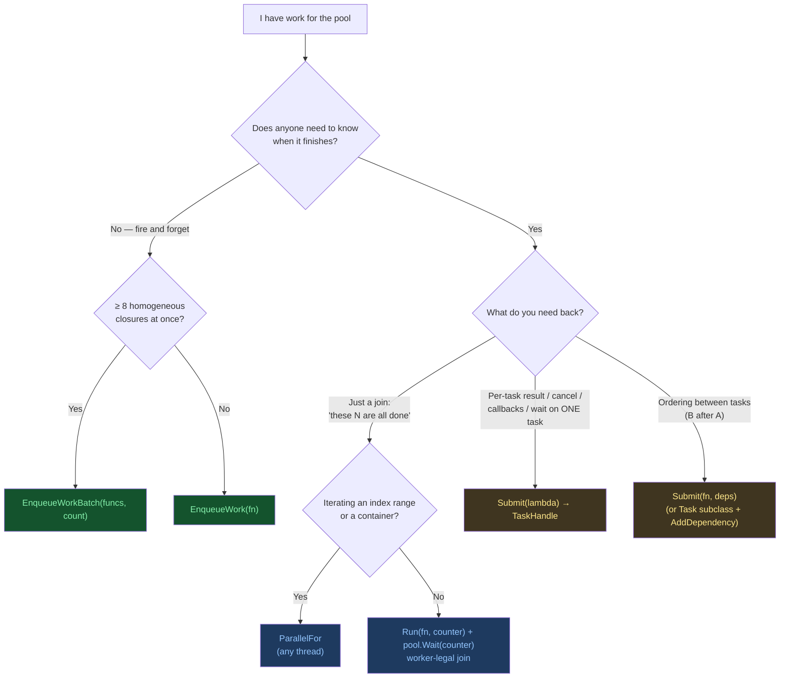

:::note[Who this is for]

engine developers putting work on the pool. This guide covers the API and how to pick between its submission paths. It is a *how-to*. The design/audit record with the full race analyses is the jobsystem-overhaul record in the workbench. Every signature here is verbatim from the headers in `Engine/Modules/JobSystem/Include/JobSystem/`.

:::

:::tip[Getting the pool]

there is one engine-wide pool, created at engine init and destroyed last at teardown.

```cpp title="Get the engine's pool"
auto& pool = GameEngine::EngineCore::GetInstance().GetJobSystem();
// -> JobSystem::WorkStealingThreadPool&
```

Tests and tools construct their own: `JobSystem::WorkStealingThreadPool pool(4);`

:::

## 1. Which path?

| You have | Use | Per-task cost | You get back |
|---|---|---|---|
| Fire-and-forget work; the caller owns all synchronization | `EnqueueWork(fn)` | 0 allocs steady-state (pooled 128-byte slab), one queue push, one bounded wake · millions of tasks per second | Nothing, but the task is **never dropped**, even racing Shutdown |
| ≥ ~8 *homogeneous* fire-and-forget closures ready at once | `EnqueueWorkBatch(funcs, count)` | Bulk queue op + one bounded batch wake (≤ 4 caller notifies) · about 10 µs for a 200-task burst | Same as EnqueueWork; elements are moved-from |
| A cohort you must join ("all N finished"), possibly **from a worker thread** | `Run(fn, counter)` + `Wait(counter)` | One slab envelope per task, and one visit per task within the fork-task budget (§3.4); no TaskHandle, no TaskData · fork and join under 10 µs warm | Happens-before on all task writes at Wait-return; worker-legal join; sticky `HasAnyFailed()` |
| N units claimed one at a time, an index range to split into chunks, or a range to sort | `ParallelFor` (units, or chunks with a `minBatchSize`) / `ParallelSort` | One slab run block + at most one batch of helper envelopes (min(workers, units − 1, 64)); 0 heap allocations per call | Blocks until done; legal on **any thread**, a worker included; the first exception a chunk threw is rethrown on the caller |
| Per-task result, status, cancellation, or completion callbacks | `Submit(lambda)` → `TaskHandle` | under 1 µs in Release, exactly 1 heap alloc | `TryGetResult<T>`, `Wait`, `Cancel`, `OnComplete`/`OnFailure`, dependency-graph attachable |
| Work whose thread waits on another process, the OS or a driver for most of its run (a compiler, cmake, a compile server) | `JobChannel::Submit(fn)`, or `JobChannel::Enqueue(fn)` for work that must never be dropped, on the owning service's channel (§12) | Runs on a blocking thread, never a compute worker; at most the channel's cap run at once, the rest wait in its FIFO and hold no thread | A `TaskHandle`, as `Submit(lambda)`: cancellable while queued, a `Submit(fn, deps)` dependency |
| Execution ordering between tasks (B runs after A) | `Submit(fn, deps)`: lambda + a span of dependency handles. `Task` subclass + `AddDependency` for stateful task types | Graph node + TaskData; node erased eagerly at terminal | Dependents run only after every dependency is terminal; failure cascades to parked dependents; cancel cascades too |

The timings in this table are the rounded measurements of [9. Performance reference](#9-performance-reference).



Rule of thumb: start at the cheapest path that gives you the completion observation you actually need. Paying for a TaskHandle on work nobody waits on, or hand-rolling a barrier where a JobCounter fits, costs for nothing.

## 2. Fire-and-forget: EnqueueWork and EnqueueWorkBatch

```cpp title="JobSystem/WorkStealingThreadPool.h"
// WorkStealingThreadPool.h
template <typename F, typename = std::enable_if_t<std::is_invocable_v<F&>>>
void EnqueueWork(F&& func, JobPriority priority = JobPriority::Normal);

template <typename F, typename = std::enable_if_t<std::is_invocable_v<F&>>>
void EnqueueWorkBatch(F* funcs, size_t count,
                      JobPriority priority = JobPriority::Normal);   // elements are MOVED FROM

template <typename F, typename = std::enable_if_t<std::is_invocable_v<F&>>>
void EnqueueWorkBatch(std::span<F> funcs,
                      JobPriority priority = JobPriority::Normal);   // span convenience
```

```cpp title="Fire-and-forget and a homogeneous batch"
#include "JobSystem/WorkStealingThreadPool.h"

auto& pool = GameEngine::EngineCore::GetInstance().GetJobSystem();

// One-off. No handle, no TaskData, zero allocations in steady state
// (pooled slab). YOU own all synchronization — nothing tells you when,
// or on which thread, it ran.
pool.EnqueueWork([pixels = std::move(pixels)] { UploadToStaging(pixels); });

// Homogeneous batch: one closure TYPE, one bulk queue op, one bounded wake.
struct MipTask
{
    Texture* Tex = nullptr;
    uint32_t Mip = 0;
    void operator()() const { GenerateMip(*Tex, Mip); }
};

MipTask tasks[16];
// ... fill tasks ...
pool.EnqueueWorkBatch(tasks, 16);   // tasks[0..15] are moved-from after this
```

- **Batch threshold:** batches below `kBulkPublishThreshold` (= 8) internally route down the per-task publish loop: per-task visibility overlaps publication with execution, which measured faster for small warm forks ([9. Performance reference](#9-performance-reference)). So do not contort call sites to batch fewer than ~8 tasks. At and above 8, the bulk path wins. One `EnqueueWorkBatch` call handles up to any count (staged through 64-entry stack runs, `kStackBatch`).
- **Nothrow-move closures:** the bulk slab path `static_assert`s `std::is_nothrow_move_constructible_v<F>`. Plain member-wise structs (the intended shape) satisfy this automatically.
- **Closure size:** closures that fit a 128-byte slab (i.e. ~104 bytes of captures) are allocation-free after warmup. Oversized closures fall back to a plain heap allocation, chosen at compile time. Keep captures small on hot paths.
- **Exceptions:** a throwing bare task is caught and logged by the worker. It cannot take the pool down, but nobody else observes the failure. If you need failure observation, you wanted a JobCounter or a TaskHandle.
- **Never dropped (F13c):** an EnqueueWork racing or following `Shutdown()` still executes (see §7).

## 3. Fork-join: Run(fn, counter) and Wait(counter)

```cpp title="JobSystem/WorkStealingThreadPool.h and JobSystem/JobCounter.h"
// WorkStealingThreadPool.h
template <typename F, typename = std::enable_if_t<std::is_invocable_v<F&>>>
void Run(F&& fn, JobCounter& counter);

void Wait(JobCounter& counter);

// JobCounter.h
class JobCounter
{
  public:
    JobCounter() = default;                  // non-copyable; dtor asserts count == 0
    void Add(uint32 n = 1);                  // F16: at submit, BEFORE publish
    void Decrement();                        // once per counted unit, on any thread, after its Add
    bool IsZero() const;                     // lock-free probe — NOT a join, see below
    bool HasAnyFailed() const;               // F19 sticky: some counted task threw
    void Reset();                            // re-arm for the next wave; quiescent only
};
```

```cpp title="Fork a wave and join it"
#include "JobSystem/JobCounter.h"
#include "JobSystem/WorkStealingThreadPool.h"

JobSystem::JobCounter counter;               // stack-owned is the normal case
for (Tile& tile : dirtyTiles)
{
    pool.Run([&tile] { RebuildTile(tile); }, counter);
}
pool.Wait(counter);                          // legal on a worker thread too (see below)

if (counter.HasAnyFailed())                  // sticky flag; no per-task attribution
{
    Logger::Log::Warning("tile rebuild wave had failures");
}
// From here the counter may be destroyed, or reused for the next wave.
```

This is the engine's barrier primitive. **Do not hand-roll a barrier.**

### 3.1. The participating-Wait rule: why waiting inside Wait is legal

:::tip

`pool.Wait(counter)` participates on **every thread**: a worker of this pool, the main thread, another pool's worker, a blocking thread, a thread of your own. A waiter does not park while there is findable work: it executes tasks, but **only tasks tagged to that same counter** (they live in the counter's own queue, never drained from the pool's general queues). When no same-counter task is findable (the remainder is in flight on other threads, or the counter is a bare-chunk barrier with no tagged queue), it parks on the counter's condvar and wakes on the last decrement or on a new tagged publish. A thread that cannot block (the browser main thread) parks in 10 s slices and reports each one. This filtered consumption is what makes fork-join from inside a job deadlock-free on a bounded pool, guarantees that waiting on counter A never picks up an unrelated 5ms task or a job that waits on the waiter itself, and lets the main thread run its own wave's systems instead of sleeping through the fork. Under a storm that holds every worker, the main thread finishes its join alone. A tagged task the waiter runs is a job body on that thread, of the waiter's own class: `WorkStealingThreadPool::IsExecutingJob()` reads true inside it, as it does inside every `ParallelFor` unit, whichever thread runs it.

:::

**Scope:** participation covers only tasks submitted via `Run(fn, counter)`. A counter used purely as a barrier for externally-published work (bare `EnqueueWork` chunks with manual `Add`/`Decrement`, §3.3) **must be joined from a non-worker thread**: the waiter has nothing tagged to execute, so it only parks, and a worker parked on it would deadlock a bounded pool. Also: all tasks counted into one counter must target the **same pool**.

### 3.2. Lifetime and the destruction license

- **Caller-owned:** the counter is yours: stack, member, wherever. The pool never owns it. It must reach zero before destruction (Debug assert), i.e. `Wait()` must complete first.
- **Wait-return = destruction license for exactly ONE thread.** Only one thread may treat its Wait's return as permission to destroy the counter. A second concurrent waiter can still be inside the condvar's wait internals when the first destroys it (UB). Every in-tree counter has a single joining thread. Keep it that way, or give the counter external lifetime that outlives all waiters.
- **Never destroy off a bare `IsZero()`:** observing zero via the lock-free probe does not order a concurrent decrementer's critical section before you: the decrementer can still be inside the counter's mutex. `pool.Wait(counter)` performs the required synchronizing lock. Use it as the join point.
- **Reuse:** after Wait returns, the same counter can carry the next wave (Add/Run/Wait again). `HasAnyFailed()` is sticky *across waves* unless you re-arm: read it, then call `Reset()` between waves to clear it. Reset is legal **only at quiescence**: count == 0, no parked waiters (both Debug-asserted). Calling it while tasks or waiters are live races the flag writes it clears.
- **Exceptions always decrement:** the envelope's scope guard decrements on every exit path, so a throwing task can never hang the join. The throw is logged and flips `HasAnyFailed()`. There is no per-task failure observation on this path (F19).

### 3.3. The bare-barrier shape (Add/Decrement by hand)

A JobCounter can also gate work that was *not* submitted via `Run`: you count it in manually and decrement from the task body. In-tree example: `MaterialSystem`'s shader-prewarm drain (`Engine/Source/Engine/Rendering/MaterialSystem.cpp`):

```cpp title="A bare barrier counted by hand"
// Count BEFORE publish (F16) — a Wait issued after the submits on the same
// thread can then never miss a task.
m_PrewarmCounter.Add(1);
pool.EnqueueWork([this]
{
    struct DecrementGuard                    // decrements on EVERY exit path
    {
        JobSystem::JobCounter* Counter;
        ~DecrementGuard() { Counter->Decrement(); }
    } guard{&m_PrewarmCounter};
    CompileVariant();                        // may throw — guard still fires
});

// ... later, from the MAIN thread (a bare barrier has nothing to run: the waiter parks — §3.1):
pool.Wait(m_PrewarmCounter);
```

:::caution[F16 ordering is binding]

`Add()` on the submitting thread *before* the task is published; exactly one `Decrement()` per counted unit, after its `Add()`, on any thread: the task's completion path, or a driver's completion thread for work the pool does not run (use a scope guard so exceptions decrement). Decrement-then-publish or publish-then-Add both create windows where Wait can return early or hang.

:::

### 3.4. Do not hand-roll ranges or claim loops: ParallelFor and ParallelSort

`ParallelFor` is the one fork verb: N units, each claimed by one thread, with the caller claiming beside the pool's helpers. It handles helper publication, the join, and the fallbacks for you. The unit form is declared in `JobSystem/WorkStealingThreadPool.h`. `JobSystem/ParallelAlgorithms.h` adds the chunked overload and `ParallelSort`. Every form takes the pool by pointer, and a null pool runs the work on the caller.

```cpp title="JobSystem/ParallelForOptions.h and JobSystem/ParallelAlgorithms.h"
struct ParallelForOptions                              // JobSystem/ParallelForOptions.h
{
    static constexpr size_t kAllWorkers = SIZE_MAX;
    size_t Helpers = kAllWorkers;                      // one per worker by default; clamped to min(units - 1, 64); 0 = every unit on the caller
    JobPriority HelperPriority = JobPriority::Normal;  // a Background body's helpers are Background whatever is asked
    const std::function<bool()>* Stop = nullptr;       // polled by the caller only, before each of its claims
    struct UnitAdmission { std::function<bool()> TryAcquire; std::function<void()> Release; };
    const UnitAdmission* Admission = nullptr;          // per helper unit: acquire before, release after
};

// Units: body(size_t unit) returns void or bool (false stops the run).
template <typename Body>
bool ParallelFor(WorkStealingThreadPool* pool, size_t count, Body&& body,
                 const ParallelForOptions& options = {});

// Chunks: body(chunkBegin, chunkEnd) over [0, count), at most min(workers + 1, ceil(count / minBatchSize), 64) equal chunks.
template <typename Body> requires std::invocable<Body&, size_t, size_t>
void ParallelFor(WorkStealingThreadPool* pool, size_t count, Body&& body, size_t minBatchSize);

template <typename Iter, typename Compare, ...>
void ParallelSort(WorkStealingThreadPool* pool, Iter begin, Iter end,
                  Compare comp, size_t threshold = 5000);      // + std::less overload
```

```cpp title="ParallelFor by unit, by chunk, and cancellable"
#include "JobSystem/ParallelAlgorithms.h"

// One unit per tile; every worker gets a helper.
JobSystem::ParallelFor(&pool, tiles.size(), [&](size_t i) { BakeTile(tiles[i]); });

// Work too fine to claim one element at a time: equal chunks of about 1024 or more.
JobSystem::ParallelFor(&pool, particles.size(),
    [&](size_t begin, size_t end)
    {
        for (size_t i = begin; i < end; ++i)
            Integrate(particles[i], dt);
    },
    /*minBatchSize=*/1024);   // at or below this, the whole range runs on the caller

// A cancellable run on half the pool.
const std::function<bool()> cancelled = [&] { return m_CancelRequested.load(); };
JobSystem::ParallelForOptions options;
options.Helpers = std::max<size_t>(1, pool.GetWorkerCount() / 2) - 1;   // half the pool, the caller included
options.Stop = &cancelled;
const bool finished = JobSystem::ParallelFor(&pool, chunkCount,
    [&](size_t chunk) { return ProcessChunk(chunk); },   // false stops the run on every thread
    options);
```

:::tip[Legal on any thread]

A pool worker, the main thread, a channel job (§12), or a thread of your own may call it. The calling thread claims units itself beside at most min(helpers, units − 1, 64) helper tasks, then waits only for the units another thread has *started*: a helper still queued when nothing is left finds the run closed and ends. The call therefore never waits on work nobody has picked up, and a worker calling it cannot deadlock a bounded pool. On the browser main thread the wait services the thread's proxied calls instead of sleeping.

:::

- **Units or chunks:** the unit form runs `body(unit)` once per unit, each claimed with one atomic operation, so give it units worth that (a tile, a band, a chunk you planned yourself). The chunked overload splits [0, count) into min(workers + 1, ceil(count / minBatchSize), 64) equal chunks (a range at or under `minBatchSize` runs on the caller) and runs `body(chunkBegin, chunkEnd)` per chunk, for per-element work and for bodies that set up per-chunk state. `ParallelSort` sorts one chunk per worker in parallel and merges on the caller.
- **Result:** the unit form returns `false` when a body returned `false` or `Stop` returned true, even when no unit was left to skip (a failed last unit fails the run); `true` otherwise, and always for a `void` body without a `Stop`. It is not "every unit ran".
- **Stopping:** a body that returns `false` or throws, `Stop` returning true or throwing, or an admission hook throwing stops the run: no further unit starts on any thread; units in flight finish. `Stop` is read by the caller only, so a body that must stop helpers mid-unit returns `false` itself.
- **Exceptions:** the first exception a unit, `Stop`, or an admission hook threw, on any thread, is rethrown on the caller once the units in flight have finished. Nothing is logged and dropped.
- **Admission:** each unit a helper runs takes `TryAcquire` first and `Release` after. A refused helper ends and leaves the units to the caller and the other helpers. An admitted helper runs one unit, then re-publishes itself at the end of its lane while units are left, so the lane's other jobs run between units. The caller's own units take no admission. `TextureCookWorkers::RunBands` uses it for the texture decode budget.
- **Helpers waiting:** a pool keeps at most `kMaxUnstartedForkTasksPerWorker` (4) fork tasks per worker published and not yet started in each lane, across every caller: these helpers and the visits `Run` publishes. A `Run` past the budget publishes a visit only when its counter's queue has none pending, since one visit runs every job queued there. Background helpers queued behind a streaming flood never take a Normal fork's budget. A fork publishes only the helpers that fit and the caller claims the rest, so a thread forking back to back faster than the workers drain the helpers its closed runs left queued runs its units itself instead of growing the queue.
- **Class:** helpers publish at the class of the pool body that calls (Background inside a Background body, Normal everywhere else, §11), so a Background job's fork never puts work in the frame's lane. `HelperPriority` asks for Background outside a Background body.
- **Fallbacks:** a null pool, a single unit, or a chunked range at or under its batch size runs on the caller. An inline pool, or one whose `Shutdown()` has been requested, publishes no helper and runs every unit on the caller.
- **Lifetime:** the body, `Stop`, and `Admission` need to live only for the call: a helper that runs after `ParallelFor` returned touches none of them.
- **Bodies run on several threads at once:** give each unit its own output (a slot per unit, merged in unit order after the call) rather than a shared container behind a lock.
- **Cost:** one 128-byte slab for the run and one slab envelope per helper. The pool provisions the slabs its helpers can hold at once in both lanes when it is built (about 18 per worker), so a fork takes no heap allocation once the pool exists. Each further thread forking at the same moment can add one slab, once.

`Run(fn, counter)` + `Wait(counter)` (§3) remains the fork for work that needs a counter: a wave whose members are not an index range, or a join on tasks published from several places.

## 4. Future-style: Submit(lambda) and TaskHandle

```cpp title="JobSystem/WorkStealingThreadPool.h and JobSystem/TaskHandle.h"
// WorkStealingThreadPool.h
template <typename F, typename = std::enable_if_t<std::is_invocable_v<F&>>>
TaskHandle Submit(F&& task,
                  JobPriority priority = JobPriority::Normal);  // non-void return stored as the result

template <typename T>
TaskHandle CreateCompletedHandle(T result);  // born-terminal handle carrying its payload

// TaskHandle.h (the useful surface — there are NO public state mutators)
bool IsValid() const;   bool IsDone() const;   bool IsCompleted() const;
bool IsRunning() const; bool HasFailed() const;
String GetErrorMessage() const;
template <typename T> bool TryGetResult(T& result) const;   // non-blocking
void Wait();                                 // blocks calling thread until terminal
void OnComplete(Function<void()> callback);
void OnComplete(Function<void(const TaskHandle&)> callback);
void OnFailure(Function<void(const String&)> callback);
bool Cancel();                               // F12 single-fire arbitration, §5
```

```cpp title="Submit, poll, callbacks and Wait"
JobSystem::TaskHandle handle = pool.Submit([path]() -> MeshData
{
    return LoadMeshFromDisk(path);           // return value stored on the handle
});

// Non-blocking poll (typical per-frame check):
MeshData mesh;
if (handle.TryGetResult(mesh)) { Use(std::move(mesh)); }

// Or callbacks — they run inline on the COMPLETING thread; keep them tiny
// and never block on other handles inside them:
handle.OnFailure([](const JobSystem::String& err)
{
    Logger::Log::Error("mesh load failed: {}", err);
});

// Or block, off the pool. TaskHandle::Wait does NOT participate; on a
// worker of the handle's pool it is a Debug assert (§8).
handle.Wait();
```

- **Cost:** under a microsecond in Release ([9. Performance reference](#9-performance-reference)), exactly one heap allocation, one registry mutex hit. Cheap enough for asset-grade work; still ~30× an EnqueueWork. Do not pay it for work nobody observes.
- **Handles are values:** copy freely. All copies share the task's state. Canceling/waiting through any copy works.
- **Result typing:** the result rides in a `std::any`. `TryGetResult<T>` returns false both when the task is not `Completed` yet *and* on a type mismatch. Debug builds **assert on the mismatch** (task completed, a result exists, T does not match). Release returns false.
- **No public mutators:** `SetResult`/`SetException`/`Mark*` are private: force-completing a handle from outside the pool races the worker's F12 arbitration CAS. A *running* `Task` subclass publishes its own payload via the protected `Task::PublishResult(value)` / `PublishException(ptr)` (safe: the executing task already won the arbitration).
- **Already-available results:** if the value already exists (asset already loaded), do *not* submit a dummy task and force-complete it. That races the worker's status arbitration and is a contract violation. Use `CreateCompletedHandle(payload)`: born terminal with the payload bound at creation, waiters never block, `TryGetResult<T>` yields it immediately (T = the decayed argument type: match it to the polling side).
- **Failure:** a throwing body flips the handle to `Failed` with the exception message in `GetErrorMessage()`. `OnFailure` callbacks fire. `HasFailed()` is true for both `Failed` and `Cancelled`.
- **Result lifetime:** a finished task's result and callbacks live until its last handle is gone and the pool releases its own reference. An idle worker can keep up to 31 finished tasks until it next submits a task or its cleanup batch fills; the engine releases them when a native module unloads at hot reload (`ReleaseFinishedTasks`). A task that fails or is cancelled drops its `OnComplete` callbacks at that moment, unrun, and drops any `OnComplete` callback registered later. A job in a hot-reloadable native module can therefore return a value whose type the module defines. Release the module's handles before it unloads.

## 5. Cancellation: single-fire CAS arbitration

:::note[The semantics in one line]

`Cancel()` wins only against tasks that have not started. It performs `CAS(Pending → Cancelled)` while the dequeuing worker performs `CAS(Pending → Running)`: **exactly one side wins, exactly once**.

:::

- **Canceller wins → returns `true`:** the body *never* executes. Canceled callbacks (the `OnFailure` set) and waiter wakeups fire exactly once, inline on the canceling thread. The handle reads `IsDone() == true`, `HasFailed() == true`, `IsCompleted() == false`. For dependency-managed tasks, parked payloads are retired and pending dependents cascade to `Cancelled`.
- **Worker wins → returns `false`:** the task is Running or already terminal. A running task **completes normally** and its callbacks fire with its actual outcome, never the cancellation path. Canceled callbacks and the body are mutually exclusive by construction.
- **Every handle path is cancellable**, including plain `Submit(lambda)`.
- **Destruction latency (F14):** a won Cancel does not free the queued envelope. It is destroyed when a worker dequeues it and loses the arbitration. Captured resources in a canceled closure live until then. Do not capture things whose destruction is time-critical.
- **Fire-and-forget and JobCounter tasks are not cancellable**: no handle, no status to arbitrate. If you need cancel, you need `Submit`.

### 5.1. The cancel-on-supersede pattern (hot reload / streaming)

The typical customer: a newer request makes the in-flight one worthless (`TileStreamingManager` is the in-tree example, pinned by `Tests/Jobs/CancellationAndShutdownTests.cpp`).

```cpp title="Cancel on supersede"
void RequestTile(TileKey key)
{
    if (m_InFlight.IsValid())
    {
        m_InFlight.Cancel();
        // true  -> old body never runs; nothing to clean up.
        // false -> old job is running or already done; it will complete
        //          normally. The generation check below defuses its result.
    }

    const uint64_t gen = ++m_Generation;
    m_InFlight = pool.Submit([this, gen, key]
    {
        TileData data = LoadTile(key);
        ApplyTileIfCurrent(gen, std::move(data));   // zombie-completion guard
    });
}
```

:::caution

Because a running task always completes, **Cancel alone is an optimization, not a correctness mechanism**. Pair it with an application-side supersede guard (generation counter, key compare) so a completion that lost the race cannot overwrite newer state.

:::

## 6. Dependencies (the graph path)

Execution ordering between tasks: the lambda overload `Submit(fn, deps)` covers the common case. The dependency-aware `Task` base remains for stateful task types (cancellation flags, member results, multi-stage pipelines). Both ride the *same* graph machinery: registration, F8, failure cascade, cancel cascade, shutdown coverage.

```cpp title="JobSystem/WorkStealingThreadPool.h and JobSystem/Task.h"
// WorkStealingThreadPool.h
template <typename F, typename = std::enable_if_t<std::is_invocable_v<F&>>>
TaskHandle Submit(F&& task, std::span<const TaskHandle> dependencies);

TaskHandle Submit(UniquePtr<Task> task);     // registers declared deps in the graph

// Task.h — the Task base class; declare during creation, BEFORE Submit:
void AddDependency(TaskId dependencyId);
void AddDependency(const TaskHandle& dependency);
void AddDependency(const Vector<TaskId>& dependencies);
void AddDependency(const Vector<TaskHandle>& dependencies);
```

```cpp title="Dependencies with the lambda form"
// Lambda form — dependencies are a span of handles from ANY submission
// path of the same pool, plain Submit(lambda) handles included:
auto decode = pool.Submit([=] { return DecodeTexture(path); });      // deps FIRST
auto compress = pool.Submit(
    [=] { return CompressDecoded(); },
    std::span<const JobSystem::TaskHandle>(&decode, 1));             // runs after decode

// Fan-in: N handles in a contiguous container -> one span.
std::vector<JobSystem::TaskHandle> deps = ...;
auto join = pool.Submit([=] { Merge(); },
                        std::span<const JobSystem::TaskHandle>(deps.data(), deps.size()));
```

```cpp title="Dependencies with a Task subclass"
// Subclass form — for stateful task types:
class CompressTask : public JobSystem::Task
{
  public:
    CompressTask(JobSystem::WorkStealingThreadPool* pool,
                 const JobSystem::TaskHandle& decode)
        : Task(pool)
    {
        AddDependency(decode);               // creation-time, before Submit
    }

    void Execute() override
    {
        // Runs only after decode is terminal. Its handle is guaranteed
        // observable-terminal here — read the outcome through the handle.
        // Publish a payload with PublishResult(value) (protected on Task).
    }
};

auto decode = pool.Submit([=] { return DecodeTexture(path); });  // deps FIRST
auto compress = pool.Submit(std::make_unique<CompressTask>(&pool, decode));
```

:::tip[Lambda handles are real dependencies]

Plain `Submit(lambda)` tasks do not register in the graph (that keeps them at 1 alloc / 1 mutex). `Submit(fn, deps)` bridges them: a live lambda dependency gets a payload-less graph node whose completion/failure/cancellation is driven off the task's own terminal flip. Ordering, failure cascade, and cancel cascade all behave exactly as for subclass dependencies. The plain-Submit fast path is unchanged (one flag check at completion; the alloc/lock pins still hold). Passing a lambda handle to `Task::AddDependency` directly is *still* exempt. Route lambda dependencies through `Submit(fn, deps)`.

:::

- **Submit order matters:** submit dependencies before dependents. Ids are pool-generated. A dependent naming a never-submitted id would silently run early (see the tombstone diagnostic below).
- **Absent dependency = terminal (F8):** the graph erases terminal nodes eagerly, so a dependency that already completed/failed/canceled is simply absent at registration: the dependent **runs**, and observes the dependency's actual outcome through its `TaskHandle`. This is the designed behavior for "dependency finished before I registered", not an error.
- **Failure propagation:** a failing dependency cascades `Failed` to its *parked* dependents (and on down the chain). A dependent submitted *after* the dependency already failed runs independently (F8 again). Check the dependency handle in the body if its outcome matters.
- **Callbacks are safe:** completion callbacks fire outside the graph lock. Submitting new tasks from inside a callback does not deadlock (F10, test-pinned). They also run outside the handle's own callback lock, so a callback may register another callback on the same handle. One for the outcome that fired runs at once, on that thread (test-pinned).
- **Tombstone diagnostic (Debug, F7):** registering a dependency id that is neither live nor *recently* terminal prints a loud stderr warning: usually a submit-order violation, or a plain `Submit(lambda)` id passed to `AddDependency` directly (plain lambda submits never graph-register; route lambda dependencies through `Submit(fn, deps)`, which bridges them). Set `GE_JOB_TOMBSTONE_STRICT=1` to turn the warning into an abort during bring-up. It can false-positive on handles legitimately held long past terminal (the tombstone ring is bounded), which is why it is non-fatal by default.

## 7. Shutdown contract

`Shutdown()` is idempotent, runs in the pool destructor, and follows a binding order: **gate → join compute workers → drain → retire graph payloads → registry sweep → join blocking threads → the same release again**.

1. **Gate:** all submit paths are gated the moment shutdown is requested, `JobChannel::Submit` and `JobChannel::Enqueue` included. Blocking threads take no further work.
2. **Join compute workers:** workers stop taking new work and are joined. *In-flight tasks complete normally* (shutdown never interrupts a running body).
3. **Drain (two-phase, on the shutting-down thread):** one pass over the pool queues, every channel's FIFO, and the blocking threads' FIFO: queued **handle/graph tasks are canceled first**, then queued **bare tasks are executed**. Cancel-first matters: a bare task may Wait() on a handle task queued behind it. Canceling first makes that Wait return. Bare tasks are executed rather than dropped because they release caller-side barriers (a bare chunk counted into a `JobCounter` references the blocked caller's stack; dropping one is a hang, B7).
4. **Graph-parked payloads** are retired with cancellation events.
5. **Registry sweep:** every non-terminal TaskData is marked `Cancelled` and its waiters notified. Combined with the submitter-side re-checks below: **no `TaskHandle::Wait()` can outlive the pool**.
6. **Join blocking threads, then release again:** a channel job may be waiting on a compute handle or on another channel's handle, which only the steps above can make terminal, so the blocking threads are joined after them. Each finishes the job it holds; whatever that job published or released is drained by a second pass of steps 3 to 5.

### 7.1. What each path does around Shutdown

| Path | Racing `Shutdown()` | After `Shutdown()` returned |
|---|---|---|
| `Submit` (lambda or Task) | F13a gate: returns an **invalid handle**, callable never runs. If the submit passed the gate concurrently, it re-checks after publish (F13e) and cancels its own task: the handle is valid but terminal (`Cancelled`); `Wait()` always returns. | Invalid handle; callable never runs. Check `IsValid()` if you submit near teardown. |
| `EnqueueWork` / `EnqueueWorkBatch` | F13c: **never drops work.** If shutdown is detected after the publish, the caller self-drains the queues (bare tasks execute inline, handle/graph tasks are canceled). | Runs **synchronously on the calling thread**. Every callable runs exactly once: on a worker, in the drain, or on the caller. |
| `JobChannel::Submit` / `JobChannel::Enqueue` | `Submit`: gated like `Submit`; a channel submit that passed the gate concurrently returns a handle that reads `Cancelled`. `Enqueue`: never dropped; handed back to the caller and run there. | `Submit`: invalid handle, the job never runs. `Enqueue`: runs synchronously on the calling thread. |
| `Run(fn, counter)` | Inherits F13c via its visit: never dropped, the counter always drains, `Wait(counter)` always returns. | `fn` runs synchronously on the calling thread; counter drains. |
| `ParallelFor` / `ParallelSort` | No helper is published once shutdown is requested, and none re-publishes itself after it: the caller runs every unit left. A helper already queued runs in the drain or on a worker; it finds the run closed and ends, or claims a unit and finishes it, and the caller returns once no unit is in progress. | Every unit runs on the caller. |

:::tip

Practical upshot: teardown-adjacent code does not need its own "is the pool alive" ceremony. Fire-and-forget and fork-join degrade to synchronous execution. Handle-based code must tolerate `Cancelled` outcomes and invalid handles.

:::

## 8. Anti-patterns

:::danger[Blocking I/O in jobs]

A job doing blocking file/network I/O parks a worker for the full I/O latency. A handful of these starve the entire pool (the editor default is one pool for everything). Asset loading has dedicated reader threads (`AssetIOService`, `Engine/Include/Assets/AssetIOService.h`). Route disk/network work there and use the pool for CPU work. Work that waits on another process (a build, a compile, a tool) goes on a `JobChannel` (§12). The same applies to `std::this_thread::sleep_for` and long lock waits inside job bodies.

:::

:::danger[Waiting from a worker on work that is not tagged to that counter]

`pool.Wait(counter)` from a worker is legal *only because* it participates in that counter's own tasks (§3.1). Everything else that blocks a worker is a deadlock class on a bounded pool:

- `TaskHandle::Wait()` from a worker: parks the worker until some *other* thread completes the task. Works until the day every worker is doing it. Debug builds assert on it when the worker belongs to the handle's pool, whether or not the task has finished, so the check never depends on timing. Register `OnComplete` or submit the continuation with `Submit(fn, deps)`.
- Waiting on a bare-barrier counter (§3.3) from a worker: nothing tagged to execute, pure park.

:::

:::danger[Holding a lock across Run/Submit/Wait that the job body also takes]

Job bodies can execute *inline on your own thread*: every Wait participates, so it runs same-counter bodies on the waiting thread, the main thread included; Run's OOM fallback executes inline; post-shutdown EnqueueWork/Run execute synchronously on the caller. With a non-recursive mutex held, a body that takes the same mutex is a same-thread deadlock:

```cpp title="A same-thread lock deadlock"
std::lock_guard lock(m_Mutex);                       // held...
pool.Run([this] { std::lock_guard g(m_Mutex); ... }, counter);
pool.Wait(counter);   // participating waiter may run the body RIGHT HERE — deadlock
```

Publish and join outside the lock, or make the body lock-free with respect to the caller's mutex.

:::

:::danger[Assuming execution order]

No submission path orders task execution: not submission order, not batch index order, not "same thread submitted both". Workers, spinners, participating waiters, and the steal ring all consume concurrently. If B must run after A: dependency graph (§6), or fork A's wave, `Wait`, then fork B's.

:::

:::danger[JobCounter lifetime abuse]

Destroying a counter off a bare `IsZero()` read; two threads both treating their Wait-return as destruction license (§3.2); `Add()` after publish instead of before (F16); more than one `Decrement()` per counted unit, or a `Decrement()` before its `Add()`. Each of these is a use-after-free or a hung join under contention, even if it passes locally.

:::

## 9. Performance reference

Measured 2026-07-10 on a quiet 32-core machine (CPU not recorded), Release unless noted, so the figures are rounded. The measurement record is the job system overhaul design in the workbench (`designs/jobsystem/jobsystem-overhaul.html`). Reproduce via `Tests/Jobs` bench filters (`JobSystemBench.*`, `TopologyBench.*`).

| Operation | Measured | Notes |
|---|---|---|
| Warm-storm fork and join (8 tasks) | under 10 µs median | |
| True-cold fork (idle workers) | a few hundred µs at p99.9, none over 1 ms | cold wakeup tail |
| 200-task publication burst (`EnqueueWorkBatch`) | about 10 µs caller-side | bulk push and bounded wake |
| `Submit(lambda)` | under 1 µs in Release, about 1 µs in DebugFast | 1 heap alloc, 1 registry mutex hit |
| `EnqueueWork` steady state | 0 allocations at millions of tasks per second | slab-pooled envelopes |
| Idle pool CPU | under 0.1% delta | no wakeup churn |

Backpressure signals, if you need them: `GetApproximateQueueSize()` (tasks sitting in queues) and `GetPendingTasksApprox()` (queued + currently executing): both **Normal-only**, see §11.3. `GetWorkerCount()` for fan-out sizing; `GetCurrentWorkerId()` returns `SIZE_MAX` off-pool, the "am I on a worker?" probe. For what the pool is doing (per-lane and per-channel backlogs, what each thread runs, cumulative traffic) read `GetStatistics()`, §13.

## 10. Environment variables

| Variable | Default | Read | Effect |
|---|---|---|---|
| `GE_JOB_THREADS` | `hardware_concurrency` (non-editor runs clamp to ≤ 8) | once at engine init (`Engine.cpp`) | Worker count of the engine pool, the single sizing knob (D3). |
| `GE_JOB_SPIN_US` | `100` | once at pool construction | Per-worker adaptive spin window (µs) before sleeping, the warm-fork latency win. `0` disables spinning entirely (reproduces pre-overhaul wake behavior; the A/B knob). |
| `GE_JOB_MAX_SPINNERS` | `2` | once at pool construction | Max simultaneously armed spinner tokens. More spinners trade idle CPU for marginal latency; 2 covered every censused workload. |
| `GE_JOB_TOMBSTONE_STRICT` | unset | Debug builds, first graph violation | `=1` escalates the "dependency not recently terminal" stderr diagnostic (§6) to an abort. For dependency-order bring-up; leave unset day-to-day (bounded tombstone ring can false-positive on long-held handles). |

Tests must not mutate process env. Use `SetSpinConfigForTest(spinWindowUs, maxSpinners)` and `SetSleepBackstopForTest(backstopUs)` on the pool instance instead.

## 11. Priorities: JobPriority::Background

Two classes only: `Normal` (the default and the hot path) and `Background`. Background rides a dedicated global lane that **every consumer polls LAST** (worker lap, spin poll, retiring spinner's recheck), gated by an occupancy counter so an empty lane costs one relaxed load per scan. Background never enters worker-local queues or the steal ring. Design record: the jobsystem-priorities-design record in the workbench.

```cpp title="Background priority"
pool.Submit(fn, JobSystem::JobPriority::Background);        // handle semantics identical to Normal
pool.EnqueueWork(fn, JobSystem::JobPriority::Background);
pool.EnqueueWorkBatch(funcs, count, JobSystem::JobPriority::Background);
// Run(fn, counter) and the ParallelFor family have NO priority parameter: a fork
// publishes at the class of the pool body that forks (Background inside a
// Background body, Normal everywhere else). ParallelForOptions::HelperPriority
// asks for a class, clamped the same way. Graph tasks (Submit with deps /
// UniquePtr<Task>) are always Normal.
```

### 11.1. When Background is right

- **Deferrable, abandonable work** that should run on idle capacity: streaming decode, batch precompute, speculative bakes, cache warming. The test: if it silently ran *minutes* late (or was canceled at shutdown), would anything break?
- **Starvation is one-directional by contract:** a saturating Normal flood postpones Background *indefinitely* (no aging, by design). Background can delay Normal only by the remainder of an already-claimed body.

### 11.2. The shutdown asymmetry

Priority changes scheduling, **never lifetime**, but the two Background shapes end differently, and picking the wrong one matters:

| Shape | At shutdown | Use for |
|---|---|---|
| `Submit(fn, Background)` (handle task) | **Canceled**, like every handle task: the body never runs. | Heavy abandonable work that should die at shutdown. |
| `EnqueueWork(fn, Background)` (bare task) | **Executes** in the post-join drain, exactly like bare Normal (F13c is priority-blind: a dropped bare task can be a caller-barrier release, B7). After `Shutdown()` returns it runs synchronously on the caller. | Cheap fire-and-forget whose execution at teardown is harmless. |

### 11.3. Backpressure and flood behavior

- **Backpressure getters are Normal-only (audit A7):** `GetApproximateQueueSize()` and `GetPendingTasksApprox()` EXCLUDE the queued Background backlog: the lane is polled last, so a backlog there never delays a Normal submission, and a streaming flood keeps 10k+ background tasks queued as its steady state. Coarsening ECS batches against that would surrender parallelism for zero contention relief. In-flight background *bodies* still count in `GetPendingTasksApprox` (bounded by worker count; they genuinely occupy workers).
- **Floods keep workers spun up:** under a sustained Background flood the workers never park, so warm Normal forks actually get FASTER (no wakeup latency), pinned by the flood-regime tripwire test. A background backlog is not a latency smell for Normal work.

:::danger[Anti-pattern: frame-critical work on Background]

There is no aging: under Normal saturation a Background task waits unboundedly. Anything a frame, an interaction, or a join waits on belongs on Normal (the default). If you find yourself wanting "Background but it must land this frame", you wanted Normal with a smaller body.

:::

## 12. Blocking channels: JobChannel

A `JobChannel` (`JobSystem/JobChannel.h`) is a FIFO of *blocking* jobs owned by the module that owns the work, with a cap on how many of them run at once. A blocking job is one whose thread is off the CPU for most of its run: it waits on another process (a compiler, cmake, the compile server), on the OS, or on a driver, and finishes in bounded time. On a compute worker such a job holds the worker for its whole run while the frame's work queues behind it. On a channel it runs on one of the pool's **blocking threads** instead.

```cpp title="JobSystem/JobChannel.h"
// One channel per service, constructed after the pool and destroyed before it.
JobSystem::JobChannel m_Builds{pool, {.Name = "Native module builds", .MaxRunning = 1}};

JobSystem::TaskHandle build = m_Builds.Submit([this] { RunCMake(); });
build.OnComplete([] { /* registered before the build ends: runs on its blocking thread */ });
pool.Submit([] { /* runs after the build */ }, std::span<const JobSystem::TaskHandle>(&build, 1));

// Fire-and-forget, never dropped: a removal the user asked for runs even if the
// channel is destroyed or the pool shuts down while it is queued.
m_Removals.Enqueue([root] { std::filesystem::remove_all(root); });
```

- **Threads.** Blocking threads are created on a channel's first dispatch, up to the sum of the registered channels' caps and never above the budget the pool was constructed with (the engine passes `Platform::BlockingThreadBudget()`: 64 on desktop, 1 on the threaded web build), and are never retired. They run channel jobs only, never compute work, and never touch the compute workers' wake protocol. They are named `Job Blocking #k` in a debugger or a profiler.
- **The cap.** At most `MaxRunning` jobs of the channel run at once. The rest wait in the channel's FIFO and hold no thread. A queued job starts when a running job of the same channel ends, in submission order.
- **Two ways in, one FIFO.** `Submit` is for jobs a quit may abandon: it returns a handle, and a queued `Submit` job is cancelled when its channel is destroyed or the pool shuts down. `Enqueue` is fire-and-forget and **never dropped** (the `EnqueueWork` contract): use it for work that must happen once it was asked for, and for jobs whose scope guards release a counter someone waits on. A throw in an `Enqueue` job is logged and swallowed, as for `EnqueueWork`. Both share the channel's cap and FIFO order.
- **The handle.** `Submit` returns a `TaskHandle` with the same semantics as `pool.Submit(lambda)`: `Cancel()` wins while the job is queued (the job never runs and its slot is never taken), a throw fails the handle with the exception's message, a non-void job's value is read with `TryGetResult<T>`, and the handle is a dependency of `Submit(fn, deps)`. A callback registered before the job ends runs on the blocking thread that ran it; one registered after runs at once on the registering thread.
- **Waits.** A channel job may wait on a compute handle. `TaskHandle::Wait()` is not asserted on a blocking thread. It must **never wait on a job of its own channel**: with a cap of 1 that wait never returns. A wait on **another channel's job** needs a free blocking thread for that job, which holds only while the pool's budget covers the sum of the registered channels' caps. Below that, the waiter can hold the last blocking thread and the job it waits on never starts. On the threaded web build the budget is 1, so there **no channel job may wait on another channel's job**.
- **The cap is not a lock.** It bounds concurrency until the pool's shutdown gate. Do not use a cap of 1 as mutual exclusion over shared state. Guard shared state with its own mutex.
- **Destroying a channel** cancels its queued `Submit` jobs and hands its queued `Enqueue` jobs, in order, to the blocking threads, where they run with no cap on the threads that already exist. Its running jobs finish and keep the channel's internal state alive until they do. Destroy it before the pool: the pool's destructor asserts that no channel is still registered.
- **Shutdown.** After `Shutdown()` has started, `Submit` returns an invalid handle and the job never runs, and `Enqueue` runs the job on the calling thread. A `Submit` that passed the gate concurrently returns a handle that reads `Cancelled`, an `Enqueue` that did runs on its caller. The drain (§7) cancels every queued `Submit` job, across every channel, before it runs any queued `Enqueue` job on the thread that called `Shutdown()`. A job that finishes after the gate starts nothing more from its channel's FIFO.
- **Inline pools** (0 workers, the single-threaded web build) run a channel job on the submitting thread inside `Submit` or `Enqueue`.

The engine's channels:

| Channel | Owner | Cap | Jobs |
|---|---|---|---|
| `Script compiles` | `ScriptManager` | 1 | Every C# compile in the process: the hot-reload pipeline's compile, the deferred initial build, the package-module retry, the synchronous reload, and the game export's csproj refresh and Debug build (`ScriptManager::RunCompile`, which `Shutdown` waits for and refuses once it has started). The compile server serves one connection per workspace at a time, so a second compile waits in this FIFO rather than at the server's pipe. The export's NativeAOT publish reads nothing a live compile writes and runs on the export's own job. |
| `Native module builds` | `NativeScriptManager` | 1 | The cmake configure and build of the stale native modules, one job per batch. |
| `MSVC detection` | `MsvcToolchain` | 1 | The one-time fast-build toolchain detection (vswhere, vcvars; a PATH scan for Ninja off Windows). |
| `Engine startup` | `EngineCore` (`GetStartupChannel()`) | 2 | One-time startup loads that wait on the disk or a device: the audio device open (where the joining thread may block; on the browser main thread it runs inline on first use) and the editor's shader package preload. |
| `Terrain bake store` | `TerrainService` (one per process) | 1 | A save's terrain bake-cache copy, writes, and prune. The cap of 1 schedules one store at a time across every world; it is not a lock, so a caller that needs mutual exclusion takes its own. |
| `Tree removals` | `FileSystem::TreeRemoval` | 1 | `Enqueue`: the removal of a directory tree the user deleted (the project picker's project removal); never dropped. |
| `Polyhaven` | the editor's `PolyhavenDownloadManager` | 4 | Every Polyhaven network transfer in the editor: the placeholder downloads and the Assets browser's listing, category, thumbnail, and download fetches, reached through the editor context. Queued transfers are cancelled at quit. |
| `Project acquisition` | the editor's `ProjectAcquisition` | 1 | A new project's template copy, git clone, or archive download. |
| `Project catalog` | the editor's `ProjectCatalogService` | 1 | The community catalog fetch; the service's destructor waits for a fetch in flight, which writes into it. |
| `Game export` | the editor's `BuildPanel` | 1 | A game export, minutes long. It forks its cook work onto the compute workers (texture bands at Background, as before) and waits on the `Script compiles` channel for its script step. |

## 13. Statistics and occupancy

The pool reports what it is doing through two reads, for two kinds of reader.

```cpp title="Statistics and occupancy"
#include "JobSystem/JobSystemStatistics.h"

// Diagnostics, tools, tests: everything at once. Allocates, and takes each
// channel's mutex in turn.
JobSystem::JobSystemStatistics stats = pool.GetStatistics();
stats.Normal.Queued;        // jobs waiting in the Normal lane
stats.Background.Running;   // compute workers running a Background job
stats.Channels[0].QueueWaitNs;
stats.TasksExecuted;        // compute-lane dequeues + channel jobs run

// A reader that must never block on the pool (a watchdog): lock-free,
// allocation-free, into the caller's own array.
std::array<JobSystem::JobSystemStatistics::Occupancy, 128> threads;
size_t count = pool.SnapshotOccupancy(threads);   // workers first, then blocking threads
```

| Field | What it is |
|---|---|
| `ComputeWorkers`, `BlockingThreads` | Thread counts. Blocking threads are created on a channel's first dispatch (§12) and never retired. |
| `Normal`, `Background` | Per lane: `Queued` (jobs waiting) and `Running` (compute workers running a job of that class). |
| `Channels` | One row per registered `JobChannel`, in registration order: `Name`, `Queued` (past the cap), `Running` (holding a slot), `Cap`, `Jobs` (cumulative jobs that took a slot), `QueueWaitNs` (cumulative time jobs waited in the channel for a slot). |
| `Threads` | The occupancy snapshot: one `Occupancy` per compute worker, then per blocking thread created so far. `Running` is `"Normal"` or `"Background"` on a worker, the channel's name on a blocking thread, null when idle. `SinceNs` (steady_clock nanoseconds) is set for Background and channel jobs only: the pool reads the clock for the kinds that run long, never for a 1 µs Normal job. |
| `TasksExecuted` | Dequeues from the compute lanes (the census pops below) plus the channel jobs the blocking threads ran. It counts dequeues, so a handle job the shutdown drain cancelled and a fork visit whose job a participating `Wait` already ran are in it. Derived, so the per-task path pays nothing extra for it. |
| Census | `GlobalPushes`, `LocalPushes`, `BackgroundPushes`, `GlobalPops`, `LocalPops`, `StealPops`, `BackgroundPops`, `StealMisses`, `EmptyLoopsWithBacklog`, `BackstopTimeouts`: cumulative queue traffic. Pushes equal pops per queue once the pool is idle (steals count against the local queues). Tests assert on these, never on a sampled gauge. |

- **Gauges are relaxed reads of a running pool.** Two fields can describe slightly different moments, and a job starting or ending during a snapshot can pair one job's name with another's start time. A job that runs long, the case worth reporting, reads consistently. The cumulative counters only grow: read twice and subtract for a rate.
- **A job body, not its callbacks.** A thread reads as running from the moment a job's body starts to the moment it returns. Completion callbacks (`OnComplete`) and the dependency release after a body run with the thread already reading idle, wherever the completion happened.
- **The class a body runs as comes from where it was dequeued:** the Normal lane (global queue, local queues, steal ring) or the Background lane on a worker, its channel on a blocking thread, the class given at publish on an inline pool, the lane or channel it was queued in when the shutdown drain runs it. A participating `Wait` runs a tagged job as the waiter's own class, and a `ParallelFor` caller runs its units as its own class (Normal outside a body). `IsExecutingJob()` answers whether the calling thread is inside any of these bodies.
- **Inline pools** (0 workers) have no threads, so they report no occupancy and zero traffic.

Two consumers ship with it. The editor's `get_job_system` debug method (MCP tool and `node mcp/ge.mjs get_job_system`) returns the statistics as JSON, the instrument for any live check of the pool: which thread holds a long job, which lane or channel is backed up, how many blocking threads exist. The editor's main-thread hang watchdog adds every pool thread's occupancy to each stall report beside the main thread's stack, for example `Job Worker #3: Background for 2.4s` or `Job Blocking #0: Script compiles for 12.0s`. Teardown reports leave it out, because teardown destroys the pool.

### 13.1. The ECS wave trace and publish attribution

`get_job_system` answers between frames, so it never sees an ECS wave in flight. The wave trace answers after the fact: each `SystemManager` owns a `SystemWaveTrace` (`ECS/SystemWaveTrace.h`), a fixed ring of the newest 256 `Update` calls. Per frame it holds when each wave began and ended, how many systems it forked and how often it joined, how long the calling thread waited in those joins, and per system body the fork's publish time, the body's start and end, the worker that ran it (or the caller), and how many jobs the body published. Gaps, makespans, and waits are derived when it is read.

```cpp title="The ECS wave trace and publish attribution"
ECS::SystemWaveTrace& trace = systemManager.GetWaveTrace();
trace.SetEnabled(true);                 // allocates the ring once, then records with no allocation
// ... frames run ...
std::vector<ECS::SystemWaveTrace::Frame> frames;
trace.CopyFrames(frames, 64);           // on the thread that calls Update, outside Update

// Attribute publishes to a site of your own: every job this thread publishes
// while the scope lives adds one to `count`.
uint32 count = 0;
{
    JobSystem::WorkStealingThreadPool::PublishCountScope scope(count);
    pool.Run(job, counter);
}
uint64 total = pool.GetPublishedJobCount(); // every thread's publishes so far
```

- **Off by default.** While it is off, an `Update` pays one relaxed load. While it is on, a frame costs a few clock reads per wave and per system, and never allocates. Changing the system set (adding, replacing, or retiring a system) clears it, because frames name systems by slot.
- **Publishes are attributed three ways:** the pool tasks a wave's publish loop publishes, at most one per fork (a `Run` the fork-task budget refuses publishes none while a visit to its counter's queue is pending), the jobs each system body publishes on its own thread (a nested `Run`, a `ParallelFor`'s chunks, and the publishes of any job the body's own `Wait` runs inline on that thread, which a worker's `Wait` does), and everything else, which is the frame's total from `GetPublishedJobCount` minus the two.
- **The editor reads it** through the `get_ecs_wave_trace` debug method (MCP tool and `node mcp/ge.mjs get_ecs_wave_trace`): `enabled` arms or disarms it, the reply summarises every recorded frame per wave and per system, and `frames` adds the newest frames one by one. On macOS each traced wave, join, and system body is also an `os_signpost` interval (subsystem `com.gameengine.ecs`, category `SystemWaves`) that an Instruments recording with the Logging or os_signpost instrument shows on the timeline.
