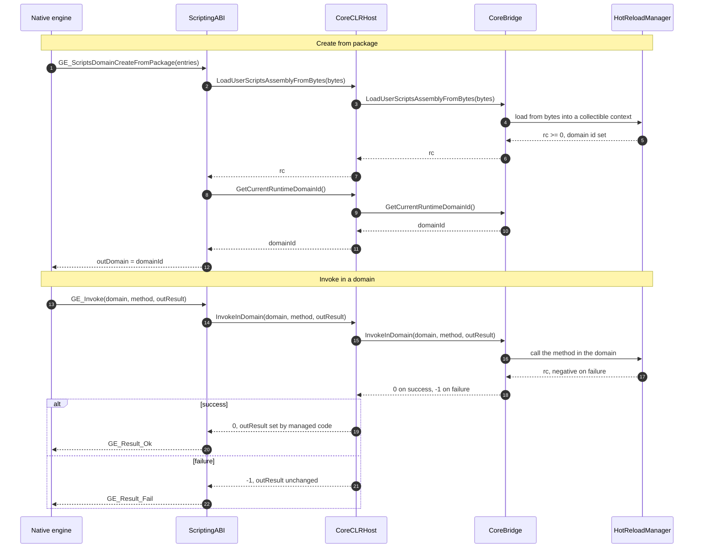

The scripting ABI is the C interface between the engine (C++) and the managed scripting runtime (.NET). It is declared in `Engine/Include/Scripting/ScriptingABI.h` and implemented in `Engine/Source/Scripting/ScriptingABI.cpp`. This page describes how to use and extend it.

## Design principles

- **Stability:** keep the ABI small and versioned. Avoid frequent breaking changes.
- **Performance:** use cdecl and blittable plain-data types, and avoid heap allocations across the boundary.
- **Safety:** pass opaque handles, not raw pointers to managed objects. Avoid reference cycles across domains.
- **Portability:** a pure C ABI (no C++ types), with UTF-8 strings and explicit lengths.
- **Determinism:** function signatures are fixed per callback id; no string-based dispatch paths.

## Calling convention and types

- All functions use cdecl (`GE_CDECL`) and the export macro `GE_API`.
- Opaque handles are 64-bit (`GE_Handle`) and valid only in the context that created them.
- Strings are UTF-8 with a length (`const char*` and `uint32_t len`) or a `GE_StringView`. Every string crossing the boundary is UTF-8: avoid `CharSet.Ansi` and pass explicit `(byte*, byteLength)` pairs.
- Arrays are non-owning pointer and length spans.

## Initialization

CoreBridge holds one managed `EngineInstanceContext` per process: the binding to the native engine library the host registered.

1. The engine calls `GE_ScriptingInitialize(&config)` with the `runtimeconfig.json` path and the CoreBridge assembly name. `config.nativeLibraryPath` names the native engine library managed code binds to, so nothing is derived from the working directory.
2. Managed CoreBridge initializes the runtime control plane and is pinned in the default AssemblyLoadContext.
3. The engine may subscribe to diagnostics with `GE_SubscribeDiagnostics`.

`CoreCLRHost` calls `CoreBridge.Initialize` and then registers the process's engine instance (`RegisterEngineInstance`). That unmanaged entry point returns 0 when registered, 1 when an instance is already registered (the first stays), -2 for an empty path, and -1 on failure. Interop calls route through the registered `EngineInstanceContext`. Without one, `Engine.Current` binds the native library beside the application.

## Host engine bootstrapping

Engine is a shared library: the host executable, `GameEngine.Native`, and the managed runtime's callbacks all see the one `EngineCore` singleton. Whoever calls `EngineCore::Initialize` first owns its lifecycle.

- **Native host (Editor, Player, native test harnesses):** the host initializes the engine itself. From its first `Initialize` on, the ABI never starts the engine: not while that `Initialize` runs on another thread, not after `Shutdown`, not after a failed run. An export that needs the engine then fails with `GE_Result_Fail` on the main ABI. The bootstrap answers `GE_Result_NotInitialized`, which only the Animator and Timeline exports pass through.
- **Standalone (managed code loading `GameEngine.Native` without a native host, such as `dotnet test`):** nobody has initialized the engine when the first ABI call arrives, so `DllBootstrap::EnsureEngineInitialized()` initializes it, configured from `GE_NATIVE_DIR` and `GE_SetHostScriptsConfig()`. Concurrent first callers wait for that `Initialize`.

`GE_SetHostScriptsConfig(const GE_HostScriptsConfig* config)` sets the scripting flags for the standalone engine. `DllBootstrap::EnsureEngineInitialized()` is the internal helper every engine-dependent export calls first. The implementation is in `Engine/Source/Scripting/DllEngineBootstrap.h`.

## Domains

- Script and editor assemblies load into collectible AssemblyLoadContexts, one per domain.
- Native hosts create domains with `GE_ScriptsDomainCreateFromPackage(entries, entryCount, flags, &domain)`. The managed loader consumes assembly and PDB bytes, which avoids file locks. `GE_ScriptsDomainLoadFromMemory` is a reserved, commented declaration, not a callable export.
- Swaps go through `GE_ScriptsDomainSwap` at a safe point (a frame boundary).
- Old domains are unloaded through `GE_ScriptsDomainUnload` after lifecycle events have run and references are cleared.
- Domain ids originate in managed code: `HotReloadManager` assigns a stable 64-bit id per collectible AssemblyLoadContext and exposes it through `CoreBridge.GetCurrentRuntimeDomainId`. Native queries it after a successful load and returns it to callers. If it is 0, native falls back to a process-local handle. Managed code is the source of truth for the context lifecycle. Native code transports opaque ids only.
- A process hosts one project, with one current runtime domain and one current editor domain. Loading a package makes its domain the current one. `GE_GetCurrentRuntimeDomain` and `GE_GetCurrentEditorDomain` return `GE_Result_Ok` with `*outDomain = 0` when no domain of that kind is current, so polling code does not error. Two projects run as two processes.

## Invoking script methods

### By name

`GE_Invoke(GE_DomainHandle domain, const char* methodUtf8, uint32_t len, int32_t* outResult)` routes by domain handle to `CoreBridge.InvokeInDomain`, which calls `HotReloadManager.CallMethodInDomain`.

- Invocable methods are public static methods with no parameters that return `int`.
- A name is `Namespace.Type.Method` or a simple `Method`, searched across the public static methods of the user assembly.
- The standard entry point is `GameEngine.Scripts.ScriptsEntryPoint.OnAssemblyLoaded` (`public static int`), defined in the scripts assembly being loaded.

Name lookup is for bootstrap. After the first resolution in a domain, use the token path.

### By token

Query once by name for a per-domain token, then invoke by token without a string lookup. Tokens are opaque 64-bit values, valid until their domain unloads, and never reused across domains.

```cpp title="Query once, invoke by token"
const char* fq = "GameEngine.Scripts.ScriptsEntryPoint.OnAssemblyLoaded";
uint64_t token = 0;
GE_QueryExport(domain, fq, (uint32_t)strlen(fq), &token);
int32_t rc = 0;
GE_InvokeByToken(domain, token, &rc);
```

- `GE_Result GE_QueryExport(GE_DomainHandle domain, const char* utf8Fqn, uint32_t nameLen, uint64_t* outToken)`
- `GE_Result GE_InvokeByToken(GE_DomainHandle domain, uint64_t token, int32_t* outResult)`

Managed code registers callbacks for both during CoreBridge initialization, and lazily through `EnsureManagedCallbacksRegistered`. If the callbacks are absent, native code resolves the CoreBridge unmanaged entry points through `CoreCLRHost` and calls them directly. The managed side is `HotReloadManager.QueryExportInDomain` and `HotReloadManager.InvokeByToken`.

`GE_ScriptsDomainUnload(domain)` calls the managed `UnloadDomain` (through the `GE_CB_UnloadDomain` callback, else `CoreCLRHost`) and removes the domain from the live set. After unload, `GE_InvokeByToken` for that domain returns `GE_Result_Fail` and leaves `outResult` untouched. A swap does not mark a domain live. Only creation does.

## Managed callbacks

- Managed static methods decorated with `[UnmanagedCallersOnly(CallConvs = new[] { typeof(CallConvCdecl) })]` expose an unmanaged function pointer.
- Registration is generated by `InteropGenerator` from the `[GenerateBinding(...)]` attributes in CoreBridge. CoreBridge calls `AutoRegisterGeneratedBindings(binding)` the first time an `EngineNativeBinding` is registered per native handle. Do not call `TryRegisterManagedCallback` by hand.
- Native code caches the function pointers and calls them without string parsing.
- **Never call an `[UnmanagedCallersOnly]` method from managed code**: the runtime throws `InvalidProgramException` when one is called through reflection or as a regular delegate. These methods are entry points for native code only. Managed code (tests, editor tools, scripts) calls the managed wrappers, such as `CoreBridge.LoadUserScriptsFromPath` and `CoreBridge.ReloadUserScripts`. The unmanaged entry points decode their UTF-8 inputs, validate arguments, and delegate to the same wrappers.

```csharp title="A generated callback binding"
[GenerateBinding(GE_CB_LogForwarder)]
[UnmanagedCallersOnly(CallConvs = new[] { typeof(CallConvCdecl) })]
public static void LogForwarder(int level, byte* msg, uint len)
{
    var text = Encoding.UTF8.GetString(msg, (int)len);
    EngineLogger.Forward((GE_LogLevel)level, text);
}
```

### Callback ids

The callback ids (`GE_CB_*`) are declared in `Engine/Include/Scripting/ScriptingABI.h`, the only place they are defined:

| Id | Value | Signature |
|---|---|---|
| `GE_CB_LogForwarder` | 1 | `void(LogLevel level, const char* msg, uint32_t len)` |
| `GE_CB_OnBeforeUnload` | 2 | `void()` |
| `GE_CB_OnAfterLoad` | 3 | `void()` |
| `GE_CB_PreloadAssemblyContext` | 10 | `int(const char* path, uint32_t len)` |
| `GE_CB_SwapPreloadedContext` | 11 | `int()` |
| `GE_CB_CleanupOldContext` | 12 | `int(const char* path, uint32_t len)` |
| `GE_CB_ClearCompilerCache` | 13 | `int()` |
| `GE_CB_GetCompilerStats` | 14 | `int()` |
| `GE_CB_GetHotReloadMetrics` | 15 | `int(uint64* lastCompileMs, uint64* lastSwapMs, int32* totalCompiles, int32* totalSwaps)` |
| `GE_CB_ResetHotReloadMetrics` | 16 | `int()` |
| `GE_CB_GetHotReloadMetricsEx` | 17 | the metrics of 15 plus `int32* totalUnloads` |
| `GE_CB_GetHotReloadEditorMetrics` | 18 | `int(uint64* lastFirstInvokeMs)` |
| `GE_CB_QueryExport` | 20 | `int(uint64 domain, const char* name, uint32 len, uint64* outToken)` |
| `GE_CB_InvokeByToken` | 21 | `int(uint64 domain, uint64 token, int32* outResult)` |
| `GE_CB_UnloadDomain` | 22 | `int(uint64 domain)` |
| `GE_CB_PlayMode_OnEnter` | 30 | `int()` |
| `GE_CB_PlayMode_OnExit` | 31 | `int()` |
| `GE_CB_PlayMode_Tick` | 32 | `int(float deltaSeconds)` |

### Calling into native code

Managed code binds the native library through `EngineNativeBinding`, loaded by absolute path, and calls through its function table rather than `[DllImport]`:

```csharp title="Calling native code through the binding"
var binding = EngineNativeBinding.LoadFrom(null); // prefers app-local, then GE_NATIVE_DIR
binding.Log?.Invoke((int)GE_LogLevel.Info, (nint)pUtf8, (uint)len);
```

## Versioned function table

The native library exposes a bootstrap entry that returns a typed table of function pointers:

- `GE_GetInterface(uint32_t abiVersion, const void** outTable, uint32_t* outSizeBytes)`; an incompatible version returns `GE_Result_Fail` and a null table.
- The ABI version is `(major << 16) | minor` (`GE_ABI_VERSION_ENCODE`). `GE_ScriptingGetAbiVersion` reports it, and the current version is 3.2 (`GE_ABI_VERSION_CURRENT`).
- The current table is `GE_Interface_v1`: `sizeBytes`, `abiVersion`, then `Log`, `RegisterManagedCallback`, `NotifyCompilationEvent`, `NotifyReloadEvent`, `GetManagedCallback`, `SubscribeDiagnostics`, `UnsubscribeDiagnostics`, `GetAssetCount`, `ScriptsDomainSwap`, `ScriptsDomainUnload`, `ECS_GetWorldHandle`, and `ECS_GetEntityCount`.

Managed code loads the native library once by absolute path (`NativeLibrary.Load`), gets the bootstrap export (`NativeLibrary.GetExport`), requests the table for its ABI version, validates `sizeBytes`, and routes calls through the table. The table carries the ABI handshake that a direct `[DllImport]` call skips.

### Versioning policy

- Bump the major version for a breaking change (a changed layout, a removed export) and the minor version for an additive one. The major must match between managed and native code.
- The minor is not advisory in one direction. A native library older than the managed build writes shorter payload structs than managed code reads, and those structs (`GE_UIEventData` and others) carry no size field, so nothing detects the mismatch per call. `EngineNativeBinding.LoadFrom` therefore refuses a native minor below the managed one and says to rebuild. A newer native is accepted, because additive fields nobody reads cost nothing.

:::caution[A direct DllImport skips the version check]
The check lives in `EngineNativeBinding.LoadFrom`, so it protects only callers that go through the binding. A managed assembly that declares its own `[DllImport]` against `GameEngine.Native` (the C# UI binding does) never touches the handshake, so a stale native library pairs with a new managed struct layout unnoticed. Rebuild the engine and the managed assemblies together.
:::

## Capabilities

`GE_Capabilities(uint32_t* outMask)` reports which features are present: `GE_Cap_HasPackageLoader`, `GE_Cap_HasDomainSwap`, and `GE_Cap_HasInvokeByName`. Branch on the mask to enable features without breaking the ABI.

Some hot reload endpoints, such as `GE_ClearCompilerCache()` and `GE_GetCompilerStats()`, may be absent depending on the build. Then they return `GE_Result_NotFound` (-3): treat it as non-fatal and skip the operation. Managed callbacks are tried first (`iface->GetManagedCallback`), then the typed C exports.

## Return codes and error handling

- 0 is success and a negative value is a failure. Do not introduce positive results.
- Do not modify out parameters on failure: set them only on success, after the values are fully computed. This holds for tokens and results in native code and in the managed wrappers.
- Managed code catches exceptions and returns a negative code. Native code never sees a managed exception across the ABI.
- The managed wrappers and unmanaged entry points return 0 for success, -2 for an invalid argument (`GE_Result_InvalidArg`), -3 for not found, incompatible, or a missing capability (`GE_Result_NotFound`), -4 for not initialized (`GE_Result_NotInitialized`), and any other negative value for `GE_Result_Fail`. Native code maps them in one place, `MapManagedRcToGeResult` in `ScriptingABI.cpp`, so `GE_QueryExport`, `GE_InvokeByToken`, and the hot reload helpers report consistent results.
- A swap without a prior preload (`GE_SwapPreloadedContext()`) returns `InvalidArg` (-2) or `NotInitialized` (-4) depending on the internal path. Both are the expected guard failure, and callers do not proceed to swap cleanup.
- A preload of an invalid path (`GE_PreloadAssemblyContext`) returns `InvalidArg` (-2). With a diagnostics sink subscribed, a `GE_Reload_Failed` event carries a short reason for the UI.

## Hot reload

- **Preload** (off the main thread) creates the collectible context, loads the assembly from bytes or a stream, and precomputes the export indices (full and simple names to delegates).
- **Swap** (main thread) flips to the preloaded context, publishes the prebuilt indices, and schedules the old context's cleanup on a background thread. When indices were not prebuilt, the swap builds them synchronously.
- `GE_GetHotReloadMetricsEx(lastCompileMs, lastSwapMs, totalCompiles, totalSwaps, totalUnloads)` returns the metrics of `GE_GetHotReloadMetrics` plus `totalUnloads`. When the extended managed endpoint is unavailable it reports the basic metrics with `totalUnloads = 0`. `GE_ResetHotReloadMetrics` resets every counter. The editor-only `GE_GetHotReloadEditorMetrics` and `GE_GetHotReloadEditorMetricsPacked64` report the first-invoke timing.

### Compile server transport

The resident compile client in `Engine/Include/Jobs/CompileServerClient.h` uses `IHotReloadTransport`, implemented by `PipeTransport`: named pipes on Windows, Unix domain sockets on Linux and macOS. See [Compile server](./compile-server.mdx) for endpoints, host discovery, and the wire protocol. Tests can inject an `IHotReloadTransport`. The production client has no TCP option or standard-I/O fallback. `Engine/Include/Scripting/ICompileTransport.h` is a separate prototype interface with a loopback implementation, not the resident client's transport.

## Diagnostics

- The engine provides a `GE_DiagnosticsSink` with compilation and reload event handlers. Managed code reports compilation started, progress, and completed (with structured `GE_Diagnostic[]`), and reload started, swapping, completed, and failed. The editor shows the diagnostics with clickable file and line links.
- `GE_DebugGetPathMask()` returns how CoreBridge reaches `HotReloadManager`: 0x01 and 0x02 for typed query and invoke delegates, 0x04 and 0x08 for the wrapper delegates over reflection, 0x10 and 0x20 when only reflection is available. CoreBridge binds the wrapper delegates when `CreateDelegate` rejects a signature or the host set `GE_HostSwitch_DisableHrmDelegates`. `ScriptingAbi_Paths.TypedDelegates_Bound_OnTheFastPath` pins that the typed delegates serve the fast path.
- `GE_VERBOSE=1` prints `CreateDelegate` failure details and path decisions.
- Host switches (`CoreCLRHost::SetHostSwitches`, delivered to `CoreBridge.SetHostSwitches`) are path selectors and fault injections for the test suites. A production host leaves them clear. `GE_HostSwitch_DisableHrmDelegates` binds through the reflection wrapper, `GE_HostSwitch_ForceHrmCapabilityFailure` makes CoreBridge act as if `HotReloadManager` were missing (entry points return -3), and `GE_HostSwitch_ForceAbiMismatch` makes `CoreBridge.Initialize` report an ABI mismatch (-3).
- The `ScriptingDiag` tool (`cmake --build build/<preset> --target ScriptingOnly --config Debug`, then `build/<preset>/bin/Debug/Tools/ScriptingDiag.exe`) prints the ABI version, capabilities, the delegate path mask, and counters. `--poke` runs a minimal query and invoke first.

## Representative engine exports

- `GE_Log(level, msg, len)` for logging.
- `GE_GetAssetCount(outCount)` for asset statistics.
- `GE_ECS_GetWorldHandle` and `GE_ECS_GetEntityCount`, a minimal ECS surface for smoke tests and statistics. `GE_ECS_GetWorldHandle` brings the engine up through `EnsureEngineInitialized` and then calls `EngineCore::EnsurePrimaryWorld`, so test harnesses use it to initialize the primary world.
- `GE_SubscribeDiagnostics`, `GE_UnsubscribeDiagnostics`, `GE_NotifyCompilationEvent`, and `GE_NotifyReloadEvent`.

## Flow


