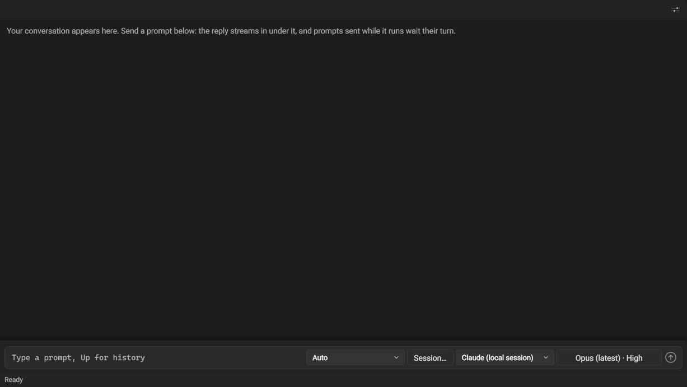
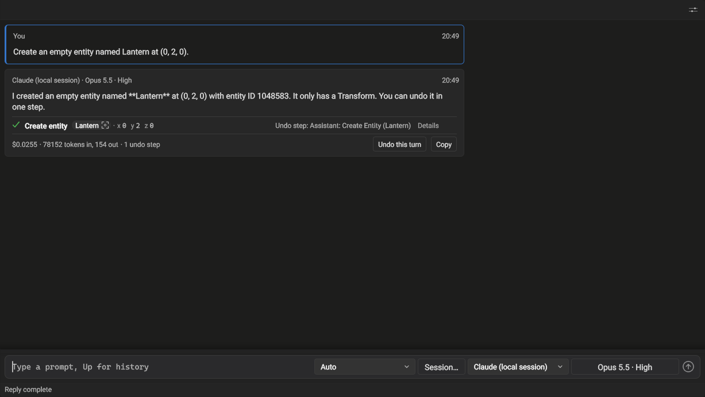
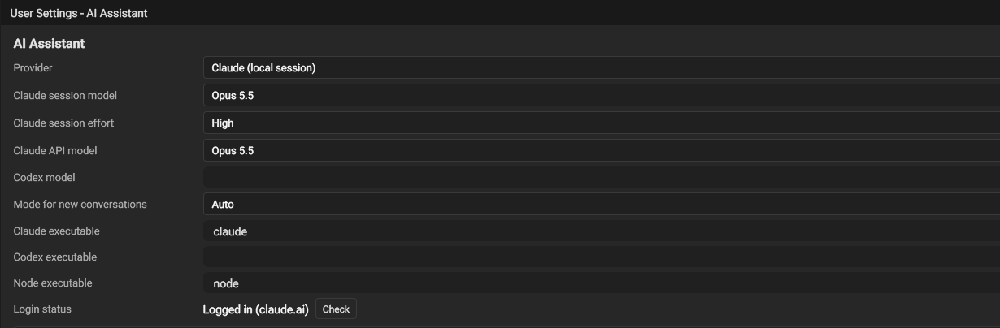

The **AI Assistant** panel sends what you type to a language model and shows its reply. The panel is the editor's own. The model behind it is a **provider** you choose in the dropdown beside the send button or on the settings page, **Settings > AI Assistant** (under User Settings). The two always show the same choice.

## Where to start

Open the panel from the **Panels** button at the right end of the top toolbar and choose **AI Assistant**. It opens as a tab beside the Scene View. Pick a provider in the dropdown beside the send button: **Claude (local session)**, the default, needs only Claude Code installed and logged in on this machine. Type a request in the prompt field, for example "Create an empty entity named Lantern at (0, 2, 0)", and press Enter.



*The panel before the first prompt: the prompt field, then the mode control, Session…, the provider dropdown, the model button, and the send button.*

## Providers

| Provider | What it needs | Where it sends your prompt |
|---|---|---|
| **Claude (local session)** (the default) | Claude Code installed on this machine and logged in (`claude auth login`). | Your own `claude` program, which talks to the service it is logged in to. |
| **Codex (local session)** | Codex installed on this machine and logged in (`codex login`), and its full path in the settings. | Your own `codex` program, which talks to the service it is logged in to. |
| **Claude (API)** | A Claude API key in the `ANTHROPIC_API_KEY` environment variable. | `https://api.anthropic.com/v1/messages`, always. |


*The provider dropdown, with Claude (local session) chosen.*

## The conversation

Each message is a row: your prompt under **You**, and the reply under the provider and model that wrote it, with the time. A Claude (local session) reply names the exact model that answered (**Opus 5.5** when you chose Opus) and the effort it asked for. The reply streams into its row as the provider writes it. The line under it says where it stands and, once it ends, any note and the provider's own cost estimate and token counts (shown, never added up).

A reply shows the Markdown the model writes: headings, bold and italic, inline code, code blocks (a long line scrolls sideways rather than wrapping), bulleted and numbered lists, quotes, tables, and links (a web link opens in your browser). Anything else shows as the characters the model wrote. Your prompt is shown as you typed it, and Copy copies a reply's Markdown.

| You do | What happens |
|---|---|
| Enter (or the send button) | Sends the prompt. Shift+Enter starts a new line. Up and Down recall earlier prompts. |
| Send while a reply is being written | The prompt waits in its row as **Queued** and is sent when the replies before it end. Prompts are answered one at a time, in order. |
| Stop on the reply's row, or Esc in the prompt field | Ends the reply being written (it keeps the text so far, ends it with an ellipsis and reads **Stopped by you**) and cancels every queued prompt (its reply reads **Cancelled before it started**). |
| Copy on a finished or stopped reply | Copies the reply's text (without the ellipsis). The status line reads **Reply copied**. |
| Retry on a failed reply | Sends the same prompt again, to the same provider and model, as a new message at the end of the conversation (queued like any prompt if a reply is being written). The failed reply stays where it was and reads **Retried below** in place of the button. It is never sent to the provider as part of the conversation. If the retry fails too, its own row offers Retry. |
| Choose another provider | Starts a new conversation: the rows and the queue are cleared. A local session keeps its own conversation, so choosing it again continues it. |
| The model button beside the provider | Opens a small panel with the **Model** and, for Claude (local session), an **Effort** slider. The button reads your choice: **Opus (latest) · High** until a reply names the version, then **Opus 5.5 · High**. In a narrow panel the button drops "(latest)", then the effort, before it cuts its text, and its tooltip holds the whole choice. A change is kept at once and applies from the next prompt you send, in the same conversation. Prompts already queued keep what they were sent with. Click outside the panel or press Esc to close it. |

### Model and effort

| Provider | Models | Effort |
|---|---|---|
| Claude (local session) | **Opus** (the first choice), **Fable**, **Sonnet**, **Haiku**: each the latest model of its family, so a new release needs no editor update. Once a reply has named the version, the button and the list show it. | **Low**, **Medium**, **High** (the first choice), **Extra high**, **Max**: how much the model reasons before it answers. Higher levels answer more carefully, take longer, and cost more. |
| Claude (API) | Opus 5.5, Sonnet 5.5, Haiku 4.5. | None. |
| Codex (local session) | The button is hidden: Codex names its own models, so the **Codex model** setting takes the name as Codex spells it. | None. |

The choice is yours, not the project's: it is kept in your editor settings and applies to every project you open. A model your account cannot use fails the prompt with Claude Code's own message ("There's an issue with the selected model …"). Choose another and send again.

A message holds at most 64 KB of text. A prompt longer than that is not sent: the status line gives its size, and the prompt stays in the field for you to shorten. A reply longer than that keeps its first 64 KB: its text ends with an ellipsis, the line under it reads **Reply truncated at 64 KB**, Copy copies those 64 KB and says so, and later prompts to Claude (API) carry those 64 KB as the reply.

A reply runs on a thread of the panel's own, so a reply that takes minutes never holds up the editor's other work. Closing the panel stops it.

## Mark-ups in the conversation

A prompt can name [world mark-ups](world-markups.mdx): the places, areas, and paths you and the agent mark in the scene. Name one with a token, `@markup:<tag>` or `@markup:"<title>"`, and the prompt's turn carries what the mark-up is, so the agent reads its shape, notes and thread without asking the editor first. In a quoted title, `\"` stands for a quote and `\\` for a backslash. The list and Ask the AI Assistant write them for you. A mark-up's tag is the first of the tags its inspector's **Tags** row lists. The list and Ask the AI Assistant name a mark-up by its tag when no other mark-up's first tag is the same and the tag holds no space; otherwise by its title when no other mark-up has that title; otherwise not at all, and they say what to change.

| You do | What happens |
|---|---|
| Type `@` at the start of a word | A list of the scene's mark-ups opens under the prompt: each row is its title (its tag for an untitled one; "Untitled mark-up" for one with neither, which no token can name) with a dot in the color it draws in, over its status, its kind, and its tag. What you type next searches titles and tags. No row is highlighted until you type or press an arrow key, so an Enter right after the `@` closes the list. Choosing a row puts its token where the `@` was. Esc, Enter with nothing highlighted, or a click outside the list closes it and puts what you typed in its search field after the `@`, so a token typed by hand reaches the prompt whole. Choosing a row no token can name says why and what to change, with its entity id: "2 mark-ups are titled Meadow: give this one (entity 1048585) a tag or another title to name it". |
| **Ask the AI Assistant** on a mark-up (a button in its inspector section, or the right-click menu of its row in the Mark-ups panel) | Opens this panel with the mark-up's token at the end of the prompt. A mark-up no token can name has the button off. Its tooltip reads "Give this mark-up a title or a tag to ask the AI Assistant about it" when it has neither, or what the list says when you choose it: the shared title or tag and the fix. |
| Send a prompt that names mark-ups | Each mark-up is read as it is when you send: one block per mark-up follows the prompt in what the provider receives. Your row shows the prompt as you typed it, with a chip per mark-up under it, named by the mark-up's title when you sent the prompt. A chip's click selects the mark-up and frames it in the Scene View as a double-click on its Mark-ups panel row does: its whole shape (a region's outline and height, a path's line), along the view's heading, looking down at least 30 degrees. A token that names no mark-up is sent as `[unknown mark-up @markup:…]` and the status line says so. When two mark-ups share a title, a title token names the one changed most recently. In play mode mark-ups are not read: the turn says why for each token. |
| **Comment on mark-up** on a reply to a prompt that named mark-ups | Adds the reply to the thread of each named mark-up as your comment, introduced as "From the assistant (Claude (local session) · Opus 5.5 · High):" (the reply's own header) and cut after 2,000 characters, so it shows in the Mark-ups panel's Activity tab like any comment. Only on your click, and once: after it the button is off. A reply is never added on its own. |

### What the agent receives for a mark-up

Each named mark-up becomes one block after the prompt. Its `tags` are the mark-up's tags, the ones its inspector's **Tags** row edits, in that order: each in double quotes (written `&quot;` inside the attribute), separated by spaces, a quote or a backslash in a tag written `\"` or `\\` as in a quoted title; empty when it has none. A member's `tags` are the same. These are the user's tags, the first of which a token names. The mark-up tools' `tag` field (`markup_list`, `markup_get`, a member given by tag to `markup_create` or `markup_update`) is something else: the entity's scene id, until it is renamed (#3992).

```xml title="What a turn carries for a region with a sphere excluded, and for the sphere"
<markup tags="&quot;meadow-main&quot; &quot;grass&quot;" title="Meadow" status="Proposed" kind="region" outline="0,0 30,0 40,10 45,25 40,40 30,48 15,50 0,45 -10,35 -12,20 -8,8 -3,2" area="2284" netArea="2234" bounds="-12,0 45,50" extrudeHeight="8">
Keep it open grass; no trees.
<member mode="exclude" kind="volume" title="Pond" tags="" center="15,20" radius="4"/>
Agent 2026-10-13T06:10:01Z created
User 2026-10-13T06:10:09Z Could the north edge follow the stream?
</markup>
<markup tags="" title="Pond" status="Proposed" kind="volume" shape="sphere" center="15,0,20" halfExtents="4,4,4" rotation="0,0,0,1">
Agent 2026-10-13T06:10:01Z created
</markup>
```

A path's block reads `kind="path" points="0,2,0 40,3,10 80,3,30" length="91.2"` in place of the region's shape.

**Coordinates and numbers.** Positions, extents, heights, and lengths are in meters, in world space: left-handed, +X right, +Y up, +Z forward. A point's or a tuple's numbers are separated by commas and points by spaces: `x,y,z` for a point in space, `x,z` for a point on the ground plane, `x,y,z,w` for a rotation. Outlines, path points and bounds are written to a tenth of a meter (the outline's own tolerance); a volume's center and extents, a circle and heights and lengths to a centimeter; a rotation's components to four decimals; an area to the square meter. Numbers are written the same way whatever the system's language settings.

- **A volume** (a box or a sphere) carries its `shape`, `center`, `halfExtents`, and `rotation` (a unit quaternion, x,y,z,w).
- **A region** carries its `outline`, the area's edge (the ring `markup_get` returns) cut to at most 64 points by keeping the points that carry the shape, so a corner or the tip of a spit stays; its `area`, the square meters the outline encloses (what the inspector's Outline area shows); its `netArea`, that area with its members applied (an excluded pond taken out, an included field added); its `bounds` (the lowest x,z then the highest); and its `extrudeHeight`. Each member is a `<member>` line: its mode, kind, title and tags and its footprint, an `outline` cut the same way or a `center` and `radius`; a deleted member reads `deleted="true"`. A region whose points cannot enclose an area (fewer than three, or edges that cross) carries its `knots` and a `problem` that names the fix in place of the outline and the area.
- **A path** carries its `points` (x,y,z, at most 64, the same rule) and its `length` along the ground.
- Then the description, the members and the newest ten thread entries: each entry is one line, its author, its time (ISO 8601, UTC) and its text (or what it did: `created`, `status Requested`, `edit`), cut at 500 bytes of what was written (before escaping, so a cut never splits an escaped character).

**Escaping.** Attribute values escape `&`, `<`, `>`, and `"` as XML does, and a line break in one becomes a space. The description and the thread entries escape `&`, `<`, and `>`, so nothing written in a mark-up, a quoted block included, can close its block or start another.

**Caps.** A block holds at most 8 KB. The shape and the members keep their room. The description is cut first, then the thread, and a last line says what was left out: `[not shown, the 8 KB block cap: the description's last 1200 bytes, 4 entries]`. A turn's context, unknown-token lines included, holds at most 32 KB. The mark-ups past that are counted on one line, `[3 more mark-ups not included: the 32 KB per-turn cap]`. To read more, the agent calls `markup_get`.

## Local sessions: Claude Code and Codex

A local session runs the command-line program you already use, under your own login, on this machine. For each prompt the editor starts the program in the project's folder, hands it the prompt, and shows the reply as the program reports it. The editor never stores, copies, or sends your login anywhere. The program runs with its own tools turned off (Claude Code) or in its read-only sandbox (Codex), so it cannot change your files itself. What it may do in the editor is the editor's decision, set by the mode control (see [Acting in the editor](#acting-in-the-editor)).

### Claude (local session)

- Runs `claude`, found on `PATH`, unless you set a full path in **Claude executable**. Use the native program (`claude.exe` on Windows): the `claude.cmd` script that npm installs is refused, because Windows passes a script's arguments through `cmd.exe`.
- Needs Claude Code 2.1.259 or later. An older one is refused with "run `claude update`".
- Not logged in: run `claude auth login` in a terminal, then send the prompt again.
- The model and the effort come from the model button (or **Claude session model** and **Claude session effort** in the settings), and every prompt names both: Opus at High until you choose. Your own Claude Code model and effort settings do not apply to the panel.

### Codex (local session)

- Codex is usually not on `PATH` (an editor extension installs it in its own folder), so **Codex executable** starts empty: set it to the full path of `codex.exe`. Until you do, a prompt fails with "No Codex executable: set its path in Settings > AI Assistant."
- Not logged in: run `codex login` in a terminal, then send the prompt again.
- The model comes from **Codex model**, a name as Codex spells it. Empty uses Codex's own default.
- Codex has no option to add the panel's instructions to its own, so a Codex session answers without them.

### Your login, not a key

Both programs prefer a key in the environment over your login. So that a session always runs on your login, the editor removes `ANTHROPIC_API_KEY`, `ANTHROPIC_AUTH_TOKEN`, `CODEX_API_KEY`, and `OPENAI_API_KEY` from the environment of every program it starts, the login check included. Everything else in the environment is passed on unchanged.

Other ways of signing Claude Code in are your own configuration and are left alone: an `apiKeyHelper` in your Claude Code settings, `CLAUDE_CODE_OAUTH_TOKEN`, or a cloud-provider switch such as `CLAUDE_CODE_USE_BEDROCK` or `CLAUDE_CODE_USE_VERTEX`. The **Login status** row tells you which one Claude Code is using. The session's turns are billed through it.

### Login status

The **Check** button on the **Login status** row asks the chosen local session's program whether it is logged in (it takes a few seconds) and shows the answer in the row. It shows the login method only, never the account's email address, organization, or a key:

| The row shows | Meaning |
|---|---|
| Logged in (claude.ai) | Claude Code runs on your Claude login. |
| Logged in (*method*): turns are billed through that credential | Claude Code runs on another credential, for example `api_key_helper`. |
| Logged in using ChatGPT | Codex's own status line, cut before any key it would show. |
| Not logged in: run `claude auth login`. / run `codex login`. | Log in from a terminal, then check again. |
| Could not start ... set its path in Settings > AI Assistant. | The program was not found: set its executable row. |
| ... did not answer ... within 20 s: check its executable in Settings > AI Assistant. | The program did not exit in time. The row's executable is probably not the right program. |

With Claude (API) chosen, the row explains that the API has no login: it reads its key when a prompt is sent.

Before the first prompt of each session the editor runs the same checks itself (for Claude Code also its version), so a session that cannot answer is refused with the fix instead of failing halfway.

### Conversations

A local session keeps its own transcript: each prompt continues the conversation, and the program remembers the earlier turns. The editor keeps each session for as long as it runs, so closing the panel and opening it again continues the same conversation, although the panel no longer lists the earlier turns. The trash button (behind the **Prompt settings** button at the top right of the panel) clears the panel and starts a new conversation on the next prompt. Changing a session's executable or opening another project also starts a new one, as does restarting the editor, until you pick a session with the **Session…** button.

### Picking a session

With a local session chosen, the **Session…** button beside the provider dropdown opens a list you can search (its tooltip names the session you are in). The list is read from the program's own session files for this project, newest first. Each row shows the session's first prompt (its first line), when the session was last used, and how many turns it holds. Type to keep the sessions whose first prompt contains what you typed.

| Row | What happens |
|---|---|
| New session | Clears the panel. The next prompt starts a new session. |
| Resume last | Continues the session this provider used last in this project, also after the editor was restarted. The session's first prompt is shown under it. Shown once a session has run here. |
| A session | Continues that session. |

A continued conversation starts with one row, for example **Continued session from 2026-10-07 14:05 · 3 earlier turns not shown**: the program remembers those turns, but the panel does not show them. Your next prompt continues the session.

Where the files are: Claude Code keeps one file per session under `%USERPROFILE%\.claude\projects\` (or `CLAUDE_CONFIG_DIR`), in a folder named after the project's path. Codex keeps its sessions under `%USERPROFILE%\.codex\sessions\` (or `CODEX_HOME`), and the list shows those started in the project's folder. The editor only reads these files, and only when you open the list. A file it cannot read is left out, and the status line says how many were.

If the program no longer has the session (its file was deleted), the first prompt fails with the program's message and the status line reads **Reply failed: the session could not be continued, so Retry starts a new session**. The editor forgets that session. Retry sends the prompt again in a new session. Any other failure (not logged in, the program not found) keeps the session: fix the cause and send the prompt again to continue it.

A reply the program stops before finishing (it exits early, for example) fails with the program's exit code and its last error line. The text that arrived stays in the panel.

## Acting in the editor

A Claude (local session) conversation can read and change the editor through the editor's own tools: the program is started with the editor's tool server attached and calls it while it answers. The **mode control** beside **Session…** decides, per conversation, what those calls may do: a call runs, waits on its row for your answer, or is refused.

| Mode | What runs | What asks you first |
|---|---|---|
| **Read only** | Reads: the editor state, the hierarchy, components, the log, screenshots of the editor's rendered frame, render-graph resources, profilers. | Nothing: everything that changes something, the view included, is refused. |
| **Auto** (the default) | Reads; view changes (camera, selection, mark-up visibility); scene edits you can undo (create, change or delete entities, mark-ups and their comments); injected keyboard, pointer and drop input. | Actions that cannot be undone as one step: saving the scene, writing project files (C# components and systems, game graphs, thumbnails), play mode, commands, render settings that are saved into the project, game builds, GPU captures. |
| **Ask before every edit** | Reads and view changes. | Every scene edit, injected input and action that cannot be undone. |
| **Edit freely** | Everything the assistant is allowed, without asking. | Nothing. Only what is never allowed (below) is refused. |

**Never allowed**, in any mode: building the engine, running tests, starting, waiting for or stopping editors; moving windows or taking the operating system's focus; **undo** and **redo** (the assistant cannot see what is on top of the undo history, so correcting a change is a new edit and undoing is yours); screenshots that capture the desktop (`allowWindowCapture`): only the editor's own rendered frame is sent. A refused call tells the assistant why and which mode would run it, so it can tell you.

The tools that write files (C# components and systems, game graphs and their generated C++) work inside the open project only: a relative path is relative to the project's folder, and a path outside it is refused in every mode. Generated C++ that exists already is replaced only when the call asks for it explicitly.

- A new conversation starts in the mode you chose last (Auto until you first choose). A session you resume keeps the mode it last ran in. **Mode for new conversations** in the settings shows and sets the remembered mode.
- A change applies from the assistant's next call, also while a reply runs.
- Screenshots and render-graph captures the assistant reads are sent to the provider, in every mode.
- Each scene edit the assistant makes is one undo step named for it, for example **Assistant: Set DirectionalLight (12)** in the Edit menu and in Undo History. An entity is named by its id, as the call gave it. Injected input lands as the editor's own steps.
- A scene edit, or an action that cannot be undone, that arrives while you drag or scrub a value waits until you let go, and then runs as its own step after yours.

### The calls under a reply



*Auto mode, the prompt "Create an empty entity named Lantern at (0, 2, 0).": the reply, its Create entity call with the undo step it left, and the footer with the cost, the undo step count, Undo this turn, and Copy.*

Each call the assistant made is a row under its reply: a mark (a check for a call that changed something, a ring for a read or a view change, a cross for a call that did not run, a question mark for one that waits), the action, what it acted on, and at the end what it left in the undo history: the step's name, "not an undo step" or "nothing changed". Consecutive calls of one tool with the same arguments share a row ("Lantern_02, Lantern_03 (2 calls)"). **Details** shows the call as the assistant sent it and the editor's answer. The reply's footer counts its undo steps and the calls that did not run, by the word their rows use, for example "5 undo steps · 1 refused · 1 failed".

### Images and assets in the conversation

A screenshot the assistant takes, or a render-graph texture it captures, shows under its call's row as the picture itself, as wide as the row at most and no taller than a fixed height. Click it (or press Enter on it) to open it in the Asset View panel, fitted to the panel. The conversation keeps only the image's file path and size: the file is the PNG the editor wrote into its capture folder, and the row shows a smaller copy of it. Only a screenshot or a capture the editor wrote shows as a picture. Its tooltip shows the file's path, and a right-click offers the Assets panel's menu for a file: **Open** (in the system's image viewer), **Show in Explorer** (Finder on macOS), and **Copy Full Path**. An asset tile has the same menu.

A model, material or texture the assistant names, by its path or its GUID, in what it sent or what the editor answered, shows under the row as a tile: the asset's thumbnail, its file name, its type, and **Open**, which opens it as a double-click in the Assets panel does. A path to an asset that is not in the project when the call runs shows its file name and "not found". A tile shows a timer while its thumbnail is still being drawn.

What leaves your computer: each screenshot and captured texture the assistant reads is sent to the provider as an image, in every mode, Read only included, together with the rest of the tool's answer. Only the editor's own rendered frame is ever captured, never other windows. The asset tiles are drawn by the editor and are not sent anywhere.

**Undo this turn**, beside Copy on a finished reply that changed the scene, takes back that reply's edits, newest first. It works only while they are the newest steps in the undo history: when anything came after them (your own edit, or a later reply's), the button is disabled and its tooltip names the step on top. Undo that first, or use Undo History. Afterwards the rows read "undone" and Redo (Ctrl+Y) brings the edits back one by one. A reply whose first edit has dropped off the end of the undo history is too old to undo as a turn. Each call is also one line in the editor log: the tool, what it acted on, what happened, and its undo step.

A call that asks waits on its row with **Allow**, **Allow for this turn**, and **Deny**. The status line reads **Waiting for your answer**, and the assistant's later calls wait behind it, in order. From the prompt field, **Ctrl+Enter** takes the keyboard to the waiting call's Allow. Tab moves to Allow for this turn and Deny, and Enter answers.

- **Allow** runs the call. **Allow for this turn** also runs, without asking, every later call of the same tool in that reply (allowing one save does not allow a build). The next reply asks again.
- **Deny** runs nothing. The assistant is told "The user declined" with the action.
- Stop, or the assistant's program ending, cancels a waiting call: its row reads "Cancelled: the session ended".
- A call nobody answers is refused after 10 minutes.
- A call that did not run says why on its row: "(refused)" and the reason when the mode or the tool's class does not allow it, "(failed)" and the error when the editor could not do it (for example "(failed) Invalid entity"), "you declined" after Deny. A call the program refused itself, before it reached the editor, reads "(failed)".

### What acting needs

- Node.js 20 or later: `node` on `PATH`, or its full path in **Node executable**. Without it a reply runs without the editor's tools and says why.
- The tool server staged beside the editor: build the `McpServer` target. Without it the mode control reads **Conversation only** and its tooltip says what to build.
- The editor's debug server running (it starts with the editor; `--debug-port` picks its port).

:::caution[Codex: conversation only]
Codex keeps a shell in its read-only sandbox. Before Codex could act, the editor checks whether a command in that sandbox can open the editor's debug port. If it can, the command could reach the editor around the mode's checks, so Codex stays a conversation and its mode control reads **Conversation only** with that reason. Use Claude (local session) for the editor's tools. On Windows with Codex 0.162 the check connects, so Codex answers without the editor's tools.
:::

The editor's debug port is reachable by any program on this machine, as before. The modes limit what the panel's assistant does, they do not make the port private.

## Settings > AI Assistant

| Row | What it sets |
|---|---|
| Provider | The connection the panel talks to (the same choice as the panel's dropdown). |
| Claude session model | The model of a Claude (local session) turn (the same choice as the panel's model button). |
| Claude session effort | The effort of a Claude (local session) turn (the same choice as the panel's effort slider). |
| Claude API model | The model of a Claude (API) turn (the same choice as the panel's model button). |
| Codex model | The model of a Codex (local session) turn; empty for Codex's default. |
| Mode for new conversations | The mode a new conversation starts in; the panel's mode control changes it. |
| Claude executable | `claude` on `PATH` by default, or a full path to `claude.exe`. |
| Codex executable | The full path to `codex.exe`. |
| Node executable | `node` on `PATH` by default, or a full path to `node.exe` (Node 20 or later), which runs the editor's tools for the assistant. |
| Login status | The Check button described above. |

There is no key row: the editor never asks for, shows, or stores a key.



*Settings > AI Assistant with the defaults, after Check on the Login status row.*

### Claude (API): supplying the key

The editor reads the key from the `ANTHROPIC_API_KEY` environment variable each time you send a prompt, and from nowhere else. There is no key field in the panel or in the settings, and the editor never writes the key to a file. Set the variable before you start the editor, for example in PowerShell, then start the editor from the same window:

```powershell title="Set the key for this PowerShell window"
$env:ANTHROPIC_API_KEY = "sk-ant-..."
```

Without the variable, a prompt fails with "No Claude API key: set ANTHROPIC_API_KEY in the environment before starting the editor." A key the API rejects fails with the API's message, HTTP 401, and a reminder to check the variable. The **Claude API model** row defaults to `claude-opus-5-5`. A reply is capped at 16,384 tokens. Each prompt is sent with the conversation's earlier prompts and their finished replies. A reply that failed or was stopped is left out, together with its prompt.

:::caution[Long replies]
A reply may take a while to start. The panel waits as long as the server keeps sending and gives up after ten minutes of silence. A reply that reaches the 16,384-token limit, or that the model declines, ends with a note saying so. A reply stream larger than 8 MiB, more than a 16,384-token reply needs, is cut off with a message saying so. The text received until then stays in the panel.
:::

## Connecting an AI client to the editor

An AI client that runs outside the editor, such as Claude Code, Cursor, or Claude Desktop, can read and change the editor through the editor's MCP server, the same server the panel attaches to a Claude (local session) conversation. [MCP Server & CLI Setup](../getting-started/mcp-setup.mdx) covers building and registering the server, configuring each of those clients, and pointing one at your editor's port. It also covers the `ge` command-line interface, which calls the same tools from a terminal.
