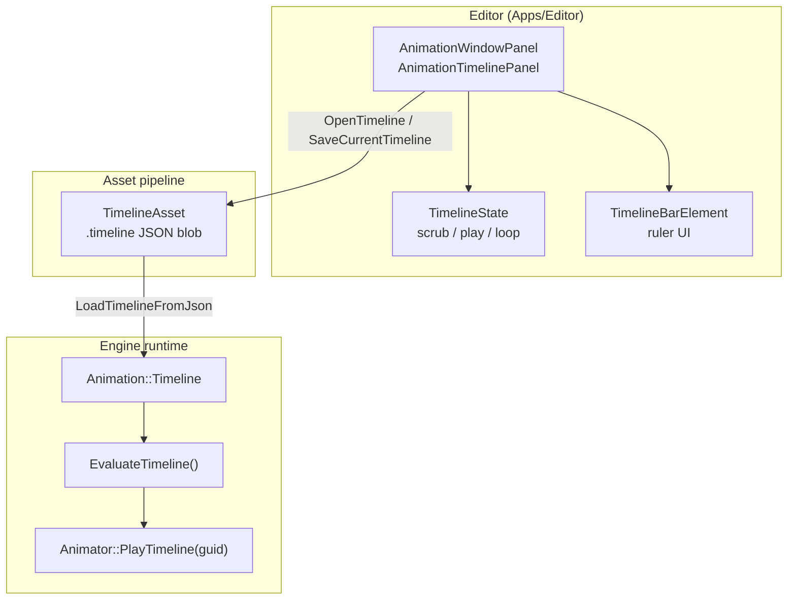

Reference for the engine timeline evaluator (`GameEngine::Animation`), `.timeline` assets, editor animation windows, and timeline bar UI controls. C# scripts evaluate timelines and drive playback through `TimelineApi` ([C# scripting API](#c-scripting-api)).

:::tip[How the pieces fit]

- **`Timeline` + `EvaluateTimeline`**: a `.timeline` asset holds tracks and clips; evaluating it at a time range returns the blended samples and the events crossed.
- **`AnimationClip` + Dope Sheet / Curves**: per-clip curve editing in the Animation window (not this evaluator's JSON tracks).
- **`AnimationWindowPanel` / Timeline tab**: the editor windows for scrubbing and sequencing.

:::

## Architecture layers



::::cardgrid

:::card[Pick this API when…]

- Runtime sequencing, cinematics, gameplay timelines → [Engine API](#engine-runtime-api)
- Loading/saving `.timeline` files → [JSON](#json-asset-format-timeline) + [TimelineAsset](#assets--animator)
- Editor scrubber, playhead, dock tab → [AnimationWindowPanel](#editor-panel-api)
- Custom ruler/marker UI → [Timeline bar widgets](#timeline-bar-ui-widgets)

:::

:::card[Not timeline API]

- `IDevice::CreateTimelineSemaphore`: Vulkan GPU sync, unrelated.
- `TimeCompositeModel` / `LaneClipModel`: editor-only sequencing models; not in `AnimationTimeline.h`.

:::

::::

## Engine runtime API

:::meta

- **Namespace**: `GameEngine::Animation`
- **Header**: `Engine/Modules/Animation/Include/Animation/AnimationTimeline.h`
- **Implementation**: `Engine/Modules/Animation/Source/AnimationTimeline.cpp`

:::

### Enumerations

| Type | Values (JSON string where noted) |
|---|---|
| `TimelineTrackType` | `animation`, `audio`, `property`, `position3d`, `rotation3d`, `scale3d`, `blendShape`, `method`, `event` (alias `animationEvent`), `bezier` |
| `TimelineTrackUpdateMode` | `continuous`, `discrete`, `capture` |
| `TimelineTrackInterpolation` | `nearest`, `linear`, `cubic` |
| `TimelineBezierHandleMode` | `Free`, `Linear`, `Balanced`, `Mirrored` (value keys) |

### Track capability helpers

| Function | Returns true when track uses… |
|---|---|
| `TimelineTrackTypeUsesValueKeys` | `property`, `position3d`, `rotation3d`, `scale3d`, `blendShape`, `bezier` |
| `TimelineTrackTypeUsesClips` | `animation`, `audio` |
| `TimelineTrackTypeUsesAudioKeys` | `audio` |
| `TimelineTrackTypeUsesAnimationKeys` | `animation` |
| `TimelineTrackTypeComponentCount` | Default component count for value keys (1, 3, or 4) |

### Core structs

| Struct | Key fields |
|---|---|
| `Timeline` | `SchemaVersion`, `Tracks[]` |
| `TimelineTrack` | `Type`, `Name`, `TargetPath`, `PropertyPath`, `Clips`, `ValueKeys`, `MethodKeys`, `AudioKeys`, `AnimationKeys`, `Markers`, `UpdateMode`, `Interpolation`, `Enabled`, … |
| `TimelineClip` | `ClipGuid`, `ClipAssetType`, `OffsetOnTimeline`, `InTime`/`OutTime`, `Muted`, `FadeInDuration`/`FadeOutDuration` |
| `TimelineValueKey` | `Time`, `Value[4]`, `ComponentCount`, bezier handles |
| `TimelineMethodKey` | `Time`, `MethodName`, `Arguments` |
| `TimelineAudioKey` | `Time`, `AudioGuid`, offsets, volume, pitch |
| `TimelineAnimationKey` | `Time`, `AnimationName`, `AnimationGuid`, `SpeedScale` |
| `TimelineEvaluateOptions` | `Loop`, `DurationOverride` |

### Evaluation outputs

| Struct | Contents |
|---|---|
| `TimelineEvaluationResult` | Aggregates all samples for one evaluation step |
| `TimelineValueSample` | Interpolated property/position/rotation/scale at `sampleTime` |
| `TimelineMethodEvent` | Method keys that crossed the time window (forward or loop wrap) |
| `TimelineAudioEvent` | Audio keys fired in the window |
| `TimelineClipSample` | Active clips: `LocalTime`, `Weight` (fade), `ClipGuid` |

### Free functions

:badge[primary API]{variant=note}

The C# side evaluates a timeline from its JSON text or from its asset and returns the result as JSON. Loading, saving, and the track type names have no managed call.

:::::tabs
::::tab[C++]

```cpp title="Animation/AnimationTimeline.h"
bool LoadTimelineFromJson(const nlohmann::json& doc, Timeline& outTimeline, std::string* outError = nullptr);
nlohmann::json SaveTimelineToJson(const Timeline& timeline);
float32 GetTimelineDuration(const Timeline& timeline);

TimelineEvaluationResult EvaluateTimeline(
    const Timeline& timeline,
    float32 previousTime,
    float32 currentTime,
    const TimelineEvaluateOptions& options = {});

const char* TimelineTrackTypeToString(TimelineTrackType type);
TimelineTrackType TimelineTrackTypeFromString(const std::string& value);
```

::::
::::tab[C#]

```csharp title="GameEngine.Scripting.ABI.dll"
public static string EvaluateDocument(string timelineJson, float previousTime, float currentTime,
                                      bool loop = false, float durationOverride = 0.0f);
public static string EvaluateDocumentUtf8(ReadOnlySpan<byte> timelineJsonUtf8, float previousTime, float currentTime,
                                          bool loop = false, float durationOverride = 0.0f);
public static string EvaluateAsset(Guid timelineAssetGuid, float previousTime, float currentTime,
                                   bool loop = false, float durationOverride = 0.0f);
public static float GetDurationFromDocument(string timelineJson);
```

::::
:::::

## JSON asset format (`.timeline`)

On disk, timelines are JSON objects. `SaveTimelineToJson` always writes `assetType: "Timeline"` and `schemaVersion` (default 1).

#### Root

```json title="The root object"
{
  "schemaVersion": 1,
  "assetType": "Timeline",
  "tracks": [ /* TimelineTrack objects */ ]
}
```

#### Track object (common fields)

| JSON field | C++ member | Notes |
|---|---|---|
| `type` | `Type` | See track type strings above |
| `name` | `Name` | Display / debug name |
| `targetPath` | `TargetPath` | Binding path (e.g. `Root`) |
| `propertyPath` | `PropertyPath` | e.g. `Transform.position` |
| `updateMode` | `UpdateMode` | `continuous` \| `discrete` \| `capture` |
| `interpolation` | `Interpolation` | `nearest` \| `linear` \| `cubic` |
| `enabled` | `Enabled` | Default `true` |
| `clips` | `Clips` | Animation / audio tracks |
| `valueKeys` | `ValueKeys` | Property / transform tracks |
| `methodKeys` | `MethodKeys` | Scripting-style events |

#### Clip object

```json title="A clip on an animation track"
{
  "clipGuid": "01234567-89ab-cdef-0123-456789abcdef",
  "assetType": "Animation",
  "name": "Walk",
  "offsetOnTimeline": 2.0,
  "inTime": 0.25,
  "outTime": 1.25,
  "muted": false,
  "fadeInDuration": 0.5,
  "fadeOutDuration": 0.25
}
```

#### Value key object

```json title="A value key on a position track"
{
  "time": 0.5,
  "value": [5.0, 1.0, -2.0],
  "componentCount": 3,
  "label": "mid"
}
```

Tests with full examples: `Engine/Modules/Animation/Tests/AnimationTimelineTests.cpp`.

## EvaluateTimeline semantics

:::note[Signature]

```cpp title="The call"
EvaluateTimeline(timeline, previousTime, currentTime, options)
```

:::

- **Sample time**: If `options.Loop`, `currentTime` is wrapped with `GetTimelineDuration` (or `DurationOverride` when > 0).
- **Value tracks**: Interpolated at the wrapped sample time; result in `ValueSamples`.
- **Clips**: Active when global time ∈ [`OffsetOnTimeline`, `OffsetOnTimeline + (OutTime - InTime)`]; `LocalTime = global - offset + InTime`; weight from fade in/out.
- **Method / audio keys**: Fired when key time falls in `(previousTime, currentTime]` (handles reverse scrub and loop via `IsTrackEventInRange`).
- **Disabled tracks**: Skipped entirely (`Enabled == false`).

```cpp title="Load and evaluate a timeline asset (as ModelAnimationPlayMode.cpp does)"
Animation::Timeline timeline;
std::string err;
if (!Animation::LoadTimelineFromJson(timelineAsset->GetDocument(), timeline, &err))
    return false;

Animation::TimelineEvaluateOptions options;
options.Loop = loop;
auto result = Animation::EvaluateTimeline(timeline, t, t, options);

for (const auto& sample : result.ActiveClips) {
    // Resolve sample.ClipGuid → AnimationClip, drive animator at sample.LocalTime
}
```

## Assets & Animator

### TimelineAsset

:::meta

- **Header**: `Engine/Include/Assets/TimelineAsset.h`
- **Asset type**: `AssetType::Timeline`, file extension `.timeline`

:::

| Method | Description |
|---|---|
| `Load() / LoadFromData()` | Parse JSON into internal document |
| `GetDocument()` | Const `nlohmann::json` for `LoadTimelineFromJson` |
| `SetDocument(json)` | Replace document (editor save path) |

### Animator component

`PlayTimeline` sets the animator's timeline and plays it. From C#, `TimelineApi` plays, pauses, stops, and seeks the timeline on an entity.

:::::tabs
::::tab[C++]

```cpp title="Components/Animation/Animator.h"
void PlayTimeline(const GUID& guid);  // sets timelineGuid, source = Timeline, pendingCommand = Play
```

::::
::::tab[C#]

```csharp title="GameEngine.Scripting.ABI.dll"
public static void Play(WorldHandle world, uint entityId, Guid timelineAssetGuid, bool loop = true, bool autoPlay = true);
public static void Pause(WorldHandle world, uint entityId);
public static void Stop(WorldHandle world, uint entityId);
public static void Seek(WorldHandle world, uint entityId, float timeSeconds);
```

::::
:::::

Playback source enum includes `AnimatorPlaybackSource::Timeline` alongside clip and library modes.

### TimelinePlaybackSystem

:badge[runtime]{variant=note}

When `Animator.source == Timeline`, `TimelinePlaybackSystem` advances `TimelinePlaybackState`, calls `EvaluateTimeline`, and applies results via `ApplyTimelineEvaluation`. Register gameplay hooks with `RegisterTimelineMethodCallback` (`Engine/Include/Engine/Rendering/TimelinePlayback.h`). Method-track keys dispatch by `MethodName` during playback. From C#, one listener receives every method key.

:::::tabs
::::tab[C++]

```cpp title="Run gameplay code on a method key"
RegisterTimelineMethodCallback("OnDoorOpen",
    [](ECS::World& world, ECS::EntityHandle root, const Animation::TimelineMethodEvent& event) {
        // ...
    });
```

::::
::::tab[C#]

```csharp title="Run gameplay code on a method key"
TimelineApi.SetMethodListener((entity, method, args) => { /* method track */ });
```

::::
:::::

## Editor panel API

:::meta

- **Header**: `Apps/Editor/Include/Panels/AnimationWindowPanel.h`
- **Overview doc**: [Animation window](animation-window.mdx)

:::

### Panel types

| Class | Dock id | PanelKind |
|---|---|---|
| `AnimationWindowPanel` | `Animation` | `Animation` |
| `AnimationTimelinePanel` | `Timeline` | `Timeline` |
| `AnimationClipEditorPanel` | `ClipEditor` | `ClipEditor` |

`AnimationTimelinePanel` is an empty subclass: same API as `AnimationWindowPanel`, different default layout/tab.

### TimelineState

:badge[playback]{variant=caution}

Owned by the panel; advanced each frame via `TickTimeline(deltaTime)` when `playing`.

| Field | Meaning |
|---|---|
| `currentTime` | Playhead position (seconds) |
| `fullStart` / `fullEnd` | Full timeline domain |
| `rangeStart` / `rangeEnd` | Playback loop range |
| `viewStart` / `viewEnd` | Visible zoom window |
| `fps` | Frames per second (frame ruler) |
| `playing` / `paused` / `loop` / `reverse` | Transport flags |

```cpp title="Panels/AnimationWindowPanel.h"
const TimelineState& GetTimelineState() const;
TimelineState& GetTimelineState();
void TickTimeline(float deltaTimeSeconds);
```

### Asset I/O

| Method | Description |
|---|---|
| `OpenTimeline(path)` | Load `.timeline` into editor model |
| `SaveCurrentTimeline()` | Save bound timeline file |
| `OpenClipSet(path)` / `SaveCurrentClipSet()` | Clip-set assets |
| `SetCurrentClip(const AnimationClip*)` | Feed dope sheet / curves (single clip) |
| `OpenAnimation(path)` / `SaveCurrentClip()` | Animation clip workflow |
| `HasUnsavedChanges()` | Clip, timeline, or clipset dirty |

### Child views (getters)

```cpp title="Panels/AnimationWindowPanel.h"
TimelineBarElement* GetTimelineBarElement() const;
DopeSheetView* GetDopeSheetView() const;
CurvesGraphView* GetCurvesGraphView() const;
TimeCompositeView* GetTimeCompositeView() const;
LaneClipEditorView* GetLaneClipEditorView() const;
TreeView* GetPropertiesTree() const;
```

### Integration callbacks

| Setter | Use |
|---|---|
| `SetOnTimelineInspectorRequested(title, buildContent)` | Push custom Inspector UI |
| `SetOnOpenTimelinePanel` / `SetOnOpenAnimationPanel` | Cross-panel navigation |
| `SetOnPreviewToggled` | Scene / asset view preview |
| `SetUndoRedoService` | Editor undo |
| `SetContext(EditorContext*)` | Asset manager, thumbnails, etc. |

### Opening the Timeline dock tab

```cpp title="Open the Timeline tab beside the Animation tab"
#include "EditorPanelManager.h"
#include "EditorPanelIds.h"

panelManager->ShowOrActivatePanel(ctx, EditorPanelIds::Timeline, EditorPanelIds::Animation);
```

Panel type string in UXML: `AnimationTimelinePanel` (`Apps/Editor/Assets/UI/layout.uxml`).

## Timeline bar UI widgets

:::meta

- **Header**: `Apps/Editor/Include/Panels/TimelineBarElement.h`
- **Wired by**: `AnimationWindowPanel` during layout bind

:::

| Class | Role | Key API |
|---|---|---|
| `TimelineBarElement` | Ruler, playhead pill, scrub | `SetTimelineState`, `SetOnTimeChange`, `SetOnPan`, `SetOnZoom`, scrub begin/end |
| `TimelineTimeLabelsElement` | Seconds labels (top) | Same scrub/pan/zoom callbacks |
| `TimelineFrameLabelsElement` | Frame numbers (bottom) | Same scrub/pan/zoom callbacks |
| `TimelineMarkersElement` | Marker diamonds | `SetMarkerTimes`, `SetOnMarkerTimeChanged`, `SetOnMarkerRemoved` |
| `TimeRangeSliderElement` | Range thumbs / pan strip | `SetFullRange`, `SetVisibleRange`, `SetOnRangeChanged` |

All elements draw via `OnGeneratePrimitives` (custom UI primitives, not textured quads).

## Source file index

| Path | Layer |
|---|---|
| `Engine/Modules/Animation/Include/Animation/AnimationTimeline.h` | Runtime types + evaluate API |
| `Engine/Modules/Animation/Source/AnimationTimeline.cpp` | JSON + evaluation |
| `Engine/Modules/Animation/Tests/AnimationTimelineTests.cpp` | Unit tests / JSON examples |
| `Engine/Include/Assets/TimelineAsset.h` | Asset wrapper |
| `Engine/Include/Components/Animation/Animator.h` | `PlayTimeline` |
| `Apps/Editor/Include/Panels/AnimationWindowPanel.h` | Editor panel + `TimelineState` |
| `Apps/Editor/Source/Panels/AnimationWindowPanel.cpp` | Implementation |
| `Apps/Editor/Include/Panels/TimelineBarElement.h` | Ruler UI controls |
| `Apps/Editor/Source/PlayMode/ModelAnimationPlayMode.cpp` | Runtime resolve example |
| [Animation window](animation-window.mdx) | Short editor overview |

## Common recipes

### Evaluate a timeline at play time

1. Acquire `TimelineAsset` by GUID from `AssetManager`.
2. `LoadTimelineFromJson(asset->GetDocument(), timeline)`.
3. `EvaluateTimeline(timeline, prevT, currT, options)`.
4. Consume `ActiveClips`, `ValueSamples`, or events.

### Author in editor, run in game

1. Create `.timeline` in Assets (context menu → Create Timeline).
2. Open Timeline dock tab; edit tracks; `SaveCurrentTimeline()`.
3. Assign timeline GUID to `Animator`; call `PlayTimeline(guid)` from gameplay code.

### Custom inspector from timeline UI

```cpp title="Show the timeline's inspector content in the Inspector"
panel->SetOnTimelineInspectorRequested(
    [inspector](const std::string& title, std::function<void(UIElement*)> build) {
        inspector->ShowCustomInspector(title, "inspector-header-kind-node", std::move(build));
    });
```

:::tip[Runtime playback]
`TimelinePlaybackSystem` evaluates and applies timelines each frame (clips, transforms, audio, method callbacks).
:::

## C# scripting API

:::meta

- **Assembly**: `GameEngine.Scripting.ABI` · `Managed/Scripting.ABI/TimelineApi.cs`
- **Native**: `Engine/Include/Scripting/TimelineABI.h`

:::

```csharp title="Evaluate a timeline document and play a timeline asset on an entity"
using GameEngine.Scripting;
using GameEngine.ECS;

// Sample a .timeline JSON string (mirrors EvaluateTimeline)
string resultJson = TimelineApi.EvaluateDocument(timelineJson, prevTime, currTime, loop: true);

// Drive playback on an entity (TimelinePlaybackSystem applies each frame)
TimelineApi.Play(Ecs.PrimaryWorld, entityId, timelineAssetGuid, loop: true);
TimelineApi.SetMethodListener((entity, method, args) => { /* method track */ });
```

:::tip[Editor → runtime serialization]
`SaveTimelineDocumentFromCompositeModel` converts `TimeCompositeModel` to `Animation::Timeline` and writes via `SaveTimelineToJson`. Editor-only video tracks are preserved under `editorOnly.videoTracks`. Load uses `LoadTimelineFromJson` + merge.
:::

:::caution[Remaining limitations]

- Multi-clip skeletal blending uses dominant weight only (not full pose layers).
- Video tracks are editor-only until a runtime video evaluator exists.

:::
