The `smartshape2d` package generates a textured fill, directional edges, and static collision from a spline. The shape lies in its entity's local XY plane. Move, rotate, or scale the entity to place it in the scene.

## Author a grassy platform

This walkthrough uses the materials in `Packages/smartshape2d/Samples/GardenWorlds`.
The screenshots show real editor output. The seven-point outline is an example; start with the default four-point rectangle to learn the same controls.

### 1. Open the example project

Copy `GardenWorlds` to a writable project folder. Open that copy with the Editor's `--project` option, then open `Assets/MeadowCrossing.scene` from the Assets panel.
The project includes `PaintedEarth`, `BlueSlate`, `DaisyEdge`, and `CloverEdge` materials in `Assets/Materials`.

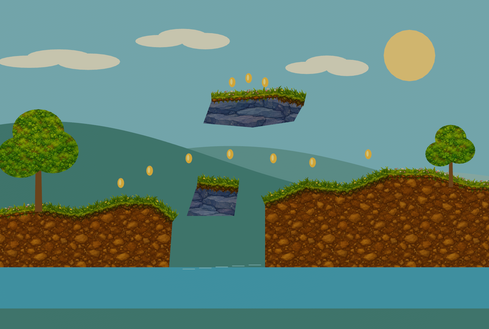

*Meadow Crossing supplies the materials used in this walkthrough.*

### 2. Create a Smart Shape

Open the Hierarchy context menu and choose **Create > Shape > Smart Shape**.
Name the entity **Practice meadow**. Keep it at the root of the Hierarchy.
Set its **Local Position** to `(0, 10, 0)` to work above the example terrain.
Switch the Scene View to **2D** and frame the shape.

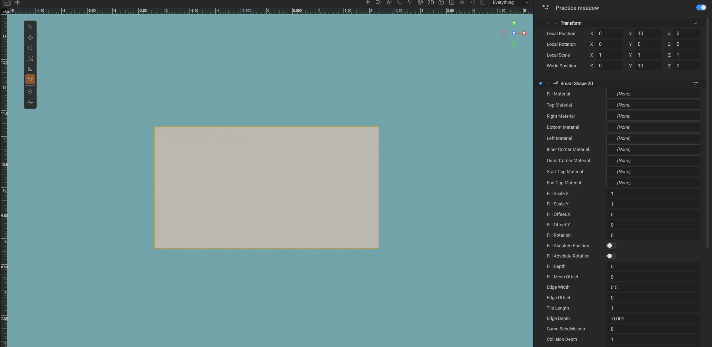

*The creation command adds a closed rectangle and the Smart Shape 2D and Spline components.*

### 3. Edit the shape

Select the parent **Practice meadow** entity in the Hierarchy.
Click the connected-points button on the Scene View's left toolbar. Its tooltip is **Spline Tool (right-click for options)**.
Drag a green control point to change the outline. The fill, border, and collision rebuild when you edit the spline.

Collapse **Smart Shape 2D** to expose the **Spline** section.
Expand **Control Points**, then expand a point to enter its **Location** numerically.
Keep each point's local **Z = 0** and **Radius = 1** for this example.
Use **Delete Point** inside a point's foldout to remove it.
Keep at least three points for a filled, closed shape.

Set **Type** to **Linear** for angular terrain, **Catmull-Rom** for a smooth outline, or **Cubic Bezier** for editable tangent handles.
Keep **Closed** enabled for a platform. With Cubic Bezier, drag the handles or edit **Tangent In** and **Tangent Out**; their local Z must also stay zero.

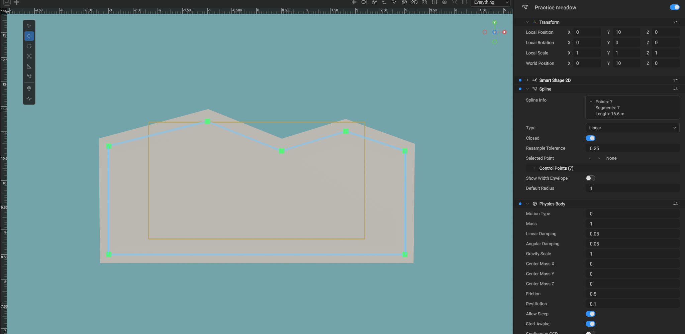

*Green squares are editable control points. The blue line connects them.*

You can edit the outline again after assigning materials. Select the parent and use the same Spline tool.
To move the entire platform, choose **Translate** on the Scene View toolbar and click its fill or border.
The click selects the parent Smart Shape, and the Translate tool stays active. Drag the transform gizmo to move the whole shape.
Choose **Spline Tool** explicitly when you want to edit individual control points.
If other splines clutter the view, right-click the Spline toolbar button and disable **Show All Spline Controls**.
Enable gizmo visibility if the control points are hidden.

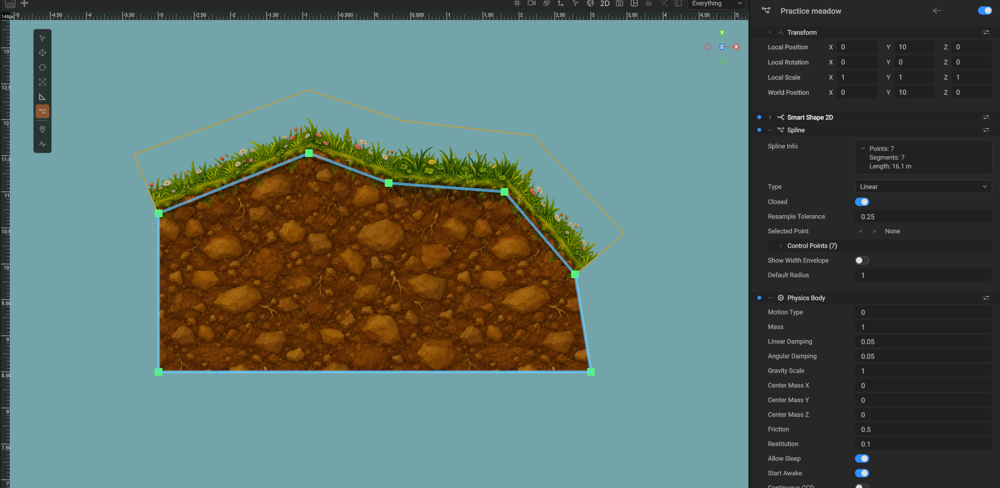

*Editing the textured shape uses the same controls. The orange selection outline is the mesh boundary, including transparent texture margins; it is not a collision preview.*

**Show Width Envelope** starts disabled. Keep it disabled for ordinary Smart Shape editing.
A point's Radius multiplies Edge Width; it does not change the fill outline.

### 4. Assign the earth fill

Expand **Smart Shape 2D**. Assign `PaintedEarth.material` to **Fill Material**.
Set both **Fill Scale** values to `4`. Keep **Fill Enabled** on.
For the fill-only view below, turn **Edges Enabled** off temporarily.
Use `BlueSlate.material` instead when making a stone platform.

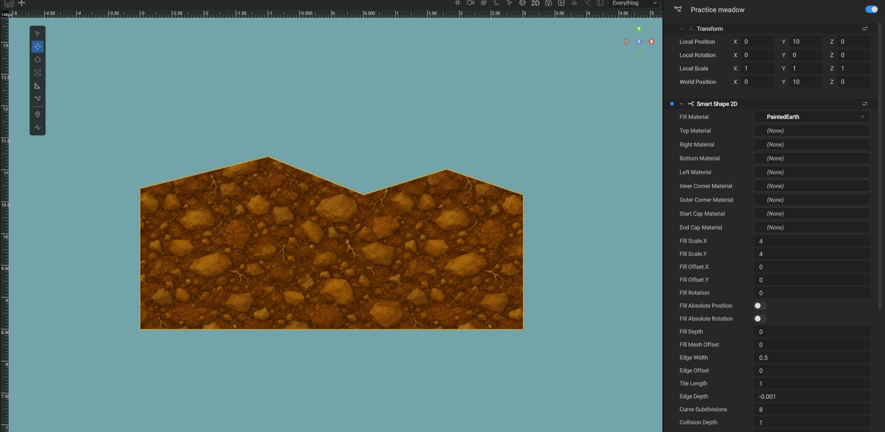

*Fill Scale sets world units per texture repetition.*

### 5. Add the flower border

Enable **Edges Enabled**. Assign `DaisyEdge.material` to **Top Material**, **Right Material**, **Bottom Material**, and **Left Material**.
These are independent slots. Reusing DaisyEdge here demonstrates a complete border; the next step removes grass from the cliff sides and bottom.

| Setting | Value |
| --- | --- |
| Edge Width | `1.4` |
| Edge Offset | `0.25` |
| Tile Length | `4.2` |
| Edge Depth | `-0.03` |
| Stretch To Fit | Off |
| Use Corner Textures | Off |
| Use Taper Textures | Off |

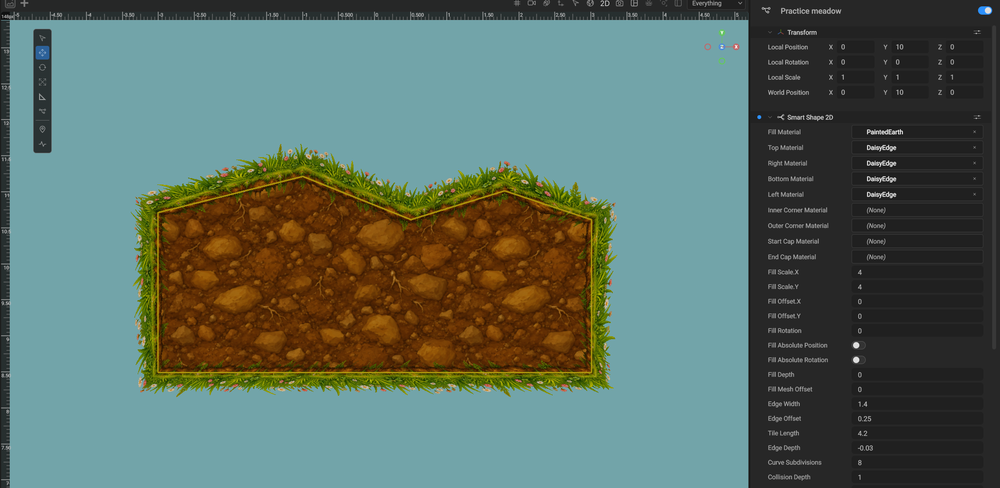

*DaisyEdge contains transparent grass blades, flowers, and roots.*

The supplied DaisyEdge and CloverEdge materials use **Mask** alpha mode, **Alpha Cutoff = 0.25**, and **Double Sided** rendering.
Use those materials directly to retain the transparent silhouette.
**Start Cap Material** and **End Cap Material** are separate tip materials for edge runs; they are not the bottom material.

### 6. Keep grass on the upper edge

Select the parent shape and choose **Create > Shape > Shape Edge Override** from its Hierarchy context menu.
Name the child **Hide cliff edges** and keep it parented to the shape.
Enable **Use Normal Range**, set **Normal Start = 150**, set **Normal Sweep = 240**, and disable **Visible**.
Leave **Material** empty and **Override Texture Settings** off.

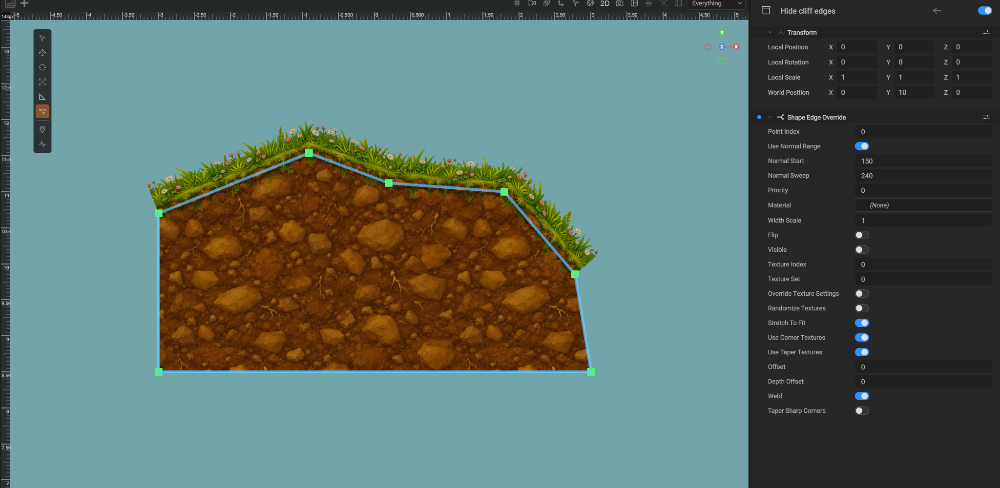

*The upper edge keeps its flowers. The earth fill supplies the visible sides and bottom.*

This range works for the illustrated outline. Adjust it for steeper slopes.
To draw a different bottom border, assign another **Bottom Material** on the parent and change the hiding rule so it does not hide that direction.

### 7. Mix daisies and clover

Select the parent and choose **Create > Shape > Shape Texture Entry** twice.
Keep both entries parented to the shape. Set the following properties:

| Property | First entry | Second entry |
| --- | --- | --- |
| Material | DaisyEdge | CloverEdge |
| Index | `0` | `1` |
| Texture Set | `0` | `0` |
| Point Index | `-1` | `-1` |
| Tile Length | `4.2` | `4.2` |
| Width Scale | `1` | `1` |

Enable **Randomize Textures** on the parent and set **Texture Seed = 42**.
Keep the seed unchanged for repeatable results.

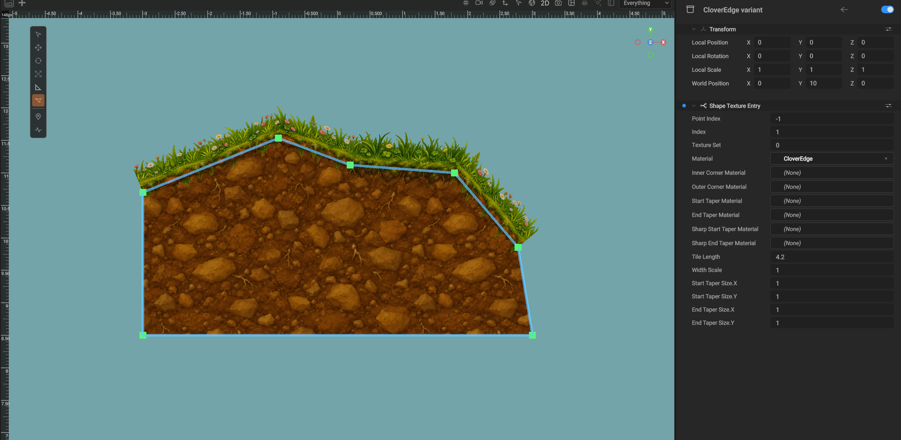

*Texture entries supply variants without duplicating the shape.*

### 8. Configure collision on the parent

Select the parent. Enable **Collision Enabled** and choose **Collision Mode = Filled**.
Use **Collision Offset = 0** and **Collision Depth = 1** for this platform.
Collapse the Smart Shape and Spline sections to see **Physics Body** and **Physics Collider** below them.
Keep **Motion Type = 0** (Static). Adjust friction on the parent as needed.

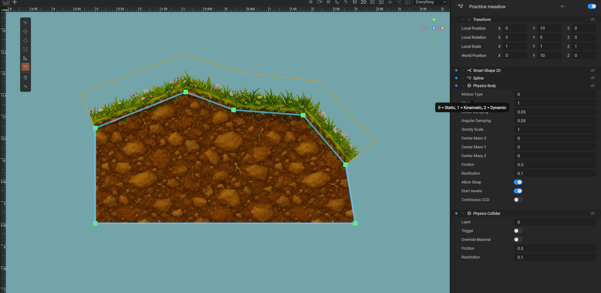

*Physics components belong to the parent. Filled collision follows the closed spline, not the transparent flower silhouette.*

### 9. Save the scene

Use **Save As** to save the exercise as `AuthoringPractice.scene` in the project's Assets folder.
Reopen it to continue authoring. The editor regenerates the meshes and collision from the saved parent and authored children.
Edit the parent rather than the generated **Fill** or edge children.

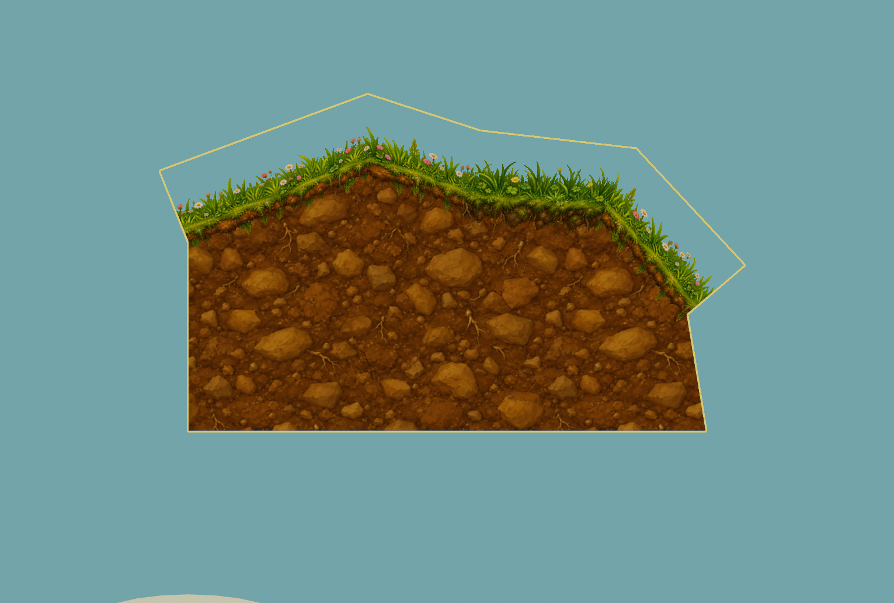

*The finished platform retains its editable spline and material rules.*

### 10. Edit an open path

Open `WoodlandTrail.scene` and select **Winding flower trail**.
Its Spline uses **Catmull-Rom** with **Closed** off. Select the Spline tool to move its control points.
An open path draws an edge ribbon without an interior fill.
To start another path, choose **Create > Shape > Smart Path**.

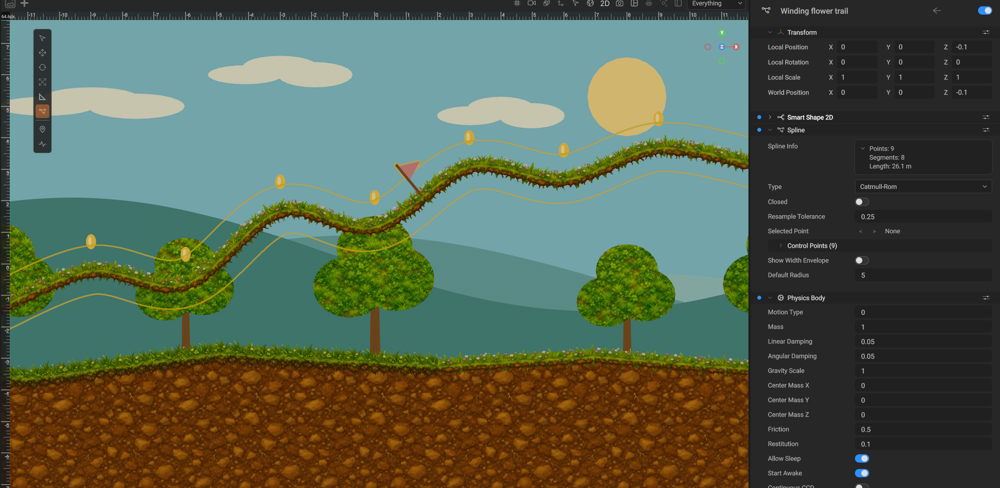

*The winding trail demonstrates a smooth open spline.*

### 11. Attach a flag to the path

Expand **Winding flower trail** in the Hierarchy and select **Trail flag point anchor**.
The example uses **Point Index = 4** and **Point Offset = 0.5**.
Change the offset to move the flag along the outgoing segment.
Move the path's control points to see the flag follow it.

To make another attachment, select the path and choose **Create > Shape > Shape Point Anchor**.
Parent the decoration to that anchor. Use the anchor's **Rotation** to rotate it relative to the path tangent.

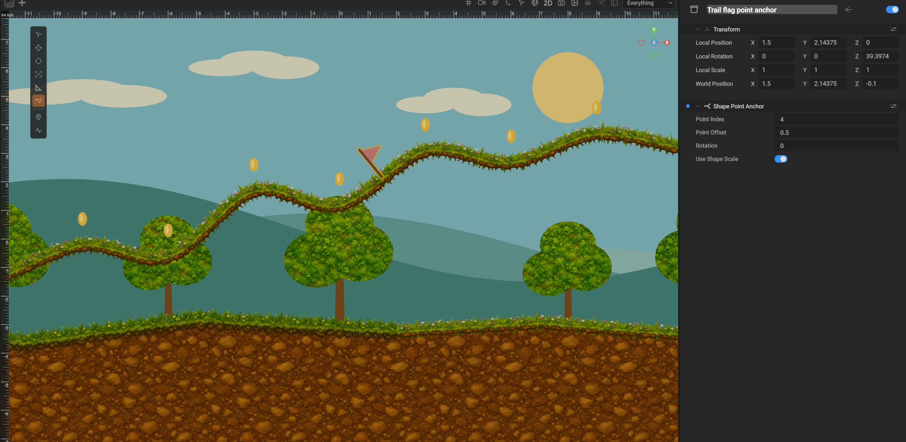

*The flag pole and pennant are children of the point anchor.*

## Fill and edge settings

| Setting | Effect |
| --- | --- |
| Fill Enabled | Draw the interior of a closed outline. Open paths never have a fill. |
| Fill Scale | World units per texture repetition on X and Y. Both values must be positive. |
| Fill Offset | Translate the texture in shape units before conversion to UV coordinates. |
| Fill Rotation | Rotate the texture in degrees. |
| Fill Absolute Position / Rotation | Keep the texture aligned to world position or rotation as the shape moves. |
| Fill Mesh Offset | Inflate or inset the fill independently of the border, in shape units. |
| Fill Depth | Local Z of the fill. |
| Edges Enabled | Draw the border ribbon. |
| Edge Width | Border thickness, multiplied by point radius. |
| Edge Offset | Offset the ribbon across its normal in multiples of half its width. Zero centers it on the outline. |
| Tile Length | World units per edge texture repetition. |
| Stretch To Fit | Fit a whole number of repetitions around the outline. When off, retain the requested tile length and crop the last repeat. |
| Flip Edges | Reverse which side of the outline the edges face, including corner classification. |
| Edge Depth | Local Z of the border. A small negative value places it in front of the fill when viewed from negative Z. |
| Weld Edges | Join neighboring quads while preserving their average height. |
| Use Corner Textures / Use Taper Textures | Enable the assigned corner and taper materials. |
| Taper Sharp Corners | Split sharp turns with their dedicated taper materials when no ordinary corner applies. |
| Curve Subdivisions | Samples per curved segment, from 1 to 64. Straight segments need no subdivision. |

Inner and outer corner materials apply to turns from 80 through 100 degrees. Their vertices follow the adjacent segment directions, and neighboring quads weld to their corner-specific attachment points. Start and end cap materials are tapers: they split **inside** each contiguous edge run, including at edge-rule boundaries and hidden segments. A taper larger than the segment retextures that segment instead. **Start Taper Size** and **End Taper Size** are the texture dimensions in shape units; both axes participate when the edge is diagonal. Corners use the full UV square. Tapers use their own texture dimensions and the source fit behavior, including short-segment retexturing.

Standard material normal maps use generated mesh tangents, including on rotated edges, corners, and flipped textures.

## Override an edge

Select the shape, then choose **Create > Shape > Shape Edge Override** from its Hierarchy context menu. Keep the override entity parented to the shape.

Set **Point Index** to the zero-based index of the point that starts the segment. The override can select a material, multiply the width at that point, flip the ribbon texture, or hide the segment. Use at most one point override for each point. Point indices address the current spline order, so check overrides after inserting or removing points.

Turn on **Use Normal Range** to select edges by their outward direction instead. **Normal Start** is measured counterclockwise from local +X. +Y is 90 degrees. **Normal Sweep** is the signed angular span. Zero or a full turn selects every direction. Negative spans run clockwise, and ranges can cross zero degrees.

Every matching normal rule draws a separate material layer. **Priority** orders rule processing; use **Depth Offset** to place an overlay in front of another layer. A point override replaces all normal layers on its segment. Hiding one normal rule only hides that layer. Ranges use the direction between authored control points, so a curved segment keeps its material across all its samples. Width Scale belongs to a point override. Normal rules can also scale width. **Texture Set** selects the numbered group of texture entries for that rule. Enable **Override Texture Settings** to give the rule its own randomization, stretch/crop, corner, and taper settings. Otherwise it inherits those settings from the shape. **Offset** shifts the selected ribbon across its normal; **Depth Offset** changes its local Z relative to Edge Depth. **Weld** and **Taper Sharp Corners** control joins for the selected edges.

## Texture sets

Choose **Create > Shape > Shape Texture Entry** on the shape to add a material variant. Each entry can supply an edge material, matching inner and outer corners, ordinary start/end tapers, and sharp-corner start/end tapers. Add as many entries as needed. **Texture Set** groups entries for edge rules (zero is the default). Give each entry a unique **Index** for its Texture Set and Point Index. **Index** orders the set, **Tile Length** sets its horizontal texture dimension, and **Width Scale** changes its thickness.

An entry with **Point Index = -1** belongs to the default set. Entries with a specific Point Index replace that set for the segment leaving that point. An edge override's **Texture Index** selects an entry, wrapping around the available count. Enable **Randomize Textures** to choose an entry for each sampled segment. **Texture Seed** makes the selection repeatable when a scene reloads.

## Point anchors

Choose **Create > Shape > Shape Point Anchor** on a shape. The anchor follows **Point Index** plus **Point Offset**, from zero to one along the outgoing segment. **Rotation** is measured in degrees from the forward curve tangent. **Use Shape Scale** controls whether its children inherit the shape's scale. Parent a sprite, mesh, light, or another entity to the anchor. Moving the spline updates the attachment automatically.

## Collision

**Collision Enabled** generates a static triangle collider on the Smart Shape entity itself. Existing physics body and collider settings are preserved when the shape rebuilds. Disabling collision removes the generated mesh and only the physics components added by the package. **Collision Depth** extrudes it along local Z. **Collision Mode** selects **Filled**, **Rendered edges**, or **Hollow**. Filled and hollow modes use **Collision Offset** independently of the visual fill. Hollow and open shapes use **Collision Width**; open collision ends are flat. These offsets use mitered polygon buffering with intersection resolution. Collision is generated even when rendering is disabled with Fill Enabled or Edges Enabled, and in a headless runtime. Switching off the Smart Shape component removes all generated output, including collision.

The collider uses the normal PhysicsECS lifecycle. Physics bodies are created during simulation and released when the generated entity is removed. These triangle colliders are static terrain. Use the engine's convex collider types for dynamic objects.

## Saving and runtime

The scene stores the spline, shape settings, and authored edge-override, texture-entry, and anchor children. Generated mesh children and triangle collision data are runtime output and are not saved. The parent uses ordinary physics components for its collision settings. They rebuild when the scene loads, including in the Player with the package's runtime module installed.

### Undo and redo editor operations

Use the editor's **Undo** and **Redo** commands for Smart Shape authoring. A completed spline-point or tangent drag is one step, including a transform of controls selected across multiple splines. Point insertion/deletion, inspector settings and material assignments, creation of shapes and their authored children, and whole-shape transforms use the same editor history.

You can undo a point edit, undo creation of its shape, then redo both operations. Redo restores the edit on the recreated shape. Select the Smart Shape parent and use Translate outside Spline mode to move the whole shape; Undo restores its previous transform.

Use the parent shape's inspector to edit generated output. Changes made directly to a generated mesh child are replaced on regeneration.

The native package does not import external project or resource formats. Recreate the source outline and assign native materials.

## Invalid outlines

A self-crossing outline, non-finite value, nonpositive width or texture scale, or out-of-plane point produces no geometry. The Console reports the entity and the correction. Fix the authored data to regenerate it.

An outline can contain up to 4096 sampled points. Lower Curve Subdivisions or split the shape when that limit is exceeded. This bounds the polygon validation and triangulation work.

## Garden Worlds examples

The package includes a sample project at `Packages/smartshape2d/Samples/GardenWorlds`.
Copy this folder to a writable project location, then open it with the Editor's `--project` option.
Open one of these scenes from Assets:

- **MeadowCrossing.scene**: grassy banks, a brook, stone platforms, and a hidden upper garden.
- **FloatingGardens.scene**: layered floating islands, randomized flower edges, and a curved connecting path.
- **DestructionGarden.scene**: click-to-explode terrain with falling physics seeds, crater collision, and reset controls.
- **WoodlandTrail.scene**: a smooth open flower trail with a checkpoint flag attached through a point anchor.

The first three scenes are editable environment examples. Coin shapes indicate possible routes. They do not include a player controller, collection logic, or win conditions.
The terrain and paths include static collision on their parent entities. Backgrounds and decorations do not collide.

The five painted PNG textures include earth, meadow fill, blue slate, daisies, and clover.
The two edge strips have real alpha channels for grass blades, flowers, and hanging roots.
Their materials use **Mask** transparency with an **Alpha Cutoff** of `0.25`.
Keep **Stretch To Fit** off on these examples so short edges show a cropped tile instead of stretching a narrow sample across the edge.

## Destructible terrain

1. Open **Garden Worlds → DestructionGarden.scene** and press **Play**. The gold seeds fall onto the flower bridge.

2. Click the bridge in **Game View** to blast a circular hole. Both the visible mesh and collision rebuild. Sleeping seeds wake and fall through the opening.

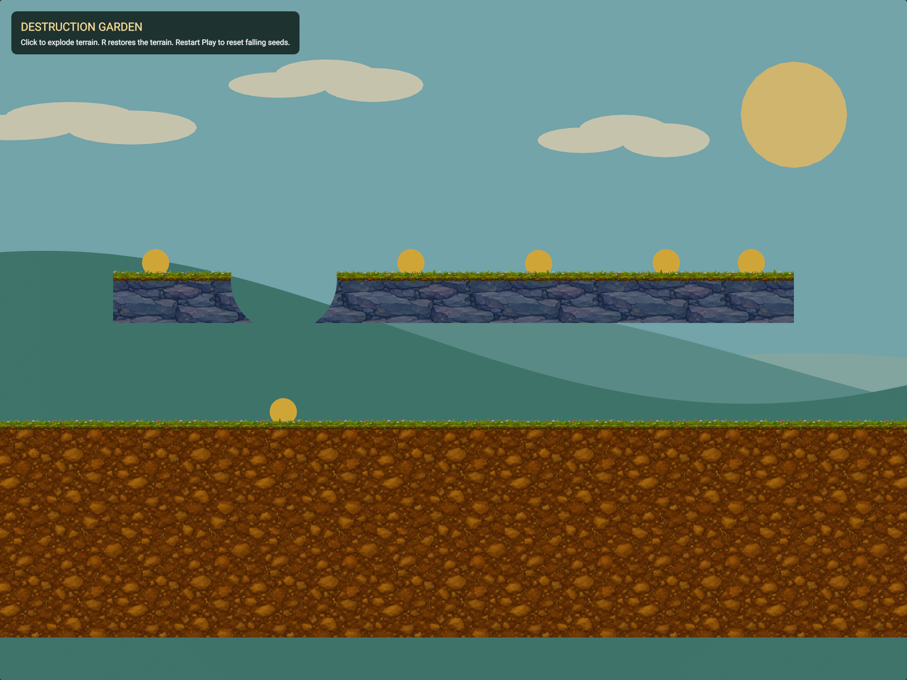

3. Click the meadow below the seed to cut a crater. Click again to enlarge it or make another opening.

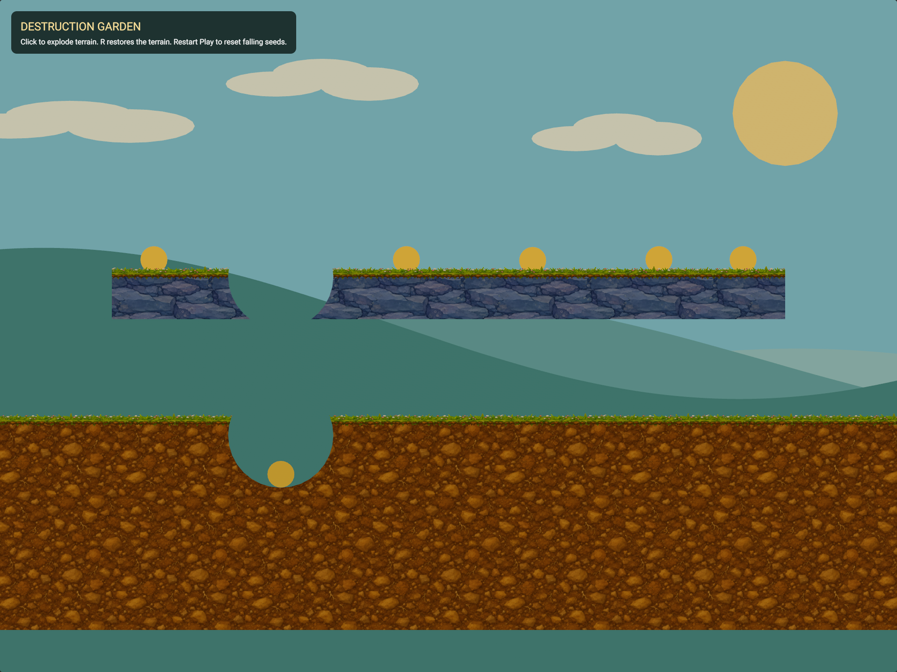

4. Press **R** to restore all terrain. Stop and restart Play to reset the seeds. Stop restores the authored scene.

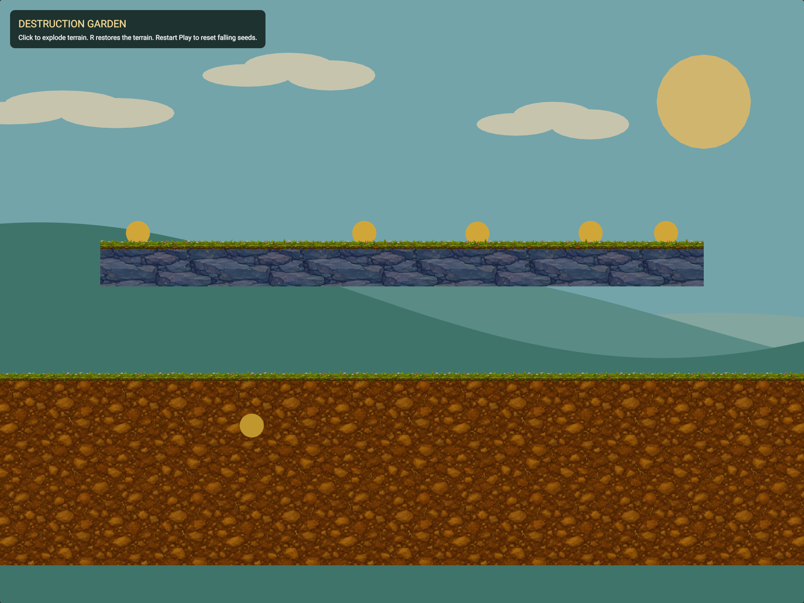

To enable destruction on your own terrain, select the parent Smart Shape and enable **Destructible**.
Keep **Collision Enabled** on if objects must collide with the remaining terrain.
For the click-to-explode example controller, add **Shape Destruction Demo** to an entity and set **Radius** and **Flash Material**.
The controller uses the first orthographic camera and an XY game plane. Use Game View while playing; Scene View clicks continue to edit the scene.

Native gameplay code can include `SmartShape2D/ShapeExplosion.h` and call
`GameEngine::SmartShape2D::ExplodeShapes(world, center, radius)` from an exclusive world update.
The center and radius are in world units; the blast is a disk in the world XY plane, projected into each opted-in shape's local XY plane.
`ResetShapeDestruction(world)` removes the blast footprints. Meshes and collision rebuild on the next Smart Shape update.
The authored spline and material assignments stay intact. Blast footprints are runtime state and are not saved into the scene.

For games that implement their own runtime history, native gameplay code can own a `SmartShape2D::ShapeDestructionHistory` and call `Explode`, `Reset`, `Undo`, and `Redo` with exclusive world access. Use the history for every damage operation in that session. Direct damage changes invalidate its prior history.
