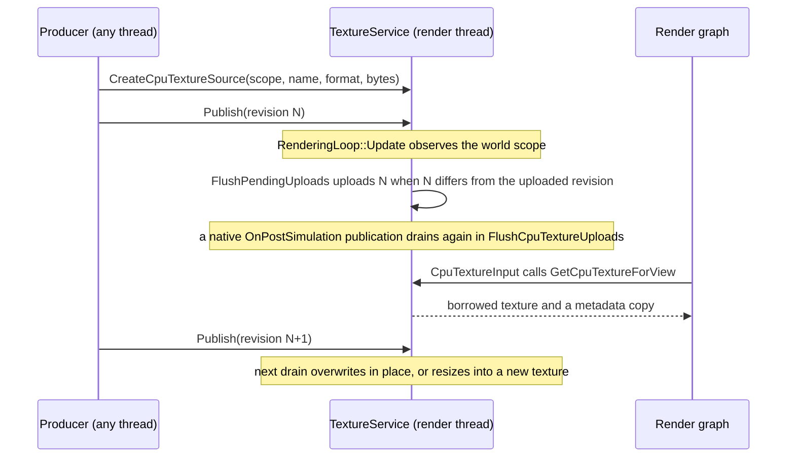

An engine-owned way for runtime code to hand a small, changing CPU image plus a fixed block of metadata to an authored fullscreen pass. Runtime masks and simulation fields (a visibility mask, a flow field, a paint layer) are the intended producers. `TextureService` owns the retained bytes, the upload, and the GPU texture. The producer holds only a move-only lease.

:::caution[Not a fog or visibility system]

This is a producer API. It defines no factions, bounds, or fallback policy. The consuming composition decides what to draw when the source is absent. The existing `FullscreenShader` node skips a stage whose input is missing (the chain threads through), which is not a fail-closed visibility curtain.

:::

## Producer

```cpp title="Publish a visibility mask with its bounds"
struct MaskBounds { float OriginX, OriginZ, SizeX, SizeZ; };

auto source = services.Textures().CreateCpuTextureSource({
    {world.GetWorldId(), world.GetLifecycleResetGeneration()},
    HashStringId("Visibility"),
    Rendering::TextureFormat::R8G8_UNORM,
    sizeof(MaskBounds)});

const bool accepted = source.Publish(width, height, pixels,
                                     std::as_bytes(std::span(&bounds, 1)));
```

| Rule | Detail |
|---|---|
| Scope | The lease is fixed to one `(world id, lifecycle reset generation)`. A world reset closes every lease of the previous generation. The producer sees `!source` and creates a new one. |
| Identity | `Name` is a `StringId`. Two live publishers of the same scope and name are rejected: the second `CreateCpuTextureSource` returns an empty lease. |
| Image | Tightly packed `R8_UNORM`, `R8G8_UNORM`, or `RGBA8_UNORM`; at most 4096 pixels per axis and 16 MiB per revision. Linear formats only. |
| Metadata | Optional, fixed size, a multiple of 16 bytes, at most 256 bytes. Its shader layout belongs to the producer and its consuming shader. Zero bytes means no buffer is published. |
| Publish | Copies image and metadata together as one revision, outside the lease's mutex. The newest pending revision replaces the previous one. There is no queue and no callback. `false` means invalid arguments, allocation failure, or a closed lease, and the previous revision stays. |
| Acceptance | `true` means the CPU bytes were retained. The GPU receives them at the next render-thread drain. |
| Threads | `Publish` may run on any thread. Calls on one lease object need caller synchronization (it is a plain move-only value). |
| Release | Reset or destroy the lease when the producer stops. Service shutdown and world resets revoke leases. A revoked lease cannot be revived by publishing. |

## Pipeline node

```json title="A CpuTextureInput pass"
{
  "id": "VisibilityInput",
  "type": "CpuTextureInput",
  "source": "Visibility",
  "output": "VisibilityMask",
  "parameters": "VisibilityBounds",
  "viewPurpose": "Game"
}
```

`CpuTextureInput` is a per-view node. It imports the uploaded texture into the view's render graph under `output` and, when the source carries metadata, copies it into the frame's upload ring and publishes it under `parameters`. `FullscreenShader.inputs` and `.buffers` consume both names unchanged. `viewPurpose` defaults to `Game`. `EditorScene`, `EditorPreview`, and `UtilityCapture` are the other values. Views of other worlds, and world zero, never see the source.

The node publishes neither resource when the lease is absent, the scope is stale, no revision has uploaded, the node's `parameters` presence disagrees with the source's metadata size, the device is not healthy, or the per-frame metadata allocation fails.

## Lifetime and execution



| Event | Behavior |
|---|---|
| Drain | `TextureService::FlushPendingUploads`, once per application frame inside `BeginWorldDrawFrame`, before extraction and graph declaration. Only sources whose pending revision differs from the uploaded one submit. An unchanged source costs no upload. A second drain, `FlushCpuTextureUploads`, runs from `NativePostSimulationSystem` once a native `OnPostSimulation` hook has been delivered, so a lease created or published in that hook uploads in the same frame (see [Native user systems](../scripting/native-user-systems.mdx)). |
| Upload | One staging buffer and one graphics-queue command list per dirty source, through `UploadTexturesBatched`. Every staging allocation and the command list exist before anything is submitted. A preparation failure submits nothing and keeps the previous image and metadata, including on resize. |
| Ordering | The in-place copy is bracketed `ShaderResource` to `CopyDest` and back on the graphics queue, which orders it after the previous frame's sampling of the same image. Consumers are sampled reads on that queue. The backend resolves the image layout from its own tracking. |
| Resize | A revision with new dimensions uploads into a fresh texture. The previous one is destroyed only after the new upload was submitted. A failed resize retires the replacement and keeps the previous pair. |
| Dispatch exception | The device's submit API is void. If it throws after a copy may have run, an in-place image is invalidated (no binding until a complete retry) and the exception propagates. |
| Borrowing | A `CpuTextureBinding` is valid until the next drain. Nothing retains it across frames. The node looks it up again at every declaration. |
| Destruction | Textures retire through the device's fence-deferred destroy, so frames already submitted keep sampling safely. The service's entry table is the owner: it destroys on close, resize, and shutdown. |
| Device rebuild | `ReprovisionAfterDeviceRebuild` forgets the dead handles without destroying them. Retained CPU revisions upload again at the next drain. |
| World reset and shutdown | `ObserveCpuTextureWorld` closes leases whose reset generation no longer matches. `Shutdown` closes everything and destroys the textures. |
| Module unload | The engine retains no function pointer, deleter, or renderer feature from the producer. A native module releases its lease and can unload. |

:::caution[Per-frame cost of a streaming publisher]

A source that publishes every frame pays one revision copy on the publisher's thread and, on the render thread, one staging buffer create and retire, one command list, and one queue submit per frame. The engine's video path (`VideoFrameUploader`) amortizes the same work with a persistent staging ring and a single submit per tick. Sharing that uploader is the planned follow-up for publishers that stream every frame.

:::

## Verification

`CpuTextureSourceTests` (Engine tests, headless Vulkan) reads pixels back and checks: latest-revision coalescing across views, preparation-failure retention, dispatch-after-copy invalidation, failed-resize cleanup, scope and reset revocation, duplicate-lease rejection, invalid payload rejection, device reprovision re-upload, a publisher thread racing the drain, an authored pipeline compiling with a `FullscreenShader` consumer, and the real `TextureService` plus node publishing only coherent view-scoped pairs. `RenderPipelineDeclareTests` and `EngineTextureTests` gate the touched pipeline and service paths.
