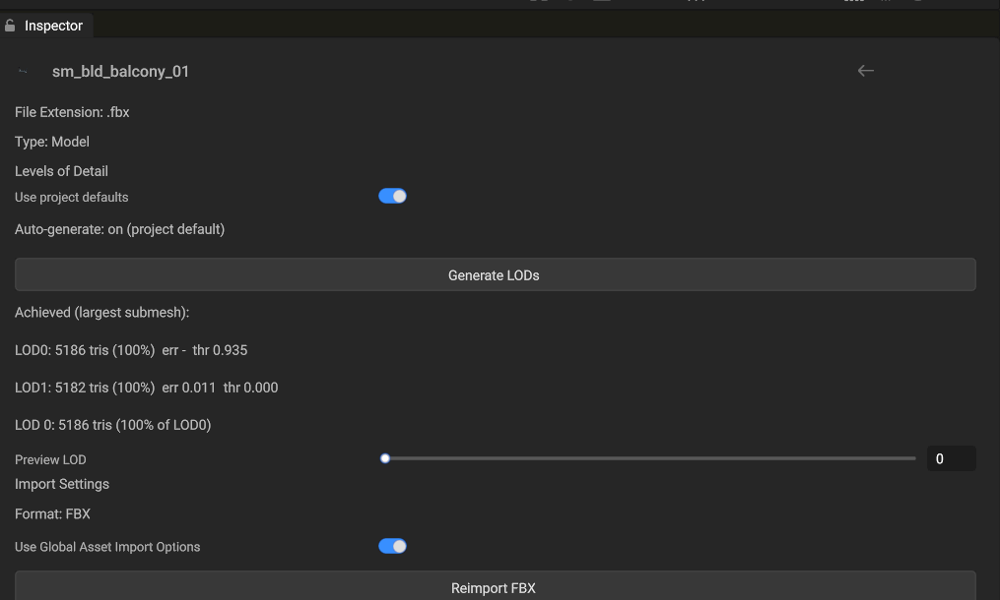

:::tip[TL;DR]
Static (non-animated) models get LOD chains **automatically**: nothing to set up. Import a model, and up to 4 LOD levels are generated at load time by meshoptimizer, selected per-instance on the GPU by screen coverage. Skinned meshes are excluded by default (opt-in per asset). The whole 828-model POLYGON ElvenRealm pack generates in **91 ms total** (worst single model: 6.3 ms), on background threads.
:::

## Zero-config path (what happens by default)

1. Drop FBX/glTF files into your project's `Assets/` folder (or open a project that has them).
2. On load, each non-skinned mesh gets up to 4 LOD levels. You will see one log line per model:

   ```text title="The log line for one model"
   LOD gen: 3 meshes -> 4 LODs in 0.64 ms (7262 tris) (assets/fbx/props/sm_prop_tent_01.fbx)
   ```

3. At runtime the GPU picks the LOD per instance from projected screen coverage: distant instances render with fewer triangles. Shadow cascades benefit the most (measured: generated chains cut cascaded-shadow GPU time by up to **10×** on heavy scenes).

:::note
Meshes that are already simple stay LOD0-only: the simplifier only keeps a level when it actually reduces triangles meaningfully. On stylized low-poly content (Synty), ~80% of meshes are correctly left untouched. The heavy 20% (buildings, rocks, props) get chains.
:::

## Per-asset settings (Model Inspector)

Select a model in the **Assets** panel. The Inspector shows a **LOD** tab:



*Per-model LOD controls with the achieved-results table and forced-LOD preview slider.*

| Control | What it does |
|---|---|
| **Use project defaults** | ON (default): this asset follows the project-wide policy. Turn OFF to override LOD count, per-level target ratios/errors, border locking, and the skinned opt-in for this asset only. Overrides persist in the asset database (git-friendly, shared with the team). |
| **Auto-generate LODs** | Shows the resolved policy (`on (project default)` in the screenshot). With a per-asset override you can force generation on/off regardless of the project setting. |
| **Generate LODs** | Explicitly (re)generates now and refreshes the results table. Useful after changing settings. |
| **Achieved table** | Per level: triangle count, % of LOD0, achieved simplification error, and the derived switch threshold. This is your quality window: if LOD1 shows a large error on a hero asset, override the ratios or disable generation for it. |
| **Preview LOD** | Forces a LOD level in the asset preview so you can eyeball each level before it ships. |

## Project-wide setting

**Settings → Asset Import → Automatic LODs → Auto-Generate LODs** toggles the project default (stored as `import.autoGenerateLODs` in the project settings). It applies on every project-open path: picker, last-project auto-load, and `--project` launches. Packaged Player builds inherit the policy through `game.config` (`lod.autoGenerate`, also default-on), so shipped games generate the same chains from the same settings.

To regenerate everything after changing the policy: run the **Reimport LODs (project)** command. It walks every model in the project and reports `regenerated / skipped` counts.

## What it costs

| Corpus | Models | Meshes / tris | Total gen time | Worst model | p95 |
|---|---|---|---|---|---|
| POLYGON ElvenRealm (Synty) | 828 | 1,345 / 769k | **91.3 ms** (CPU, sum) | 6.31 ms | 0.43 ms |

Generation runs on background asset workers during load: it never blocks the frame. The measured number above is why auto-generation is on by default: it is effectively free next to FBX parsing (~23 s for the same corpus).

## Runtime behavior (how selection works)

- A LOD level is either **index-only** or **own-vertex**. An index-only level is an index buffer over LOD0's vertices and adds no vertex memory. An own-vertex level carries its own vertex block, uploaded after LOD0's block in the same vertex buffer. An authored level on a mesh with vertex colors also carries its own RGBA block. Levels of an authored LOD chain are own-vertex, and so are generated far levels that fell back to the sloppy simplifier (rebuilt with their own vertices so normals and UVs stay correct). Every other generated level is index-only.
- Per-mesh switch thresholds are **derived from the achieved simplification error**: a level that simplified almost losslessly switches in earlier (bigger win, invisible), a lossy level waits until the instance is small on screen.
- Selection happens in the GPU draw-command scatter pass per instance per view, from projected coverage of the bounding sphere. This includes shadow cascade views.
- A switch between levels dissolves instead of popping: for **LOD Crossfade (s)** in **Settings → Level of Detail** (default 0.25 s, 0 turns it off) both levels draw, each keeping a complementary half of a screen-space dither. Shadow casters switch without a fade.
- An LOD chain imported with the model (`_LOD<N>` name suffixes, `MSFT_lod`, FBX LOD groups, explicit slots) takes precedence over generation for that mesh.
- A global LOD bias is available for debugging/perf work (`lodBiasGlobal`, exposed via render stats tooling).

:::note[No per-object LOD authoring]
There is no LOD component to add to an object and no per-renderer switch heights to tune. The mesh asset carries the chain, the switch thresholds follow from the measured simplification error, and every instance of the mesh uses them. The global LOD bias above scales every switch.
:::

## Skinned / animated models

:::caution[Opt-in by design]
Skinned meshes are skipped by default: position-only simplification ignores joint-assignment seams, which can produce "weight swim" on animated silhouettes. If you want chains on a specific character, turn OFF **Use project defaults** on that asset and enable **Generate for skinned meshes**, then verify animation quality with the Preview LOD slider (static poses) and in Play mode.
:::
