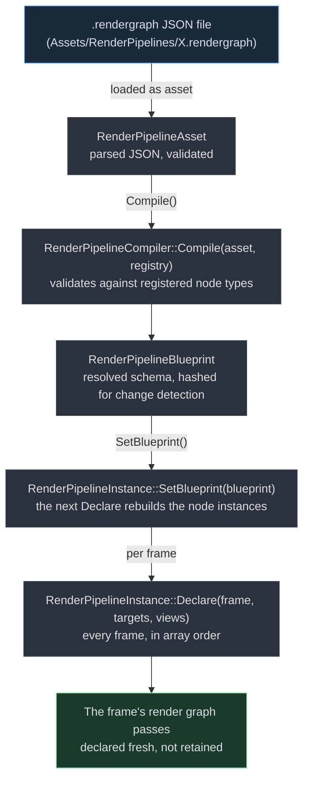
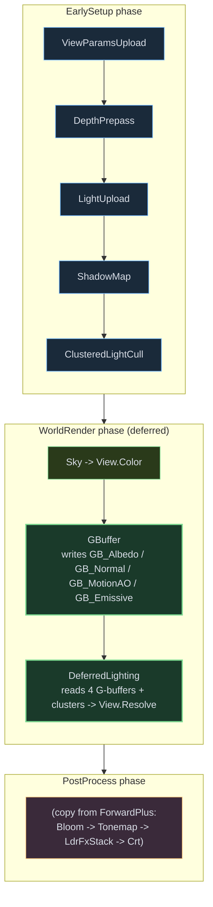
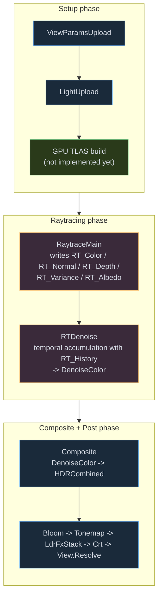

A render *pipeline* in this engine is the **complete frame-level execution plan** for rendering a view: which passes run, in what order, with what resources, producing what final output. This guide covers reading existing pipelines, modifying them, and creating new ones, including a deferred pipeline and a raytracing/path-tracing pipeline.

For individual pass authoring (the pieces a pipeline is made of), see the [recipes section of the rendering architecture guide](rendering-architecture.mdx#writing-a-render-pass-recipes) and [Render graph quick reference](render-graph.mdx). For the broader rendering architecture, see [Rendering architecture](rendering-architecture.mdx).

## What is a render pipeline?

A pipeline answers these questions for every frame:

| Question | Answered by |
|---|---|
| What intermediate buffers/textures does the frame need? | The `resources` block in the JSON |
| What passes run, in what order, with what dependencies? | The `passes` array |
| What is the *final* output the editor / swapchain presents? | The `outputs` block |

The pipeline is **per-project**: a project selects which `.rendergraph` to use (default is `ForwardPlus.rendergraph` shipped with the editor). Different projects can use entirely different pipelines: a stylized 2D project might use a very minimal pipeline; a high-fidelity 3D project uses the full ForwardPlus chain.

### Why is this data-driven rather than code?

Three reasons:

1. **Hot-reload.** Editing JSON is instant feedback in the running editor: no rebuild.
2. **Variants without recompilation.** A `ForwardPlus_DebugOverlay.rendergraph` can enable cluster visualization without code changes.
3. **Engine vs Game separation.** Game projects can ship their own pipelines without forking the engine.

Pipelines are written in JSON for parsing simplicity, but the schema is rich enough to express complex orchestration (per-view scope, expressions for dynamic sizes, passes declared in array order).

### Built-in pipeline files

Currently shipped in `Engine/Assets/RenderPipelines/`:

| File | Purpose |
|---|---|
| `Sample_PostStack.rendergraph` | World + a single fullscreen pass — minimal post-process example |
| `ForwardPlus.rendergraph` | **The canonical full pipeline** — forward+ clustered lighting, cascaded shadows, full post stack |
| `ForwardPlus_DebugOverlay.rendergraph` | ForwardPlus + the cluster debug overlay enabled |

## Pipeline file format

### Top-level schema

```jsonc title="The top level of a .rendergraph file"
{
  "schemaVersion": 2,
  "pipelineName": "MyPipeline",
  "outputs": { /* final view output mapping */ },
  "resources": { /* named intermediate resources */ },
  "passes": [ /* ordered pass entries */ ]
}
```

### Outputs

Maps a logical pipeline output to a resource reference. The editor consults this to know what to display:

```jsonc title="The outputs block"
"outputs": {
  "FinalColor": "View.Resolve"
}
```

`View.Resolve` is the per-view final output texture managed by `RenderServices`. You can route to any named resource.

### Resources

Each entry declares one texture or buffer the pipeline owns. Resources have a **scope** (`PerView`, `Frame`, `Persistent`) and a **kind** (`Texture` or `Buffer`).

#### Texture entry

```jsonc title="A half-resolution texture"
"BloomA": {
  "kind": "Texture",
  "format": "R16G16B16A16_FLOAT",
  "scope": "PerView",
  "extent": { "scale": [0.5, 0.5] },       // half-res of the view
  "usage": ["RenderTarget", "ShaderResource"]
}
```

| Field | Values |
|---|---|
| `format` | Any `TextureFormat` enum value as a string. Common: `R8_UNORM`, `R8G8B8A8_UNORM`, `R16G16B16A16_FLOAT`, `R11G11B10_FLOAT`, `D32_FLOAT`, `R32_UINT` |
| `scope` | `PerView` (one per camera), `Frame` (one per frame), `Persistent` (across frames) |
| `extent.scale` | `[sx, sy]` relative to view size. Omit for view-sized. |
| `extent.absolute` | `[w, h]` for fixed-size targets (e.g. shadow maps) |
| `usage` | Array of: `RenderTarget`, `DepthStencil`, `ShaderResource`, `Storage`, `CopySource`, `CopyDestination` |
| `mipLevels` | Optional, default 1 |
| `arrayLayers` | Optional, default 1 (4 for cascaded shadows) |

#### Buffer entry

```jsonc title="A buffer sized by an expression"
"ClusterBuffer": {
  "kind": "Buffer",
  "memoryUsage": "DeviceLocal",
  "scope": "PerView",
  "size": {
    "expression": "clustersX * clustersY * depthSlices * clusterDataBytes",
    "variables": {
      "clusterDataBytes": 16,
      "clustersX": "ceil(renderWidth / tileSizeX)",
      "clustersY": "ceil(renderHeight / tileSizeY)",
      "depthSlices": 24,
      "tileSizeX": 16,
      "tileSizeY": 16
    }
  },
  "usage": ["Storage", "ShaderResource", "CopyDestination"]
}
```

| Field | Values |
|---|---|
| `memoryUsage` | `DeviceLocal` (fast GPU-only), `Upload` (host-visible, persistently mapped), `Readback` (GPU → CPU) |
| `size.bytes` | Fixed size in bytes |
| `size.expression` | String expression evaluated at allocation time. Vars from `size.variables` |
| `size.variables` | Map of name → number or expression string. Built-in: `renderWidth`, `renderHeight` |
| `flags` | Array, optional. `PersistentlyMapped` keeps the buffer mapped for CPU writes |
| `usage` | `Storage`, `ConstantBuffer`, `VertexBuffer`, `IndexBuffer`, `IndirectArgs`, `CopySource`, `CopyDestination` |
| `zeroOnCreate` | Optional, default `false`. The buffer is zero-filled the first frame it exists, for state a pass reads before it writes it |
| `perFrameCopies` | Optional, default `false`. For a small state buffer that passes on two queues read and write every frame (the exposure history). The buffer is kept as one copy per frame in flight; each frame's copy starts as the previous frame's contents, and the first frame's starts at zero. A frame's write then does not wait for the previous frame's reads on the other queue |

#### Expression language

Resource size expressions support: integer arithmetic (`+`, `-`, `*`, `/`), `ceil()`, `floor()`, `min()`, `max()`, plus the built-in vars `renderWidth` and `renderHeight` (the active view's resolution). Implementation: `Engine/Source/Engine/Rendering/Pipeline/ExpressionEvaluator.cpp`.

### Passes

Each entry is one pipeline node instantiation:

```jsonc title="A pass entry"
{
  "id": "MyPass",            // unique within the pipeline
  "type": "FullscreenShader", // must match a registered node type
  "enabled": true,            // can be toggled
  // ... type-specific fields ...

  // Optional: a tiebreak among passes that are ready at the same point
  "phase": "PostProcess"
}
```

`type` is the critical field: it dictates which `IRenderPipelineNode` subclass instantiates. Available built-in types:

| Type | What it does | Where to find more |
|---|---|---|
| `DepthPrepass` | Clears + renders world depth | `DepthPrepassNode.cpp` |
| `ViewParamsUpload` | Uploads per-view UBO | `ViewParamsUploadNode.cpp` |
| `LightUpload` | Uploads light SSBO | `LightUploadNode.cpp` |
| `ShadowMap` (alias: `CascadedShadowMap`, deprecated) | Renders all shadow families (cascades + area/spot/point) + uploads shadow UBO. `"fitShadowDistanceToScene": true` replaces `maxShadowDistance` with a range fitted per view to the bounds of every mesh instance in the scene, in every world and render layer: the fade starts just beyond the far side of those bounds as seen from the camera, and the cascades split only that range. Terrain and water are not mesh instances and do not extend the range; its only limit is the camera's far plane, which clamps the cascade splits. Meant for pipelines whose scenes have no fixed scale, such as a model viewer. | `ShadowMapNode.cpp` |
| `SkyRender` | Sky atmosphere | `SkyRenderNode.cpp` |
| `WorldRender` | Forward+ world geometry with material binding | `WorldRenderNode.cpp` |
| `ComputeShader` | JSON-driven generic compute dispatch | `ComputeShaderNode.cpp` |
| `FullscreenShader` | JSON-driven generic fullscreen pass | `FullscreenShaderNode.cpp` |

**Adding new types** = implementing `IRenderPipelineNode` + registering. See [Add a new node type](customizable-render-pipeline.mdx#add-a-new-node-type).

### Resource reference grammar

Inside a pass entry, resource refs are strings:

| Form | Means |
|---|---|
| `"View.Color"` | Per-view standard color target |
| `"View.Depth"` | Per-view standard depth target |
| `"View.Resolve"` | Per-view final-resolve target (display output) |
| `"MyResource"` | A resource declared in the pipeline's `resources` block |

Per-view resources are automatically expanded per view by the framework. You reference them by name regardless of how many cameras are active.

### Pass ordering

The order of the `passes` array is the order of the frame. The pipeline declares its passes in array order every frame, and the render graph derives the dependencies from the resources each pass reads and writes (if pass A writes resource X and pass B reads it, B runs after A). Put every producer before its consumers.

- `"phase"`: `"EarlySetup"`, `"WorldRender"`, `"PostProcess"`, `"Overlay"`, `"UI"`, `"Finalize"`, `"Present"`, or an integer. It only breaks ties among passes that are otherwise ready to run. It does not move a pass ahead of a pass it depends on, or after one that depends on it.
- `"tags"` and `"after"` are read from the file but have no effect on the order. `"afterTag"` is not read at all. Order passes by their place in the array instead.

The same rule is stated in [Pass order](customizable-render-pipeline.mdx#pass-order).

## How pipelines load



*Pipeline load & build flow*

Key types in `Engine/Include/Engine/Rendering/Pipeline/RenderPipeline.h`:

- `RenderPipelineCompiler::Compile(asset, registry)` returns a `RenderPipelineBlueprint`, validated against the registered node types and hashed for change detection.
- `RenderPipelineInstance::SetBlueprint(blueprint)` replaces the active blueprint. The node instances are rebuilt on the next `Declare`.
- `RenderPipelineInstance::Declare(frame, targets, views)` runs every frame. It walks the blueprint's passes in array order and each node declares its work into that frame's render graph. Per-view nodes run once for each view.

Nothing is retained between frames: passes and frame resource handles are declared fresh every frame, and only the node instances and the GPU resources they own persist (see [How the pipeline is used at runtime](customizable-render-pipeline.mdx#how-the-pipeline-is-used-at-runtime)).

## Walkthrough: `Sample_PostStack.rendergraph`

Demonstrates the minimum to add a post-process effect over the world.

```json title="Sample_PostStack.rendergraph"
{
  "schemaVersion": 2,
  "pipelineName": "Sample_PostStack",
  "passes": [
    { "id": "World", "type": "WorldRender", "enabled": true },
    {
      "id": "SolidColor",
      "type": "FullscreenShader",
      "enabled": false,
      "output": "View.Resolve",
      "shaderPkg": "Shaders/solidcolor.shaderpkg"
    }
  ],
  "outputs": {
    "FinalColor": "View.Resolve"
  }
}
```

Two passes: `World` renders meshes, then `SolidColor` (disabled by default) writes a flat color over the result. Toggle `enabled` on `SolidColor` for instant override.

**Pedagogical value**: this is the entry-level template for any custom pipeline that wants to add a single post-process step.

## Walkthrough: `ForwardPlus.rendergraph` (the canonical pipeline)

The full production pipeline. Worth reading the whole file (`Engine/Assets/RenderPipelines/ForwardPlus.rendergraph`) end-to-end: it is the most concrete reference for everything below.

### Frame flow

```mermaid
flowchart TD
    subgraph EarlySetup["EarlySetup phase"]
        direction TB
        VPU["ViewParamsUpload<br/>matrices, camera position"]
        DP["DepthPrepass<br/>Z prepass to reduce overdraw"]
        LU["LightUpload<br/>extracted lights -> SSBO"]
        CSM["ShadowMap<br/>all shadow families + UBO"]
        CLC["ClusteredLightCull<br/>per-cluster light index lists"]
        VPU --> DP --> LU --> CSM --> CLC
    end

    subgraph WorldRender["WorldRender phase"]
        direction TB
        SKY["Sky<br/>writes sky into View.Color"]
        TER["Terrain<br/>terrain CDLOD rendering"]
        WR["World<br/>forward+ world geometry"]
        SKY --> TER --> WR
    end

    subgraph PostProcess["PostProcess phase"]
        direction TB
        BT["BloomThreshold<br/>View.Resolve -> BloomA"]
        BBH["BloomBlurH<br/>BloomA -> BloomB"]
        BBV["BloomBlurV<br/>BloomB -> BloomA"]
        BC["BloomCombine<br/>-> HDRCombined"]
        HCF["HDRColorFx<br/>HDR grading -> HDRFiltered"]
        TM["Tonemap<br/>HDR -> LDR -> LDRBeforeFilter"]
        LFX["LdrFxStack<br/>CAS etc. -> LDRBeforeCRT"]
        CRT["Crt<br/>CRT emulation -> View.Resolve"]
        BT --> BBH --> BBV --> BC --> HCF --> TM --> LFX --> CRT
    end

    EarlySetup --> WorldRender --> PostProcess

    classDef phase fill:#232831,stroke:#3a414d,color:#d8dde6;
    classDef setup fill:#1a2a3a,stroke:#6db4ff,color:#d8dde6;
    classDef world fill:#2a3a1a,stroke:#7bd88f,color:#d8dde6;
    classDef post fill:#3a2a3a,stroke:#f6c177,color:#d8dde6;
    class DP,VPU,LU,CSM,CLC setup;
    class SKY,TER,WR world;
    class BT,BBH,BBV,BC,HCF,TM,LFX,CRT post;
```



*ForwardPlus pipeline execution order*

```text title="ForwardPlus passes by phase"
EarlySetup phase:
  ViewParamsUpload       — uploads per-view UBO (matrices, camera position)
  DepthPrepass           — renders world depth (Z prepass to reduce overdraw)
  LightUpload            — uploads light SSBO from extracted lights
  ShadowMap              — renders all shadow families + uploads shadow UBO
  ClusteredLightCull     — compute pass; builds per-cluster light index lists

WorldRender phase:
  Sky                    — writes sky into View.Color
  Terrain                — terrain CDLOD rendering
  World                  — forward+ world geometry (samples clusters + shadows)

PostProcess phase:
  BloomThreshold         — extract bright pixels from View.Resolve into BloomA
  BloomBlurH             — horizontal blur BloomA → BloomB
  BloomBlurV             — vertical blur BloomB → BloomA
  BloomCombine           — combine bloom with HDR → HDRCombined
  HDRColorFx             — HDR color grading → HDRFiltered
  Tonemap                — HDR → LDR → LDRBeforeFilter
  LdrFxStack             — CAS sharpening etc. → LDRBeforeCRT
  Crt                    — CRT emulation → View.Resolve

ClusterDebugOverlay      — (disabled) cluster visualization
ForwardPlusLighting      — (disabled) standalone deferred-style lighting reference
```

### Resources it owns

```text title="ForwardPlus resources"
Per-view textures:  BloomA, BloomB, HDRCombined, HDRFiltered, LDRBeforeFilter, LDRBeforeCRT
Per-view buffers:   ClusterBuffer, LightIndexBuffer, ClusterParams, LightBuffer, ShadowData, ViewParams
```

`View.Color`, `View.Depth`, `View.Resolve` come from `RenderServices` automatically per active camera.

### What makes it "Forward+"

- **DepthPrepass** writes depth before world rendering, enabling early-Z rejection
- **ClusteredLightCull** runs after the prepass with depth available, building per-cluster (16×16 screen tile × 24 depth slice) light index lists
- **World** pass samples the cluster lists per fragment: only iterating lights that affect this cluster instead of all lights

This is dramatically more efficient than naive forward rendering for scenes with many lights, while keeping forward's per-material MSAA support and transparency flexibility.

## Scene color and the pre-exposure

`ForwardPlus.rendergraph` and `Web.rendergraph` store scene color multiplied by a factor P, the pre-exposure.
P is the view's exposure rounded to a power of two.
A bright noon scene and a dark night scene then use the same part of the half-float range, so dim light keeps its precision.

The `PreExposureSnapshot` pass writes P once per frame, before any pass writes scene color.
It writes P into the view's `ExposureHistory` buffer.
The tonemap divides P out again, so the picture on screen does not change.
A pipeline without the snapshot pass stores scene color at P = 1.

### What a pass must do

A pass that reads or writes scene color binds `ExposureHistory` and includes `Includes/exposure_history.glsl`.
That include gives three functions:

| Function | Returns | Use |
|---|---|---|
| `GE_PreExposure()` | P for this frame | Multiply radiance by it before you write scene color. Divide a scene color value by it before you compare it with an absolute value. |
| `GE_PreExposureHistoryScale()` | P of this frame divided by P of the previous frame | Multiply a temporal history by it before you blend the history with this frame. Use it only for a history that the previous frame of the view wrote. |
| `GE_ResolvePreExposure(p)` | `p`, or 1 when `p` is 0 | Read a P value that no snapshot wrote. |

```glsl title="Store radiance at the pre-exposure"
#define GE_EXPOSURE_HISTORY_BINDING 3
#include "Includes/exposure_history.glsl"

void main()
{
    oColor = vec4(radiance * GE_PreExposure(), 1.0);
}
```

In the pipeline file, the pass binds the buffer by name:

```json title="Bind ExposureHistory to a FullscreenShader pass"
"buffers": { "uExposure": "ExposureHistory" },
"bufferUsages": { "uExposure": "Storage" }
```

Each of these mistakes renders wrong by a factor of P:

- A custom `FullscreenShader` writes radiance into scene color and does not multiply by `GE_PreExposure()`.
- A pass compares scene color with an absolute threshold and does not divide by `GE_PreExposure()`.
- A `TemporalFullscreenShader` keeps a history of scene color and blends it without a correction for P.

### Temporal histories

A history that a pass wrote at an earlier frame holds the P of that frame.
The engine's TAA and screen-space reflection nodes multiply their histories by `GE_PreExposureHistoryScale()`.
If a frame of the view renders without the node, the node discards its history, and the next frame starts a new history.

The `TemporalFullscreenShader` node does not rescale its history.
Use one of these two methods in your shader:

- Store the history in absolute units: divide by `GE_PreExposure()` before you write the history, and multiply by `GE_PreExposure()` after you read it. This method is correct on every frame.
- Multiply the history by `GE_PreExposureHistoryScale()` when you read it. This method is correct only when the node reports the history as valid.

The node reports the validity through the push constant that `temporalHistory.validPushConstant` names.
The value is 1 only when the node wrote the history in the frame immediately before this one, at the same size and for the same world.
On any other frame the value is 0, and the shader must not read the history.

### The preExposed flag

Set `"preExposed": true` on a texture resource that holds scene color at P.
The editor's resource capture divides such a texture by P, so a capture shows scene-linear values.
The flag does not change what renders.

### The clear color of a view without a sky

A clear color is a constant that the CPU sets, and P lives on the GPU.
The CPU cannot multiply the clear color by P.
For a view without a sky, the `SkyRender` node adds a pass named `ClearColorBackdrop`.
The pass draws the clear color over the full view, multiplied by P.
The world pass then loads the color target and does not clear it.

You do not add `ClearColorBackdrop` to a pipeline file.
It is part of the `SkyRender` node, and the render graph inspector shows it as `Pipeline.<pipeline>.<SkyRender id>.View<N>.ClearColorBackdrop`.
The node skips the pass in these cases:

- The view has an active sky. The sky draws the background.
- The view does not clear its color target.
- The clear color is black, because black times P is still black.

If your pipeline has the `PreExposureSnapshot` pass, keep the `SkyRender` node before the world pass.
Without `SkyRender`, a view without a sky stores its clear color without P, and the screen shows that color divided by P.

## Creating a new pipeline from scratch

A project's pipeline is an asset of the project: it lives in the project's `Assets/RenderPipelines/` folder, and the engine's own pipelines stay as they are.

### Step 1: write the JSON

Create `Assets/RenderPipelines/MyPipeline.rendergraph` in your project. Start from a copy of the engine's `Sample_PostStack.rendergraph` or `ForwardPlus.rendergraph` (in `Engine/Assets/RenderPipelines/`) and add what you need. Give it a name of its own, so it never shadows an engine pipeline.

### Step 2: make it the project's pipeline

In the **Assets** panel, right-click the file and choose **Render Pipeline → Set Active**, or pick it as the active render pipeline in the project's **Settings** (Rendering). Either way the choice is saved per project, as `rendering.activeRenderPipeline` in `.Editor/ProjectSettings.json`, with the asset-root-relative path (`RenderPipelines/MyPipeline.rendergraph`). From code, `renderServices.Spine().SetActiveRenderPipelinePath("RenderPipelines/MyPipeline.rendergraph")` does the same for the running session.

### Step 3: edit it while the editor runs

Save the file and the editor reloads it: the pipeline is compiled again and the next frame draws with it. A pipeline the compiler rejects leaves the previous one drawing, and the Scene View and Game View name the reason.

## Worked example: a deferred pipeline

Builds on a GBuffer adapter and a deferred lighting pass, as described in [Adding a new path](rendering-architecture.mdx#adding-a-new-path-eg-gbuffer-adapter). The pipeline JSON is the orchestration glue.



*Deferred pipeline execution order*

### `MyDeferred.rendergraph`

```jsonc title="MyDeferred.rendergraph"
{
  "schemaVersion": 2,
  "pipelineName": "MyDeferred",
  "outputs": { "FinalColor": "View.Resolve" },
  "passes": [
    // ── EarlySetup ──────────────────────────────────
    { "id": "ViewParamsUpload",   "type": "ViewParamsUpload",
      "buffer": "ViewParams",     "enabled": true },
    { "id": "DepthPrepass",       "type": "DepthPrepass",      "enabled": true },
    { "id": "LightUpload",        "type": "LightUpload",
      "buffer": "LightBuffer",    "enabled": true },
    { "id": "ShadowMap",          "type": "ShadowMap",
      "buffer": "ShadowData",     "cascades": 4, "resolution": 2048,
      "splitLambda": 0.75, "depthBias": 0.005, "normalBias": 0.5,
      "maxShadowDistance": 200.0, "enabled": true },

    // ── ClusteredLightCull ─────────────────────────────
    {
      "id": "ClusteredLightCull",
      "type": "ComputeShader",
      "shaderPkg": "Shaders/clustered_light_cull.shaderpkg",
      "buffers": {
        "ClusterBuffer": "ClusterBuffer",
        "ClusterParams": "ClusterParams",
        "LightBuffer": "LightBuffer",
        "LightIndexBuffer": "LightIndexBuffer",
        "ViewParams": "ViewParams"
      },
      "bufferUsages": {
        "ClusterBuffer": "StorageWrite",
        "ClusterParams": "Sampled",
        "LightBuffer": "StorageRead",
        "LightIndexBuffer": "StorageWrite",
        "ViewParams": "ConstantBuffer"
      },
      "inputs": { "DepthTex": "View.Depth" },
      "inputUsages": { "DepthTex": "DepthSampled" },
      "dispatch": { "x": "ceil(renderWidth / 16)", "y": "ceil(renderHeight / 16)", "z": 1 },
      "uniformWrites": { "ClusterParams": { "u32x4": [16, 16, 24, 64] } },
      "enabled": true
    },

    // ── Sky ─────────────────────────────────────────
    { "id": "Sky", "type": "SkyRender", "output": "View.Color", "enabled": true },

    // ── GBuffer ──────────────────────────────────
    { "id": "GBuffer", "type": "GBuffer", "enabled": true,
      "targets": {
        "AlbedoMetallic":  "GB_Albedo",
        "NormalRoughness": "GB_Normal",
        "MotionAO":        "GB_MotionAO",
        "Emissive":        "GB_Emissive"
      },
      "depth": "View.Depth"
    },

    // ── Deferred Lighting ────────────────────────────
    {
      "id": "DeferredLighting",
      "type": "FullscreenShader",
      "shaderPkg": "Shaders/deferred_lighting.shaderpkg",
      "inputs": {
        "uGBufferAlbedo":   "GB_Albedo",
        "uGBufferNormal":   "GB_Normal",
        "uGBufferMotionAO": "GB_MotionAO",
        "uGBufferEmissive": "GB_Emissive",
        "uSceneDepth":      "View.Depth"
      },
      "inputUsages": { "uSceneDepth": "DepthSampled" },
      "samplers": {
        "uGBufferAlbedo":   "PointClamp",
        "uGBufferNormal":   "PointClamp",
        "uGBufferMotionAO": "PointClamp",
        "uGBufferEmissive": "PointClamp",
        "uSceneDepth":      "PointClamp"
      },
      "buffers": {
        "ClusterBuffer": "ClusterBuffer", "ClusterParams": "ClusterParams",
        "LightBuffer": "LightBuffer",     "LightIndexBuffer": "LightIndexBuffer",
        "ViewParams": "ViewParams",       "ShadowData": "ShadowData"
      },
      "bufferUsages": {
        "ClusterBuffer": "StorageRead", "ClusterParams": "ConstantBuffer",
        "LightBuffer": "StorageRead",   "LightIndexBuffer": "StorageRead",
        "ViewParams": "ConstantBuffer", "ShadowData": "ConstantBuffer"
      },
      "output": "View.Resolve",
      "enabled": true
    }

    // (post-process chain: copy from ForwardPlus.rendergraph, change `View.Resolve` flow)
  ],

  "resources": {
    "GB_Albedo":    { "kind": "Texture", "format": "R8G8B8A8_UNORM",
                      "scope": "PerView",
                      "usage": ["RenderTarget", "ShaderResource"] },
    "GB_Normal":    { "kind": "Texture", "format": "R16G16B16A16_FLOAT",
                      "scope": "PerView",
                      "usage": ["RenderTarget", "ShaderResource"] },
    "GB_MotionAO":  { "kind": "Texture", "format": "R16G16B16A16_FLOAT",
                      "scope": "PerView",
                      "usage": ["RenderTarget", "ShaderResource"] },
    "GB_Emissive":  { "kind": "Texture", "format": "R11G11B10_FLOAT",
                      "scope": "PerView",
                      "usage": ["RenderTarget", "ShaderResource"] },

    // Same buffers as ForwardPlus — clustered lighting is shared
    "ClusterBuffer": { "kind": "Buffer", "memoryUsage": "DeviceLocal", "scope": "PerView",
      "size": {
        "expression": "clustersX * clustersY * depthSlices * clusterDataBytes",
        "variables": {
          "clusterDataBytes": 16,
          "clustersX": "ceil(renderWidth / tileSizeX)",
          "clustersY": "ceil(renderHeight / tileSizeY)",
          "depthSlices": 24, "tileSizeX": 16, "tileSizeY": 16
        }
      },
      "usage": ["Storage", "ShaderResource", "CopyDestination"]
    }
    // (... declare ClusterParams, LightBuffer, LightIndexBuffer, ShadowData, ViewParams
    //  same as in ForwardPlus.rendergraph)
  }
}
```

### What is new compared with ForwardPlus

| Difference | Effect |
|---|---|
| `GBuffer` pass replaces `WorldRender` for opaque geometry | Material variants compiled for `RENDER_PATH_DEFERRED` adapter |
| `DeferredLighting` after `GBuffer` reads all 4 G-buffer textures + cluster lists | Single fullscreen pass produces final lit color |
| `GB_*` texture resources added to resources block | Allocated per-view, transient or persistent depending on whether anything later samples them |

### What stays the same

- Clustered light culling, light upload, shadow rendering: unchanged
- Post-process chain: copy as-is from ForwardPlus
- View targets (`View.Color`, `View.Depth`, `View.Resolve`): managed by RenderServices

### Tradeoffs you have just signed up for

| Forward+ | Deferred |
|---|---|
| Per-material MSAA support | Limited / impossible MSAA |
| Transparency in one pass | Transparency requires a separate forward pass after deferred |
| Many BRDFs/material types | Limited by GBuffer layout |
| Higher overdraw cost | Constant overdraw (one lighting evaluation per pixel) |
| ~equal VRAM | More VRAM (4+ GBuffer targets) |

The engine's existing surface-shader-on-adapter system means transparent geometry can run **both** paths: the deferred adapter for opaques, the forward adapter for transparents. You would add a `ForwardTransparent` pass after `DeferredLighting` that uses the forward adapter for `MaterialAlphaMode::Blended` materials only.

## Worked example: a raytracing pipeline

This is the more ambitious case. **The engine does not yet have a complete ray-tracing pipeline**, but the pieces are in place to build one without ripping anything out.

### What exists today

| Component | Status | Location |
|---|---|---|
| `IDevice::supportsRayTracing` capability bit | :badge[DONE]{variant=note} | `Engine/Modules/Rendering/Include/Rendering/Core/Device.h` |
| `PipelineType::RayTracing` enum value | :badge[DONE]{variant=note} Declared (not implemented) | `Engine/Modules/Rendering/Include/Rendering/Core/Device.h` |
| GPU top-level acceleration structure (TLAS) from the scene | :badge[MISSING]{variant=danger} | None yet. `SceneTlas` in `Engine/Modules/Scene` is a CPU BVH over world bounds for editor picking, brought current on demand; it is not a ray-tracing acceleration structure. |
| GPU bottom-level acceleration structures (BLAS) per mesh | :badge[MISSING]{variant=danger} | None yet. |
| Vulkan `VK_KHR_acceleration_structure` extension load | :badge[CHECK]{variant=caution} | Check `VulkanDevice.cpp` |
| Vulkan `VK_KHR_ray_tracing_pipeline` extension load | :badge[CHECK]{variant=caution} | Check `VulkanDevice.cpp` |
| RT pipeline state object creation API | :badge[MISSING]{variant=danger} | Needs to be added to `IDevice` |
| Shader binding table (SBT) construction | :badge[MISSING]{variant=danger} | Needs new helper in rendering module |
| `.rgen` / `.rmiss` / `.rchit` shader compilation | :badge[MISSING]{variant=danger} | `shaderc` supports it, but build system doesn't route it yet |
| Denoising pass (e.g. NRD or custom SVGF) | :badge[MISSING]{variant=danger} | Could be added as a pipeline node consuming RT outputs |
| `cmdTraceRays` command list method | :badge[MISSING]{variant=danger} | Add to `CommandList` interface |

So the work breaks into three layers:


*Raytracing implementation gap: three layers*

### Layer 1: Rendering module primitives (rendering library)

Additions to `Engine/Modules/Rendering/`:

1. **`IDevice` extensions**. Add:
   - `AccelerationStructureHandle CreateAccelerationStructure(const ASDesc&)`
   - `RayTracingPipelineHandle CreateRayTracingPipeline(const RTPipelineDesc&)`
   - `void BuildSBT(SBTBuffer& out, const RTPipelineHandle&, const SBTLayout&)`
2. **`CommandList` extensions**. Add:
   - `BindRayTracingPipeline(handle)`
   - `BindAccelerationStructure(set, binding, handle)`
   - `TraceRays(uint32_t width, uint32_t height, uint32_t depth)`
3. **Vulkan backend**: actually implement the above using `VK_KHR_acceleration_structure` and `VK_KHR_ray_tracing_pipeline`. The DX12 backend can be a follow-up.
4. **Shader compilation routing**: extend `ShaderCompileService` to handle `.rgen`/`.rmiss`/`.rchit`/`.rahit`/`.rint` files. `shaderc` already compiles these to SPIR-V given the right `shaderc_glsl_*_shader` kind.
5. **`.shaderpkg` layout**: extend the package format to bundle the RT shader group table alongside the SPIR-V (for SBT construction).

### Layer 2: Engine glue (RenderServices + pipeline node)

Once primitives exist, add to `Engine/{Include,Source}/Engine/Rendering/`:

1. **`RaytracingRenderFeature`**: owns the SBT, RT pipeline handle, denoiser state, output texture, and the GPU TLAS it exposes to passes (to be built; `SceneTlas` is the CPU picking BVH, not this).
2. **`RaytracingPassNode`** (new `IRenderPipelineNode`):
   - Resolves the TLAS via the feature
   - Sets up: reads world data buffers (geometry + materials + textures, all bindless), writes a per-view output color/normal/depth (for denoising)
   - Execute: bind RT pipeline, bind TLAS + descriptors, `cmdTraceRays`
3. **`DenoisePassNode`**: consumes RT outputs (color + variance + albedo + normal + depth), produces denoised color. Implementation can be a fullscreen shader (SVGF) or a custom node integrating an external denoiser library.

### Three-layer implementation plan at a glance

#### Layer 1: primitives

Add IDevice / CommandList APIs for acceleration structures, RT pipelines, SBT, and TraceRays. Implement them on the Vulkan backend with VK_KHR_acceleration_structure and VK_KHR_ray_tracing_pipeline. Route .rgen/.rmiss/.rchit through ShaderCompileService.

#### Layer 2: engine glue

RaytracingRenderFeature owns SBT, RT pipeline, denoiser state, output tex. RaytracingPassNode binds TLAS + descriptors and calls cmdTraceRays. DenoisePassNode consumes RT outputs and produces a denoised color.

#### Layer 3: pipeline JSON

MyRaytracing.rendergraph wires Raytracing -> Denoise -> Composite -> post chain. Trivial once Layers 1+2 exist: pure configuration.

### Layer 3: the pipeline JSON

`MyRaytracing.rendergraph` (after Layers 1+2 are done):

```jsonc title="MyRaytracing.rendergraph"
{
  "schemaVersion": 2,
  "pipelineName": "MyRaytracing",
  "outputs": { "FinalColor": "View.Resolve" },
  "passes": [
    // ── Setup (same as forward) ─────────────────────────
    { "id": "ViewParamsUpload",  "type": "ViewParamsUpload",
      "buffer": "ViewParams", "enabled": true },
    { "id": "LightUpload", "type": "LightUpload",
      "buffer": "LightBuffer", "enabled": true },

    // ── The GPU TLAS build has no implementation yet ──
    // (it would be a pass here; the CPU SceneTlas is a picking BVH)

    // ── Ray Tracing ───────────────────────────────
    {
      "id": "RaytraceMain",
      "type": "Raytracing",
      "shaderPkg": "Shaders/path_tracer.shaderpkg",
      "buffers": {
        "ViewParams": "ViewParams",
        "LightBuffer": "LightBuffer"
        // TLAS is bound via the feature, not the JSON refs
      },
      "bufferUsages": {
        "ViewParams": "ConstantBuffer",
        "LightBuffer": "StorageRead"
      },
      "outputs": {
        "Color":    "RT_Color",
        "Normal":   "RT_Normal",
        "Depth":    "RT_Depth",
        "Variance": "RT_Variance",
        "Albedo":   "RT_Albedo"
      },
      "maxBounces": 4,
      "samplesPerPixel": 1,
      "enabled": true
    },

    // ── Denoiser ──────────────────────────────────
    {
      "id": "RTDenoise",
      "type": "Denoise",
      "inputs": {
        "uColor":    "RT_Color",
        "uVariance": "RT_Variance",
        "uAlbedo":   "RT_Albedo",
        "uNormal":   "RT_Normal",
        "uDepth":    "RT_Depth"
      },
      "samplers": {
        "uColor":    "LinearClamp",
        "uVariance": "LinearClamp",
        "uAlbedo":   "LinearClamp",
        "uNormal":   "PointClamp",
        "uDepth":    "PointClamp"
      },
      "output": "DenoiseColor",
      "history": "RT_History",     // persistent across frames for temporal accumulation
      "enabled": true
    },

    // ── Composite + Post ──────────────────────────────
    {
      "id": "Composite",
      "type": "FullscreenShader",
      "shaderPkg": "Shaders/copy.shaderpkg",
      "inputs": { "uSrc": "DenoiseColor" },
      "samplers": { "uSrc": "LinearClamp" },
      "output": "HDRCombined",
      "enabled": true
    },

    // (post chain — bloom, tonemap, etc., same as ForwardPlus)
  ],
  "resources": {
    "RT_Color":    { "kind": "Texture", "format": "R16G16B16A16_FLOAT", "scope": "PerView",
                     "usage": ["Storage", "ShaderResource"] },
    "RT_Normal":   { "kind": "Texture", "format": "R16G16B16A16_FLOAT", "scope": "PerView",
                     "usage": ["Storage", "ShaderResource"] },
    "RT_Depth":    { "kind": "Texture", "format": "R32_FLOAT", "scope": "PerView",
                     "usage": ["Storage", "ShaderResource"] },
    "RT_Variance": { "kind": "Texture", "format": "R16G16_FLOAT", "scope": "PerView",
                     "usage": ["Storage", "ShaderResource"] },
    "RT_Albedo":   { "kind": "Texture", "format": "R8G8B8A8_UNORM", "scope": "PerView",
                     "usage": ["Storage", "ShaderResource"] },
    "DenoiseColor":{ "kind": "Texture", "format": "R16G16B16A16_FLOAT", "scope": "PerView",
                     "usage": ["RenderTarget", "ShaderResource"] },
    "RT_History":  { "kind": "Texture", "format": "R16G16B16A16_FLOAT", "scope": "Persistent",
                     "usage": ["Storage", "ShaderResource"] }
    // (... ViewParams, LightBuffer same as ForwardPlus)
  }
}
```

:::caution[Persistent across frames]

Note `RT_History` is `scope: Persistent`: temporal denoising requires the previous frame's denoised output to weight the new sample. The render graph does not transient-alias it.

:::

### Raytracing frame flow (once implemented)



*Raytracing pipeline execution order*

### Path-tracing variant

For full path tracing (not just primary-ray RT), the shader does multiple bounces inside the `.rgen`/`.rchit` shaders and the JSON above changes minimally: bump `maxBounces` and `samplesPerPixel`, accept slower frame times. The denoiser handles the variance with temporal accumulation.

### Engine integration plan

If you implement this, the recommended order is:

1. **Layer 1 primitive work first**: get a hello-world ray tracing demo running against a hand-built RG (no JSON). Pure Vulkan backend extension work.
2. **Add a TraceRays unit test**: confirm the device + command list flow works.
3. **Then Layer 2**: `RaytracingRenderFeature` + `RaytracingPassNode`. Now you can describe RT passes in JSON.
4. **Layer 3 last**: the `.rendergraph` is the easy part once the substrate exists.

Each layer is testable in isolation. You do not need to commit to the whole stack to start.

## Switching pipelines at runtime

The editor switches pipelines without a restart:

1. **Render Pipeline → Set Active** in the Assets panel, the project settings, or the render pipeline inspector saves the choice and calls `renderServices.Spine().SetActiveRenderPipelinePath(path)` (`Engine/Include/Engine/Rendering/FrameOrchestrator.h`).
2. At the next frame the spine loads the `.rendergraph`, runs `RenderPipelineCompiler::Compile` and, when the blueprint has no errors, calls `RenderPipelineInstance::SetBlueprint`.
3. The next `Declare` rebuilds the node instances for the new blueprint and declares its passes. A rejected pipeline leaves the previous one drawing and reports why.

So switching between forward and deferred at runtime is supported. Just make sure both pipelines' resources are correctly scoped.

## Validating and debugging pipelines

### Validate at load time

`RenderPipelineCompiler::Compile` returns `Blueprint::issues`: an array of warnings/errors. Inspect via `Blueprint::HasErrors()`. The Editor logs these on load.

Common issues:

- Unknown `type` (node not registered)
- Resource referenced by a pass but not declared in `resources`
- A `DepthPrepass` or `WorldRender` declared before `ViewParamsUpload`: passes are declared in blueprint order and bind their buffers when declared, so a pass above the upload would read the fallback view parameters (no projection, no texture-sharpness bias). The compiler rejects the order. Move `ViewParamsUpload` above them.
- A `TerrainUpload`, `CBTRender`, or `TerrainGrass` listed after `DepthPrepass` (a warning): these passes feed the depth prepass, which draws the terrain's and the grass's depth from the buffers they fill this frame, so the compiler declares them just above the first `DepthPrepass`, in their listed order, and reports each one it moved. List them there to clear the warning.

### Inspect the live pipeline

When the editor is running:

- **RenderGraph panel**: live list of passes, resources, barriers
- **RenderPipelineInspector**: shows the active blueprint's structure
- **VRAM panel**: per-resource memory usage
- **Visual Profiler panel**: per-pass GPU timings

### Render graph debug flags (per-process)

Set before launching the editor:

```powershell title="Trace render graph compiles and launch the editor"
$env:GE_DEBUG_TRACE_RENDERING = "1"
.\build\vs2026-x64-local\bin\DebugFast\Apps\Editor\Editor.exe
```

| Flag | Effect |
|---|---|
| `GE_DEBUG_TRACE_RENDERING=1` | Full compile + execute log to stdout |
| `GE_DEBUG_SRGB_ENCODE=1` | sRGB encode diagnostic logging |

Both are read once per process, in `Engine/Modules/Rendering/Include/Rendering/Core/RenderingDebugFlags.h`.

### Test pipelines exist

The `Tests/Projects/WASDDemo/` directory contains test projects with their own `.rendergraph` files. You can copy these as starting templates for new pipelines and run them in the demo via the WASD smoke test.

*Pipelines are configuration, not code, and that is the point. When in doubt about adding C++, try JSON first.*
