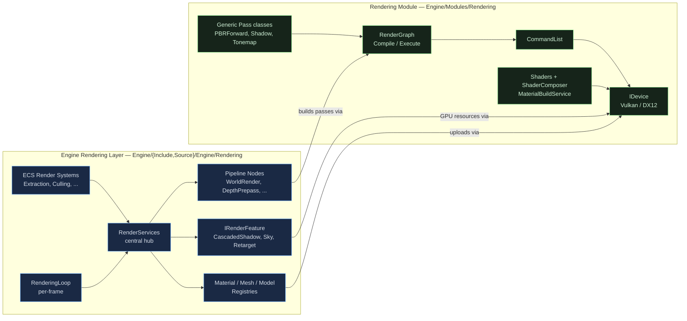
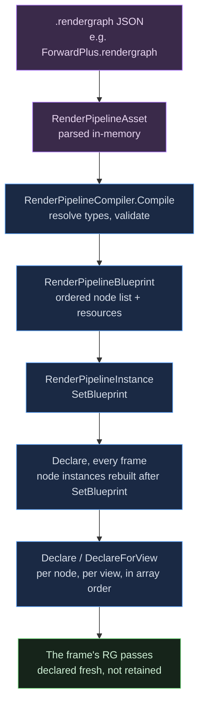
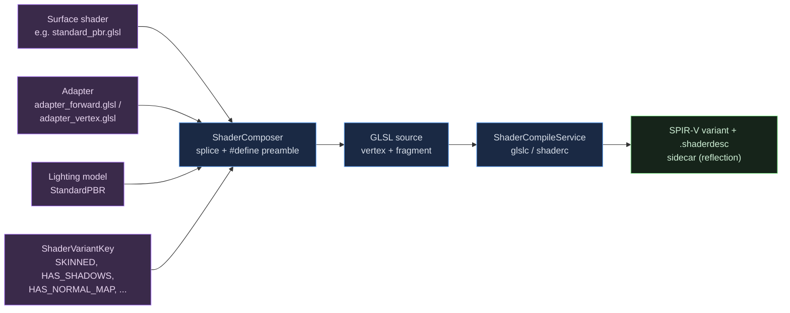

A comprehensive reference for the engine's graphics subsystems. Covers both the **Rendering module** (the low-level GPU/render-graph library) and the **Engine Rendering** layer (the orchestration that wires it to ECS, scenes, and assets). Intended as the primary reference for adding render passes, lighting models, screen-space effects, and raytracing.

Companion docs:

- [Render graph quick reference](render-graph.mdx): the immediate-mode render graph: API quick reference and doc pointers
- [Creating render pipelines](render-pipeline-authoring.mdx): authoring a `.rendergraph` pipeline
- [Your first surface shader](surface-shader-authoring.mdx): writing a custom lit surface from a project directory

## Two-tier architecture

The rendering code is split into two layers. **Where you add code depends on what you are adding.**



*Two-tier architecture: what flows between layers*

| Layer | Location | What lives here | What does NOT live here |
|---|---|---|---|
| **Rendering Module** | `Engine/Modules/Rendering/` | RenderGraph, IDevice (Vulkan/DX12 backends), generic Pass classes, ShaderComposer, MaterialBuildService, all GLSL shaders | Anything that knows about ECS, scenes, world state, or features |
| **Engine Rendering** | `Engine/Include/Engine/Rendering/` `Engine/Source/Engine/Rendering/` | RenderServices, RenderingLoop, IRenderFeature, MeshGPURegistry, MaterialRegistry, PerFrameWritePool, Pipeline Nodes, ECS render systems | Vulkan/DX12 backend code, generic GPU primitives, raw shader bytecode |

:::tip[Rule of thumb]

- New GPU/RG primitive (e.g. a new render graph helper, a new generic Pass class)? → Rendering module.
- New per-frame orchestration (e.g. a new feature like volumetric fog, or a new pipeline node type)? → Engine layer.
- New shader? → Always in `Engine/Modules/Rendering/Shaders/` regardless of which layer references it.

:::

## Rendering module

`Engine/Modules/Rendering/`: pure GPU library. CMake target `GameEngineRendering`. Includes are namespaced as `Rendering/...`.

### Directory layout

```text title="Engine/Modules/Rendering/ layout"
Engine/Modules/Rendering/
├── Include/Rendering/         # Public headers
│   ├── CameraTypes.h          # CameraData, ViewDesc, ViewId
│   ├── Common/                # Math, Frustum, MatrixUtils, Utils
│   ├── Core/                  # RenderGraph, Device, CommandList, pipeline cache, descriptors
│   ├── Geometry/              # VertexAttributeFlags, VertexLayoutBuilder
│   ├── Materials/             # MaterialBuilder, ShaderComposer, ShaderMeta, ShaderVariantKey
│   ├── Passes/                # Generic pass classes (PBRForward, Shadow, Tonemap, BRDFLut, etc.)
│   ├── ShaderCache/           # ShaderPackageIO (.shaderpkg format)
│   ├── ShaderGraph/           # Shader-graph compiler, node reflection, graph file IO
│   ├── Sky/                   # SkyRenderer, SkySettings, SkySystem
│   ├── Tests/                 # Test helpers
│   └── Utils/                 # BufferHelpers, IBLSet, RingBufferHelpers, TextureUploadHelpers
├── Source/                    # Implementations
│   ├── Common/, Core/, Materials/, Passes/, ShaderCache/, ShaderGraph/, Sky/
│   ├── Vulkan/                # Vulkan backend (primary)
│   └── DirectX12/, Metal/, WebGPU/   # Secondary backends
├── Shaders/                   # All GLSL — compiled to SPIR-V at build time
│   ├── Adapters/              # Composable adapter scaffolding (forward, vertex)
│   ├── Includes/              # Shared GLSL (clustered_lighting, shadow_sampling, standard_pbr)
│   ├── Sources/               # Common bases (fullscreen_noinput.vert, solidcolor.frag)
│   ├── Surfaces/              # Surface shader implementations (standard_pbr, unlit_solid)
│   ├── AmbientOcclusion/, Graph/, Ocean/, ScreenSpaceReflections/, ScreenSpaceShadows/, UI/   # Subsystem-specific shaders
│   ├── Slang/                 # Slang sources (types, HZB build)
│   └── (root)                 # Pass-specific shaders (bloom_*, shadow_depth, tonemap, etc.)
├── Tests/                     # gtest unit tests
├── TestSupport/               # Shared fixtures and harness helpers for those tests
├── Tools/                     # Developer tools
└── docs/                      # Architecture docs (this file's home)
```

### Core — `Include/Rendering/Core/`

The render graph and GPU abstraction. **This is where 80% of low-level work happens.**

| File | Purpose |
|---|---|
| `RenderGraph/RGFrame.h` | Public RG API: `RGFrame`, `RGPassBuilder`, `RGContext`, typed `RGTexture`/`RGBuffer`, attachment ops, imports (`ImportPersistent*`/`ImportExternal*`), `AllocUpload<T>`; core IR in `RenderGraph/RGGraph.h`, pools in `RenderGraph/RGResourcePool.h`/`RGTransientPool.h` |
| `Device.h` | `IDevice` interface — abstract GPU: device creation, swapchain, pipelines, descriptors, samplers, command lists. **All Vulkan/DX12 is hidden behind this** |
| `CommandList.h` | `CommandList` — bind pipelines, descriptor sets, draw, dispatch, copy, push constants |
| `Handle.h` | Generational handle types (PipelineHandle, SamplerHandle, BufferHandle, TextureHandle, etc.) |
| `BindlessResourceManager.h` | Bindless descriptor indexing — register textures into a global descriptor array for shader access by index |
| `BufferManager.h` | Buffer creation/destruction/upload helpers |
| `BufferRing.h` | Frame-in-flight rotating buffer (one per frame) |
| `DescriptorWriter.h` | Build descriptor set updates |
| `NamedDescriptorWriter.h` | Bind descriptors by name from `.shaderdesc` metadata (no index hardcoding) |
| `NamedPushConstantWriter.h` | Set push constants by member name from metadata |
| `FrameBufferAllocator.h` | Dynamic framebuffer allocation per pass |
| `GPUCulling.h` | GPU-driven frustum culling pipeline |
| `GPUScene.h` | GPU scene SSBO — instance transforms, materials, mesh metadata |
| `HotReloadIntegration.h` | Shader hot-reload plumbing |
| `LayoutCache.h` | Descriptor set layout dedup |
| `PipelineBuilder.h` | Fluent builder for `PipelineDesc` (apply shaderdesc, set shaders, fill formats, build) |
| `PipelineCache.h` / `IPipelineCache.h` | Pipeline state object (PSO) cache |
| `PipelineManager.h` | Manages live pipelines |
| `PipelineVariantCache.h` | Variant-keyed pipeline cache (per (shader, format, blend) combination) |
| `QueryPool.h` | GPU timestamp + occlusion queries |
| `RenderingDebugFlags.h` | The renderer's debug environment variables, read once (`GE_DEBUG_TRACE_RENDERING`, `GE_DEBUG_SRGB_ENCODE`) |
| `ResourceContainer.h` / `ResourceManager.h` | Resource lifetime tracking |
| `SamplerManager.h` | Sampler dedup (linear/point clamp/wrap, shadow compare, etc.) |
| `SpecializationConstants.h` | SPIR-V specialization constant helpers |
| `TextureManager.h` | Texture lifecycle |
| `ThreadingUtils.h` | Switch that forces single-threaded rendering for debugging |
| `RenderGraph/RGTransientPool.h` | Transient resource pool: a transient is acquired when the frame is realized and released at frame end, and a later frame reuses a free entry of the same description |

### Core — `Source/Core/`

Implementation. Most files here match a header one to one. The render graph itself splits across several files:

| File | Purpose |
|---|---|
| `RenderGraph/RGFrame.cpp` | Public frame layer: declaration, imports, realize, Execute, pool write-back |
| `RenderGraph/RGGraph.cpp` + `RGSchedule.cpp` | Core IR: ref-count cull, structural working-set scheduler (components/clusters) |
| `RenderGraph/RGBarriers.cpp` | Whole-frame barrier derivation over per-(mip,layer) subresource cells |
| `RenderGraph/RGRecord.cpp` | Command recording: per-pass batches, first-touch hoist, physical-queue submits |
| `RenderGraph/RGResourcePool.cpp` + `RGTransientPool.cpp` + `RGUploadRing.cpp` | Cross-frame pool (layout carry, age eviction), transient reuse, the per-frame upload ring |

### Vulkan and DirectX12 backends

`Source/Vulkan/` and `Source/DirectX12/` implement `IDevice`, `CommandList`, swapchain, memory, resources, descriptors, etc. **You almost never touch these directly**: extend through the abstract interfaces unless adding new GPU features (e.g. RT extensions).

Vulkan is the primary backend. DX12 is secondary and may lag in feature coverage.

### Materials — `Include/Rendering/Materials/`

The composer-based shader system. Materials are JSON documents that select a surface shader, lighting model, and properties. The composer glues a *surface* shader (artist-authored), an *adapter* (engine-authored scaffolding), and a *lighting model* into a compilable shader source per variant.

| File | Purpose |
|---|---|
| `MaterialDocument.h` | In-memory material representation (parsed from `.material` JSON) |
| `MaterialBuilder.h` | Builder for constructing `MaterialDocument` |
| `MaterialBuildService.h` | **Compiles materials into SPIR-V variants.** Owns the pipeline of compose → glslc → reflect → emit |
| `MaterialHelper.h` | Utility functions for material binding |
| `MaterialPropertyBinding.h` | Property-to-uniform binding |
| `MaterialValidation.h` | Validation rules |
| `MaterialAlphaMode.h` | `enum class MaterialAlphaMode { Opaque, Masked, Blended }` |
| `ReflectionCache.h` | SPIR-V reflection results cache |
| `ShaderCapabilityDetector.h` | Detects what features a shader uses (skinning, shadows, etc.) |
| `ShaderCompileService.h` | glslc/shaderc invocation, error handling |
| `ShaderComposer.h` | Composes adapter + surface + lighting model into final source. **Stateless string utility** |
| `ShaderMeta.h` / `ShaderMetaJson.h` / `ShaderMetaValidation.h` | `.shaderdesc` sidecar: descriptor set layouts, push constants, entry points |
| `ShaderReflection.h` | SPIR-V reflection (descriptor sets, push constants) |
| `ShaderVariantKey.h` | Bitmask key identifying a shader variant (e.g. `HAS_SHADOWS \| HAS_NORMAL_MAP \| SKINNED`) |

### Passes — `Include/Rendering/Passes/`

Generic, reusable pass *classes* (implement `IRenderGraphPass`). These are the low-level building blocks. The engine layer wraps them or calls them from pipeline nodes.

| File | What it does |
|---|---|
| `TonemapPass.h` | HDR → LDR tone mapping (ACES, Reinhard, etc.) |
| `SRGBEncodePass.h` | Manual sRGB encode (when swapchain is UNORM) |

### Geometry — `Include/Rendering/Geometry/`

| File | Purpose |
|---|---|
| `VertexAttributeFlags.h` | Bitmask of vertex attributes (Position, Normal, Tangent, UV0, Color, BlendIndices, BlendWeights, etc.) |
| `VertexLayoutBuilder.h` | Builds Vulkan vertex input bindings from `VertexAttributeFlags` |
| `ShapeBuilder.h` | Primitive generation (box, sphere, etc.) — low-level |

### Sky — `Include/Rendering/Sky/`

Atmospheric sky rendering: tier1 (analytic) and tier2 (LUT-driven physically-based). Used by `SkyRenderFeature` in the engine layer.

### Utils — `Include/Rendering/Utils/`

| File | Purpose |
|---|---|
| `BufferHelpers.h` | Buffer creation/upload boilerplate |
| `IBLSet.h` | Image-based lighting cubemap pair (diffuse + specular + BRDF LUT) |
| `RingBufferHelpers.h` | Frame-in-flight ring buffer operations |
| `TextureUploadHelpers.h` | Texture data upload |

### Shaders — `Engine/Modules/Rendering/Shaders/`

All GLSL. Compiled at build time to `.spv` via `shaderc` (vcpkg dep). The build emits shader package archives (`.shaderpkg`) that bundle SPIR-V + reflection + metadata.

**Naming convention:** `<name>.vert`, `<name>.frag`, `<name>.comp` for raw shaders. `<name>.glsl` for surfaces, adapters, and includes (no entry point: meant to be composed).

| Subdirectory | Contents |
|---|---|
| `Adapters/` | `adapter_forward.glsl` (forward fragment scaffolding), `adapter_vertex.glsl` (vertex scaffolding with skinning/instancing variants). Surface shaders are spliced into these. |
| `Includes/` | Shared GLSL inclusions: • `clustered_lighting.glsl` — Forward+ cluster traversal (`GE_AccumulateClusteredLighting`) • `shadow_sampling.glsl` — PCF/PCSS shadow filtering (`GE_SampleShadow`) • `standard_pbr.glsl` — PBR BRDF (`GE_EvaluateStandardPBR`) • `surface_io.glsl`, `vertex_output.glsl`, `instance_io.glsl`, `bone_palette.glsl` |
| `Surfaces/` | Surface shaders (artist or engine-level): `standard_pbr.glsl`, `standard_pbr_extended.glsl`, `unlit_solid.glsl`, `volumetric_six_axis.glsl` |
| `Terrain/` | Terrain-specific vertex/surface shaders |
| `UI/` | UI-specific (SDF, glyph) shaders |
| `Sources/` | Common bases: `fullscreen_noinput.vert` (3-vertex fullscreen triangle), `solidcolor.frag` |
| (root) | Pass-specific shaders. Notable ones: `clustered_light_cull.comp`, `shadow_depth_shared.vert` / `shadow_depth_shared_skinned.vert` (depth-only cascade VS, reads BonePaletteAtlas), `pbr_forward.vert`/`.frag`, `forwardplus_lighting.frag`, `bloom_*`, `tonemap.frag`, `evsm_*`, `cas.frag`, `crt.frag`, `frustum_culling.comp`, `draw_command_scatter.comp`, `visibility_compaction.comp`, `depth_reduce.comp`, `sky_*` |

## Engine rendering layer

`Engine/Include/Engine/Rendering/` (headers) and `Engine/Source/Engine/Rendering/` (implementations). CMake target is part of `Engine` (the static library).

### Top-level orchestration

| File | Purpose |
|---|---|
| `RenderServices.h/.cpp` | **The central hub.** Owns `RenderGraph`, `GPUScene`, `BindlessResourceManager`, view registries, mesh/material registries, animation/skinning state. Passed to every feature and node. |
| `RenderingLoop.cpp` | The per-frame loop: extract ECS → build RG → compile → execute → present |
| `RenderDeviceContext.h/.cpp` | Bridges `IDevice` setup with the engine's lifecycle |

### Features — `IRenderFeature` pattern

`IRenderFeature` is a marker interface (`Engine/Include/Engine/Rendering/IRenderFeature.h`). A *feature* owns persistent rendering state (GPU resources, settings, cached data) that survives across frames. Features are registered with `RenderServices`. The pipeline nodes consult features when building passes.

**Existing features:**

| File | Purpose |
|---|---|
| `ShadowMapRenderFeature.h/.cpp` | Shadow maps (cascades and local lights): splits, light VP matrices, PCF/PCSS/SDSM state, per-view shadow textures, bindless registration |
| `SkyRenderFeature.h/.cpp` | Sky LUTs (transmittance, view, multiscatter), star fields, environment cubemaps |
| `RetargetRenderFeature.h/.cpp` | Animation retargeting (humanoid skeleton remap) state and dispatch |

### Material and mesh registries

| File | Purpose |
|---|---|
| `Material.h/.cpp` | Engine-level material instance (binds to a `MaterialDocument` + per-instance overrides) |
| `MaterialRegistry.h/.cpp` | GUID-keyed registry of compiled materials. Owns `MaterialCompiler` |
| `MaterialCompiler.h/.cpp` | Drives `MaterialBuildService` from the engine side; manages variant compilation |
| `MaterialCompileSpec.h` | The spec submitted to the compiler |
| `MeshGPURegistry.h/.cpp` | GUID-keyed registry of GPU mesh buffers (vertex/index VBO/IBO). Dedup by GUID |
| `ModelEntityFactory.h/.cpp` | Creates ECS entities from ModelAssets |
| `ModelMaterialBridge.h/.cpp` | Connects model material slots to MaterialRegistry instances |
| `ModelRenderSetup.h/.cpp` | Per-model GPU setup |

### Draw batching and submission

| File | Purpose |
|---|---|
| `WorldDrawTypes.h` | `WorldSubmissionRecord`: the unit of work submitted per frame |
| `PerFrameWritePool.h` | Double-buffered shared SSBOs for per-frame data (instance transforms, material params, bone palettes) |
| `RenderOrigin.h` | Camera-relative rendering (Earth-scale precision): derives the per-view render origin (integer sector + fp32 local) from the camera, packs each instance's sector into `GPUInstance`, and provides the rebased view/view-proj the vertex stage projects render-origin-relative positions through. Inactive (sector 0) inside the activation radius ⇒ byte-identical to the full-world path |

### Animation / skinning (GPU)

| File | Purpose |
|---|---|
| `AnimationComputePass.h/.cpp` | The GPU skinning compute pass |
| `AnimationSampling.h/.cpp` | CPU clip sampling |
| `BonePaletteLayout.h` | GPU bone palette layout |
| `ClipStore.cpp` | Animation clip storage |
| `GPUAnimationDataStore.h/.cpp` | GPU-side animation data |
| `SkeletonStore.cpp` | Skeleton hierarchies |
| `SkinPaletteAtlas.h` | Atlased per-instance bone palettes |
| `RetargetFullPass.h/.cpp` | Full-skeleton retargeting compute |
| `RetargetGPUDataStore.h/.cpp` | Retarget GPU data |
| `RetargetSubmission.h/.cpp` | Retargeting submission record |

### View and camera

| File | Purpose |
|---|---|
| `Camera.h/.cpp` | Camera object (matrices, frustum) |
| `CameraUtils.h` | Helpers (lookAt, perspective, etc.) |
| `ViewReadbackUtils.h/.cpp` | Readback helpers (e.g. depth → CPU for picking) |

### Other utilities

| File | Purpose |
|---|---|
| `PostProcessSettings.h/.cpp` | Post-process volume settings (bloom intensity, tonemap mode, color grading) |
| `PrimitiveGenerator.h/.cpp` | Procedural primitives (sphere, box) at the engine level |
| `ShaderCompilationCache.h/.cpp` | Cache for compiled shader variants |
| `SkinDiag.h` | Diagnostics for skinning |

### Pipeline (data-driven render graph) — `Engine/{Include,Source}/Engine/Rendering/Pipeline/`

The system that loads `.rendergraph` JSON and turns it into RG passes.

| File | Purpose |
|---|---|
| `RenderPipeline.h/.cpp` | `RenderPipelineCompiler`, `RenderPipelineInstance`, `RenderPipelineBlueprint`, `RenderPipelineNodeRegistry` — the loader/dispatcher |
| `RenderPipelineNodes.h` | `IRenderPipelineNode` interface, the `ViewDeclare` per-view context, registry types |
| `ExpressionEvaluator.h/.cpp` | Evaluates expressions in JSON (e.g. `"ceil(renderWidth / 16)"`) |
| `Nodes/DepthPrepassNode.h/.cpp` | "DepthPrepass" type — clears + renders world depth |
| `Nodes/ViewParamsUploadNode.h/.cpp` | "ViewParamsUpload" — uploads per-view UBO (matrices, camera pos) |
| `Nodes/LightUploadNode.h/.cpp` | "LightUpload" — uploads the light SSBO |
| `Nodes/ShadowMapNode.h/.cpp` | "ShadowMap" (legacy alias "CascadedShadowMap", deprecated) — renders all shadow families (cascades + area/spot/point) |
| `Nodes/SkyRenderNode.h/.cpp` | "SkyRender" — sky atmosphere render |
| `Nodes/WorldRenderNode.h/.cpp` | "WorldRender" — main forward-pass world geometry |
| `Nodes/ComputeShaderNode.h/.cpp` | "ComputeShader" — JSON-configured generic compute dispatch (used for cluster cull, etc.) |
| `Nodes/FullscreenShaderNode.h/.cpp` | "FullscreenShader" — JSON-configured generic fullscreen pass (used for all post-process effects) |
| `Nodes/PipelineNodeUtils.h` | Helper utilities (sampler resolution, attachment ops, etc.) |

### ECS systems — `Engine/Source/Engine/Rendering/Systems/`

Render-related ECS systems. These run during the world update. Their outputs feed `RenderServices`.

| File | Purpose |
|---|---|
| `RegisterRenderingSystems.cpp` | Registers all rendering ECS systems with the world |
| `TransformHierarchySystem.cpp` | Propagates parent→child transforms |
| `CameraSystem.cpp` | Updates camera matrices from Transform |
| `RenderExtractionSystem.cpp` | **Extracts ECS state into RenderServices each frame** (lights, draws, view targets) |
| `RenderGraphBuildSystem.cpp` | **Builds the render graph from the pipeline blueprint** each frame |
| `AnimationSystem.cpp` | Animation playback |
| `RigidAnimationSystem.cpp` | Non-skinned animation |
| `HumanoidRetargetSystem.cpp` | Humanoid retargeting |
| `SkinningUploadSystem.cpp` | Uploads bone palettes to GPU |
| `SkyEnvironmentSystem.cpp` | Sky environment updates (sun angle, time of day) |

## The render graph

The render graph is **immediate-mode**: the whole frame graph is declared fresh each frame into a bump arena (the graph's `Memory::Arena`), compiled in one sweep, executed, and reset. There is no retained pass state, no enable/disable/invalidate, no incremental compile. A pass that should not run this frame is not declared. Core: `Engine/Modules/Rendering/{Include/Rendering/Core,Source/Core}/RenderGraph/`.

- **Declaration**: `RGFrame` + `RGPassBuilder` (typed `RGTexture`/`RGBuffer` handles, dense per-frame ids; no hash maps or string keys in the hot path).
- **Cull**: ref-count backward reachability from sinks; every culled pass records an `RGCullReason` surfaced over MCP.
- **Schedule**: structural working-set scheduler: weakly-connected hazard components emit contiguously (the TBDR interleave fix, by construction), identical-attachment clusters group within a component, contraction stalls split-and-retry. Deterministic integer tiebreaks.
- **Barriers**: whole-frame derivation over per-(mip,layer) subresource cells with per-physical-queue reader coverage; **per-pass batched** calls plus a submission-front hoist of first-touch (init/import-sync) barriers. Imports enter at their pool-tracked layout and final layouts write back to the pool.
- **Submission**: passes partition by **physical** queue (the production default map collapses all logical queues onto one graphics submission; async compute is an explicit opt-in map) with monotonic timeline-semaphore sync.

Design rationale, comparison with other engines' render graphs, and measured claims live in the support repository as “Render Graph Redesign — Immediate-Mode, Arena-Backed, Queue-Aware”. Quick reference: [Render graph quick reference](render-graph.mdx).

## The data-driven pipeline

The canonical pipeline is JSON: `Engine/Assets/RenderPipelines/ForwardPlus.rendergraph`. The Editor loads it at startup (default editor scene) or whenever a project specifies one. Each entry in `passes[]` has a `type` string that maps to a pipeline node class.



*Data-driven pipeline load flow*

### Schema overview

```jsonc title="The pipeline schema"
{
  "schemaVersion": 2,
  "pipelineName": "ForwardPlus",
  "outputs": {
    "FinalColor": "View.Resolve"
  },
  "resources": {
    "BloomA": {
      "kind": "Texture",
      "format": "R16G16B16A16_FLOAT",
      "scope": "PerView",
      "extent": { "scale": [0.5, 0.5] },
      "usage": ["RenderTarget", "ShaderResource"]
    },
    "ClusterBuffer": {
      "kind": "Buffer",
      "memoryUsage": "DeviceLocal",
      "scope": "PerView",
      "size": {
        "expression": "clustersX * clustersY * depthSlices * clusterDataBytes",
        "variables": {
          "clusterDataBytes": 16,
          "clustersX": "ceil(renderWidth / tileSizeX)",
          "clustersY": "ceil(renderHeight / tileSizeY)",
          "depthSlices": 24,
          "tileSizeX": 16,
          "tileSizeY": 16
        }
      },
      "usage": ["Storage", "ShaderResource", "CopyDestination"]
    }
  },
  "passes": [
    {
      "id": "DepthPrepass",
      "type": "DepthPrepass",
      "enabled": true
    },
    {
      "id": "BloomBlurH",
      "type": "FullscreenShader",
      "shaderPkg": "Shaders/bloom_blur_h.shaderpkg",
      "inputs":  { "uSrc": "BloomA" },
      "output":  "BloomB",
      "samplers": { "uSrc": "LinearClamp" }
    },
    {
      "id": "ClusteredLightCull",
      "type": "ComputeShader",
      "shaderPkg": "Shaders/clustered_light_cull.shaderpkg",
      "buffers": {
        "ClusterBuffer": "ClusterBuffer",
        "LightBuffer":   "LightBuffer",
        "ViewParams":    "ViewParams"
      },
      "bufferUsages": {
        "ClusterBuffer": "StorageWrite",
        "LightBuffer":   "StorageRead",
        "ViewParams":    "ConstantBuffer"
      },
      "dispatch": { "x": "ceil(renderWidth / 16)", "y": "ceil(renderHeight / 16)", "z": 1 }
    }
  ]
}
```

### Resource scope

| Scope | Meaning |
|---|---|
| `PerView` | One instance per camera/view. Necessary for view-dependent buffers (ClusterBuffer, ViewParams). |
| `Frame` | One instance per frame (shared by all views) |
| `Persistent` | Survives across frames (e.g. accumulation buffers) |

### Pass ordering in JSON

The order of the `passes` array is the order of the frame: the pipeline declares its passes in array order, and the render graph derives the dependencies from the resources each pass reads and writes. Put a producer before its consumers. `"phase"` (a name or an integer) is only a tiebreak among passes that are otherwise ready to run. `"tags"` and `"after"` are read from the file but have no effect on the order, and `"afterTag"` is not read at all. See [Pass order](customizable-render-pipeline.mdx#pass-order).

### Built-in node types

| Type | Node class | What it does |
|---|---|---|
| `DepthPrepass` | `DepthPrepassNode` | Renders world depth |
| `ViewParamsUpload` | `ViewParamsUploadNode` | Uploads per-view UBO |
| `LightUpload` | `LightUploadNode` | Uploads light SSBO from extracted lights |
| `ShadowMap` (legacy alias `CascadedShadowMap`) | `ShadowMapNode` | Renders all shadow families (cascades + area/spot/point) + uploads shadow UBO |
| `SkyRender` | `SkyRenderNode` | Renders sky atmosphere |
| `WorldRender` | `WorldRenderNode` | Forward-pass world geometry with material binding |
| `TerrainUpload`, `CBTRender`, `TerrainGrass` | (terrain module nodes) | Upload the terrain's per-frame data, render the CBT terrain and its grass |
| `ComputeShader` | `ComputeShaderNode` | Generic compute dispatch — bind buffers/textures, dispatch with expression-evaluated sizes |
| `FullscreenShader` | `FullscreenShaderNode` | Generic fullscreen pass — bind inputs/samplers/push constants, draw 3-vertex triangle |

**To add a new pass type:** implement an `IRenderPipelineNode` subclass and register it. Drop a JSON entry referring to that type. See the [Recipes](#writing-a-render-pass-recipes) section below.

## Materials and shader composition

### The composition model

A material does not *contain* shader source. It *references*:

1. A **surface shader** (e.g. `Surfaces/standard_pbr.glsl`)
2. A **lighting model** (currently `StandardPBR`)
3. Properties (textures, scalars, vectors)

At compile time, `ShaderComposer` (`ShaderComposer.h`) emits two GLSL strings (vertex + fragment) by:

1. Selecting an **adapter** (`Adapters/adapter_forward.glsl`, `Adapters/adapter_vertex.glsl`) based on the `ShaderVariantKey`
2. Generating a `#define` preamble for the variant key (e.g. `#define HAS_SHADOWS 1`, `#define SKINNED 1`)
3. `#include`-ing the surface shader and the lighting model GLSL
4. Returning the two strings

`MaterialBuildService` (`MaterialBuildService.h`) then drives glslc to compile each variant into SPIR-V, with reflection sidecars.



*Shader composition pipeline*

### Adding a new path (e.g. GBuffer adapter)

To make every surface shader gain a deferred path, **add a new adapter**:

1. Create `Engine/Modules/Rendering/Shaders/Adapters/adapter_gbuffer.glsl`
2. In the adapter, declare MRT outputs (`layout(location=0..3) out vec4 ge_outGBuffer0..3;`) and call the surface shader's interface functions to fill them
3. Modify `ShaderComposer::Compose` to select this adapter when a new variant flag (e.g. `RENDER_PATH_DEFERRED`) is set
4. Materials referencing the same surface shader will now compile both forward and deferred variants automatically when both variant keys are requested

### `.shaderdesc` sidecars

Built shaders emit a `.shaderdesc` file alongside the SPIR-V. It contains:

- Descriptor set layouts (set, binding, type, name)
- Push constant ranges and member names
- Entry point info

:::tip[Recommendation]

This metadata enables binding by name via `NamedDescriptorWriter` and `NamedPushConstantWriter`, eliminating fragile hardcoded indices. Use it for any custom pipeline.

:::

### Variant keys

`ShaderVariantKey` is a bitmask defined in `ShaderVariantKey.h`. Examples of common bits:

- `SKINNED`: vertex shader receives bone indices/weights
- `HAS_SHADOWS`: fragment samples shadow map
- `HAS_NORMAL_MAP`: fragment uses normal map
- `INSTANCED`: vertex shader reads instance data from SSBO
- `ALPHA_TEST`: fragment discards on alpha threshold

A material can request multiple variants (e.g. one with shadows, one without). They are compiled lazily as needed.

## Vulkan conventions

:::danger[Memorize these]

The engine uses non-default Vulkan conventions for performance and correctness. They will bite you on day one if you forget.

:::

### Coordinate system

- **Left-handed**, Z+ forward, Y+ up
- Use `MakeLookAtLH` / `MakePerspectiveLH_ZO_ReverseZ` / `MakeOrthographicLH_ZO_ReverseZ` from `Mathematics`

### Reverse-Z

- NDC depth still `[0, 1]` but inverted: **near → 1.0, far → 0.0**
- Depth buffer is **D32_SFLOAT** (D24_UNORM is a precision regression under reverse-Z)
- Default depth clear: `0.0` (= far)
- Default `depthCompareOp`: `GreaterOrEqual`
- Shadow comparison sampler: `GreaterOrEqual`

### Shadow bias

- Depth bias constants are **negative** (push fragments toward 0.0)
- Receiver bias is **added** to NDC depth (not subtracted as in forward-Z)

### Negative viewport height

- The Vulkan viewport uses negative height (via `VK_KHR_maintenance1`) so Y is up at the framebuffer level
- This means shadow UV sampling needs `shadowUV.y = 1.0 - shadowUV.y` to compensate when sampling into a shadow map that was not rendered with the flip

### Camera-relative rendering (Earth-scale precision)

- The render origin is expressed as an **integer sector + fp32 local** derived from the camera each frame (`RenderOrigin.h`). It is *not* a global re-shift: each instance stores its own sector (packed into the two reserved `GPUInstance` words) and the vertex stage differences it against the camera's sector, so a moving camera re-uploads only the CameraUBO. The persistent, change-tracked instance buffer is untouched (quiescence preserved)
- The `CameraUBO` carries rebased view / view-proj (built from the camera's sector-local position) plus the origin sector; the vertex stage projects a render-origin-relative position through them for a fp32-precise clip position, while `vPosWS` stays full world for the fragment stage (lighting / shadows / fog are world-space this slice)
- Inactive (sector 0) inside the activation radius ⇒ the shader takes the full-world path, byte-identical to the pre-feature build. Kills far-from-origin vertex jitter / z-fighting for meshes out to planetary radius. Terrain (CBT), shadow-map precision, and clustered-light precision are the documented follow-up slices

## Writing a render pass (recipes)

Passes are declared fresh every frame against `RGFrame` (immediate mode: a pass that should not run is simply not declared). The declaration lambda states every access. Barriers, ordering, and culling are derived from those declarations. Execute lambdas capture **by value** and record through `RGContext`.

```cpp title="A raster pass and a compute pass"
// Raster pass: attachments + declared reads. LoadOp::Load derives a READ edge
// (depth test and blending read prior contents — this keeps the producer alive).
frame.AddPass("DepthPrepass", PassPhase::kEarlySetup,
    [&](RenderGraph::RGPassBuilder& p) {
        p.AttachDepth(depth, {.Load = LoadOp::Clear, .ClearDepth = 0.0f /* reverse-Z far */});
        p.Read(cameraUbo, RenderGraph::RGBufferRead::Uniform);
    },
    [=](RenderGraph::RGContext& ctx) { /* record draws via ctx.Cmd */ });

// Compute pass: declared storage accesses drive the barriers; no manual sync.
frame.AddPass("LightCull", PassPhase::kEarlySetup,
    [&](RenderGraph::RGPassBuilder& p) {
        p.Read(depthPyramid, RenderGraph::RGTextureRead::SampledCompute);
        p.Write(lightList,   RenderGraph::RGBufferWrite::Storage);
    },
    [=](RenderGraph::RGContext& ctx) { ctx.Dispatch(gx, gy, 1); });
```

Cross-frame resources are imported per frame: `ImportPersistentTexture/Buffer` (pool-owned, layout carried across frames), `ImportExternalTexture/Buffer` (engine-owned, no write-back). A small history one queue writes and another reads is one copy per frame in flight (`perFrameCopies` on a render pipeline resource). Per-frame CPU constants come from `AllocUpload<T>()` (one upload ring; there is no `perFrame` flag). A consume-only pass (queries, readback) uses `PreventCulling()`. Everything else survives by feeding a sink (`MarkOutput`/present/export).

Living examples: the render graph tests under `Engine/Modules/Rendering/Tests/RenderGraph/` and the pipeline nodes under `Engine/Source/Engine/Rendering/Pipeline/Nodes/` (post-FX stages share `FullscreenShaderNode::DeclareForView`).

## Resource lifecycle and bindless

### Transient and persistent

|  | Transient | Persistent |
|---|---|---|
| Frame lifetime | Single frame, reset every frame | Lives across frames |
| Memory | Pooled: reused by a later frame when a free entry of the same description exists; never shared by two transients of one frame | Dedicated |
| Use cases | Intermediate render targets, scratch buffers | Accumulation buffers, IBL LUTs, BRDF LUTs, shadow maps |
| Setup flag | Default | `desc.persistent = true` |

Transients are pooled across frames, not aliased within a frame: an entry stays in use until the frame ends, so two transients of one frame never share memory, and a later frame reuses a free entry of the same description. A transient therefore holds whatever an earlier frame left in it until a pass writes it this frame. Each window frame owns its own pool.

### PerFrameWritePool

`PerFrameWritePool` (`PerFrameWritePool.h`) is the engine's shared SSBO ring for per-frame data:

- N `BufferRing` instances (one per frame-in-flight)
- Stable binding ranges allocated each frame and read by shaders
- Used for instance transforms, per-material params, bone palettes, light data

When you need to upload data the GPU will consume this frame and discard, this is the path.

### Bindless

`BindlessResourceManager` (`BindlessResourceManager.h`) maintains a large descriptor array (1000s of slots) indexed by `uint32_t`. Use it for:

- Texture atlases where shaders need arbitrary lookup by index
- PCSS raw-depth registration (shadows already use this)
- Future GBuffer texture pools, virtualized shadow maps, ray-traced texture sampling

Each registered resource gets a stable index. Indices are *not* sequential: the allocator may recycle parked-free slots.

### Frame-in-flight isolation

- Command buffers per frame
- Per-frame fences + timeline semaphores guard cross-queue ordering
- Resources are kept alive (deferred destroy) until the GPU finishes them

## Debugging

### Environment variable flags (one-time init)

| Variable | Effect |
|---|---|
| `GE_DEBUG_TRACE_RENDERING=1` | Full render graph compile and execute trace |
| `GE_DEBUG_SRGB_ENCODE=1` | sRGB encode diagnostic logging |

Source: `Engine/Modules/Rendering/Include/Rendering/Core/RenderingDebugFlags.h`, which reads both once per process.

### Editor panels

When the Editor is running:

- **RenderGraph panel**: live pass list, resource list, barrier list, per-frame stats
- **VRAM panel**: GPU memory usage by resource
- **CPU Profiler panel**: per-frame CPU timings
- **Visual Profiler panel**: per-pass GPU timings (from QueryPool)
- **Monitors panel**: runtime counters

### The golden rule for debugging GPU bugs

:::caution[Start with data, not math]

When shadows/lighting/anything visual is wrong, the most common cause is a data pipeline issue (wrong buffer bound, stale descriptor, aliased memory), not a math error. Write a known test value to the suspect buffer and check whether the output changes. Once you know whether the GPU is reading what you think, *then* debate the math.

:::

A render graph transient holds what an earlier frame left in it until a pass writes it: if a GPU-only buffer produces stale results, look for a pass that reads it before it is written this frame (the [GPU debugging guide](gpu-debugging-guide.mdx#a-target-read-before-its-first-write-ge_vk_fill_new_targets_nan1) shows how to catch one).

See [GPU debugging guide](gpu-debugging-guide.mdx) for the full playbook.

### Common pitfalls

:::danger[Easy-to-miss bugs]

- **Forgetting `p.PreventCulling()` on a consume-only pass**: ref-count cull removes passes whose outputs reach no sink (readback/query/diagnostic passes need it)
- **Capturing frame-local ids across frames**: `RGTexture`/`RGBuffer` ids are valid only for the `RGFrame` that created them. Re-import/re-declare each frame and guard cached ids with frame identity
- **Stale `.shaderdesc`**: after editing a shader's descriptor layout, rebuild to regenerate the sidecar (otherwise `NamedDescriptorWriter` resolves stale bindings)
- **Wrong asset mount**: editor reads from `build/<preset>/bin/<config>/Apps/Editor/Assets/`, NOT from `Apps/Editor/Assets/` in the repo. Edit the staged copy for hot-reload.

:::

## Quick reference

### Where to put a new...

| Adding... | Goes in |
|---|---|
| New shader (any kind) | `Engine/Modules/Rendering/Shaders/` (root, or appropriate subdir) |
| Generic reusable pass class | `Engine/Modules/Rendering/Include+Source/Rendering/Passes/` |
| Pass type for `.rendergraph` JSON | `Engine/{Include,Source}/Engine/Rendering/Pipeline/Nodes/` |
| Stateful engine subsystem (LUTs, settings, caches) | `Engine/{Include,Source}/Engine/Rendering/` (`IRenderFeature`) |
| ECS system that contributes to rendering | `Engine/Source/Engine/Rendering/Systems/` |
| New surface shader | `Engine/Modules/Rendering/Shaders/Surfaces/` |
| New GLSL include (shared utility) | `Engine/Modules/Rendering/Shaders/Includes/` |
| New adapter (e.g. GBuffer path) | `Engine/Modules/Rendering/Shaders/Adapters/` |
| Vulkan/DX12 backend feature | `Engine/Modules/Rendering/Source/Vulkan/` or `Source/DirectX12/` |

### Common file paths

| Need to... | Open |
|---|---|
| Understand the main pipeline | `Engine/Assets/RenderPipelines/ForwardPlus.rendergraph` |
| Modify cluster cull | `Shaders/clustered_light_cull.comp` |
| Modify cluster light traversal in fragment shaders | `Shaders/Includes/clustered_lighting.glsl` |
| Modify shadow filtering | `Shaders/Includes/shadow_sampling.glsl` |
| Tune shadow CPU side (cascade splits, PCSS, SDSM) | `Engine/Include/Engine/Rendering/ShadowMapRenderFeature.h` |
| Modify PBR BRDF | `Shaders/Includes/standard_pbr.glsl` |
| Modify post chain | `Engine/Assets/RenderPipelines/ForwardPlus.rendergraph` (JSON) — or edit `bloom_*.frag`, `tonemap.frag` |
| See how world geometry submits draws | `WorldRenderNode.cpp` |
| See how shadow maps are rendered | `ShadowMapNode.cpp` |
| Add a fullscreen post effect (pure JSON) | Edit ForwardPlus.rendergraph; type=`FullscreenShader` |

### Recipe selection cheatsheet for your task list

| Task | Approach |
|---|---|
| **Modify shadows** (PCF kernel, bias, PCSS params, cascade lambda) | Edit `shadow_sampling.glsl` (staged copy) for filter; edit `ShadowMapRenderFeature.cpp` for cascade math; runtime knobs already exist as setters on the feature class |
| **Add GBuffer pass (deferred)** | New `GBufferNode` (pipeline node) with multi-RT outputs; new `adapter_gbuffer.glsl` so any surface gains deferred path; new resources in JSON; replace `WorldRender` entry with `GBuffer + DeferredLighting` |
| **Deferred lighting pass** | New `FullscreenShader` JSON entry referencing a new `deferred_lighting.frag` that samples GBuffer + reuses cluster + shadow bindings (read `forwardplus_lighting.frag` as template) |
| **SSAO** | Recipe 2 (Pipeline Node) reading `View.Depth` + GBuffer normal, writing a half-res AO target — or even pure JSON via `FullscreenShader` type if no special logic needed |
| **Raytracing** | Recipe 3 (Render Feature) + pipeline node. Verify `IDevice` exposes RT extension (`kRayTracing`). There is no GPU TLAS yet: `SceneTlas` in `Engine/Modules/Scene` is a CPU BVH for editor picking, not an acceleration structure, so the feature builds its own. RT shaders may need a new compile path (current pipeline is Vulkan-GLSL via shaderc — verify if `.rgen/.rchit/.rmiss` GLSL is supported or if HLSL is required) |

*This guide is meant to be living. When you add a major subsystem, add a row to the file catalogs and a recipe section if appropriate.*
