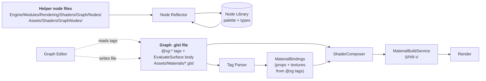
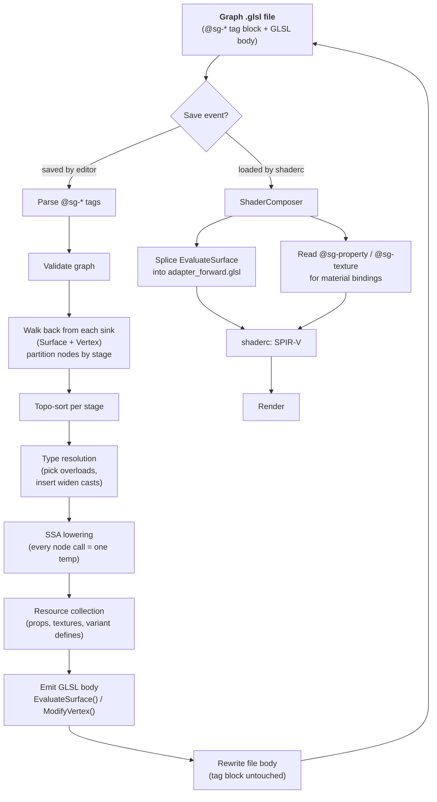

A shader graph is two kinds of file: one self-describing `.glsl` file per graph, plus a library of helper `.glsl` node files. This page is the reference for both: the tags they carry, the type rules, the endpoints, and how the compiler turns them into SPIR-V. The runtime UX of the graph editor is out of scope here. This document is about the *files* and the *compiler*.

:::note[North star]

The graph file *is* the shader file. A user-authored graph serializes its topology as structured `// @sg-*` comments at the top of a regular `.glsl` file. The rest of the file is human-readable GLSL, the compiled body of `EvaluateSurface()` (and optionally `ModifyVertex()`), regenerated by the graph editor every time the graph is saved. shaderc reads the same file as ordinary GLSL and produces SPIR-V. The editor parses the `@sg-*` tags to reconstruct the node UI. One file, two readers, zero sidecars.

:::

## 1. Where this fits

The engine already has a material composition pipeline. A surface shader is a `.glsl` file that implements:

```glsl title="The function a surface shader implements"
SurfaceOutput EvaluateSurface(SurfaceInput sIn);
```

`ShaderComposer` splices that into the engine's forward adapter (`Engine/Modules/Rendering/Shaders/Adapters/adapter_forward.glsl`), adds lighting, shadows, Forward+ clustered light traversal, and produces SPIR-V via `MaterialBuildService`. The graph plugs in *here*:



:::tip[Renderer-blind]

The graph compiler produces a `SurfaceOutput`-yielding function and a list of properties / textures / variant defines. That contract is renderer-agnostic. Whichever adapter the engine picks up at SPIR-V time (forward+ today, deferred / mobile / whatever tomorrow) consumes it. We do **not** need to invent a new material system, a new texture-binding system, a new descriptor layout, or a new render pass.

:::

## 2. The graph file

A **graph file** is a plain `.glsl` file under `<project>/Assets/Materials/**/*.glsl` that contains a graph header (`@sg-graph` tag in its top comment block) followed by a regenerated GLSL body implementing `EvaluateSurface()` and, optionally, `ModifyVertex()`.

### 2.1 Discovery

Files are graph files iff their leading comment block contains `// @sg-graph <name>`. No special extension, no sidecar. The asset registry's existing `.glsl` handler is extended to peek at the first ~50 lines on import: if it sees `@sg-graph`, the file is registered as a graph asset (parsed for tags, exposed to the graph editor) *and* as a shader source (passed to `ShaderComposer` + `MaterialBuildService`). Both paths read the same file: no copy, no cache.

Plain `.glsl` files without `@sg-graph` remain regular hand-authored surface shaders, unchanged. There is no v1-style "you have to put it in a special folder to be picked up" rule. A graph file can live anywhere under `Assets/`.

### 2.2 Anatomy

```glsl title="A graph file: the tag block and the regenerated body"
// Auto-generated. The @sg-* tag block is authoritative.
// The body below is regenerated by the graph editor on save.
//
// @sg-graph     GroundTriplanar
// @sg-version   1
// @sg-stage     surface
//
// @sg-property  uTiling     float     default=0.25       range=0,4
// @sg-texture   BaseTex     "7c1f..." hint=albedo
//
// @sg-node      n0   type=EngineInput          pos=(40,80)
// @sg-node      n1   type=TriplanarWeights     pos=(220,40)   sharpness=4
// @sg-node      n2   type=TriplanarSample      pos=(440,80)
// @sg-node      out  type=SurfaceOutput        pos=(700,80)
//
// @sg-edge      n0.WorldNormal     -> n1.normalWS
// @sg-edge      n0.WorldPosition   -> n2.positionWS
// @sg-edge      n1.weights         -> n2.weights
// @sg-edge      BaseTex            -> n2.tex
// @sg-edge      uTiling            -> n2.tiling
// @sg-edge      n2.rgb             -> out.BaseColor

#include "GraphNodes/mapping/triplanar.glsl"

SurfaceOutput EvaluateSurface(SurfaceInput sIn)
{
    SurfaceOutput o = DefaultSurfaceOutput();
    vec3 _n1_weights = SG_TriplanarWeights(sIn.normalWS, 4.0);
    vec3 _n2_rgb;
    SG_TriplanarSample(BaseTex, sIn.positionWS, _n1_weights, Mat.uTiling, _n2_rgb);
    o.baseColor = _n2_rgb;
    return o;
}
```

:::note[Why one file, not two]

Authored data (tags) and compiled output (GLSL body) live together in one file, version-controlled as one diff. You can open it in any editor and see exactly what the graph compiles to. You can diff it in git and see exactly how the shader changed when the designer tweaked a slider. The SPIR-V emit path is parser-free: shaderc reads `.glsl` as it always does and ignores comments. Only the editor needs a small comment-tag reader (~50 lines).

:::

:::danger[The GLSL body is regenerated]

Hand-edits to the `EvaluateSurface()` / `ModifyVertex()` body get overwritten the next time the graph editor saves the file. The tag block is the source of truth. The body exists for readability and for shaderc. Custom GLSL kept in a helper node file only reaches the graph from the engine's node folder today: a project's own node folder is not scanned yet (see §4).

:::

## 3. Graph file tag reference

Every tag is a structured comment line of the form `// @sg-<kind> <args>`. Order within the block does not matter. The block ends at the first non-comment line. All tags live before the first `#include` / function definition.

### 3.1 Graph-level tags

| Tag | Args | Required | Purpose |
|---|---|---|---|
| `@sg-graph` | identifier | required | Marks this file as a shader graph. The identifier is the graph's logical name (matches the material name shown in the inspector). |
| `@sg-version` | int | optional | Tag-block schema version. Bump when changing the tag grammar so old files can migrate. |
| `@sg-stage` | `surface` · `vertex` · `both` | optional | Declared sinks. Defaults to `surface`. Use `both` when the Vertex Output sink is wired. |
| `@sg-variant` | `DEFINE` | optional | Force a `ShaderVariantKey` define ON. Usually unnecessary — the compiler auto-adds defines based on which engine inputs and surface fields the graph touches (see §5, §7). |
| `@sg-lighting` | `StandardPBR` · `Unlit` · ... | optional | Lighting model the adapter should use. Defaults to `StandardPBR`. Maps to the existing `MaterialDocument::lightingModel` field. |

### 3.2 Material data tags

These tags carry the material's properties and textures inline. There is no separate `MaterialDocument` file. The binder reflects on them at material-build time.

| Tag | Form | Purpose |
|---|---|---|
| `@sg-property` | `<name> <type> default=<value> [range=lo,hi] [hint=color\|normal]` | Per-material property. Becomes an entry in the material UBO / bindless data SSBO. The graph body references it as `Mat.<name>`. |
| `@sg-texture` | `<name> "<guid>" [hint=albedo\|normal\|orm\|height\|...]` | Per-material texture binding. The adapter wires `<name>` to a sampler descriptor (or a bindless texture index) at material build time. The graph body uses `<name>` as a sampler. |

```glsl title="Material data tags"
// @sg-property  uTiling      float     default=0.25  range=0,4
// @sg-property  uTint        vec3      default=(1,0.5,0.2)  hint=color
// @sg-property  uMetallic    float     default=0     range=0,1
// @sg-texture   BaseTex      "7c1f-..."  hint=albedo
// @sg-texture   NormalTex    "8d2e-..."  hint=normal
```

:::caution[Texture binding stays in the adapter]

The body never declares `layout(set=…, binding=…) uniform sampler2D …;`. That lives in the adapter, owned by the binder. The graph file just declares *that the material wants a texture called `BaseTex`*. The adapter assembles the binding at compose time. This matches how hand-authored materials work today.

:::

### 3.3 Node tags

| Tag | Form | Purpose |
|---|---|---|
| `@sg-node` | `<id> type=<NodeType> pos=(x,y) [<pin>=<default>...]` | One node instance. `id` is the in-graph identifier used by edges; `type` is either a library node (matches an `@sgnode` in a helper file) or a built-in pseudo-node (see below). `pos` is editor layout. Trailing key=value pairs are per-pin default overrides for unconnected inputs. |

Built-in pseudo-node types (no helper file required):

| Type | Role |
|---|---|
| `EngineInput` | Single source node exposing engine-provided fields (UV0, WorldNormal, Time, etc.). See §5. Stage-aware: shows fragment pins under a Surface stack, vertex pins under a Vertex stack. |
| `SurfaceOutput` | Sink for the surface (fragment) stack. See §7.1. |
| `VertexOutput` | Sink for the vertex stack. See §7.2. |
| `PropertyRef` | Reads a material property by name. Implicit: an edge whose source is a property name resolves to a `PropertyRef` with no need to author the node explicitly. |
| `TextureRef` | Same, for textures. An edge from `BaseTex` resolves to a `TextureRef` with no explicit node tag. |

### 3.4 Edge tags

| Tag | Form | Purpose |
|---|---|---|
| `@sg-edge` | `<src>.<pin> -> <dst>.<pin>` | One directed connection. `src` / `dst` can be a node id, a property name (resolves to PropertyRef), or a texture name (resolves to TextureRef). |

A pin name on a library node matches its function parameter name (for inputs) or `@out` name / `result` (for outputs). Pin names on built-in pseudo-nodes are listed in §5 and §7.

## 4. Helper node files

Reusable building blocks (math, sampling, lighting helpers) live in `.glsl` files under one root today:

| Root | Purpose |
|---|---|
| `Engine/Modules/Rendering/Shaders/Graph/Nodes/**/*.glsl` | Engine-provided nodes. Ships with the engine. |
| `<project>/Assets/Shaders/GraphNodes/**/*.glsl` | Project-provided nodes: not scanned yet, so a project's node files do not reach the graph. Tracked by issue #3928. |

A helper file contains one or more tagged GLSL functions. There is no per-file opt-in tag: files in the engine root that contain at least one `@sgnode` are picked up by the reflector. Files without any tagged function are ignored.

### 4.1 Anatomy

```glsl title="A helper node file"
// math/basic.glsl
// @category    Math/Basic
// @version     1

// @sgnode      Add
// @display     "Add"
// @tooltip     "Component-wise addition."
// @keywords    plus sum +
float SG_Add(float a, float b) { return a + b; }
vec2  SG_Add(vec2  a, vec2  b) { return a + b; }
vec3  SG_Add(vec3  a, vec3  b) { return a + b; }
vec4  SG_Add(vec4  a, vec4  b) { return a + b; }
// Overloads of a tagged function collapse into one polymorphic node.

// @sgnode      Remap
// @display     "Remap (0..1 to A..B)"
// @category    Math/Range
// @tooltip     "Remaps t in [0,1] to [min,max]."
// @param       t       "T"     range=0,1   default=0.5
// @param       minVal  "Min"   default=0.0
// @param       maxVal  "Max"   default=1.0
// @out         result  "Result"
// @pure
float SG_Remap(float t, float minVal, float maxVal)
{
    return mix(minVal, maxVal, clamp(t, 0.0, 1.0));
}
```

### 4.2 The `SG_` prefix is required

Every function with an `@sgnode` tag **must** be named `SG_<Identifier>`. The reflector exposes a node only when its `@sgnode` identifier has a matching `SG_<Identifier>` function. Untagged helpers and tagged functions without that matching name are omitted from the node library; reflection does not report a build-time error. Reasons:

- When you read a generated graph body, every call that came from the graph is visually recognizable.
- Helper files can mix utility functions (used internally) with node functions (exposed to the graph). The prefix is the explicit boundary.
- The editor strips the prefix when displaying node names. `@display` overrides it explicitly.

### 4.3 Helper-file annotation reference

#### File-level (optional, applies to all nodes in the file unless overridden)

| Tag | Value | Purpose |
|---|---|---|
| `@category` | string path (e.g. `Math/Basic`) | Default palette category. |
| `@version` | int | Not read by the current parser. |
| `@requires` | comma-separated define list | Not read by the current parser: the nodes are available whatever defines are active. |
| `@include` | relative path | Not read by the current parser. A node file that needs another file's declarations `#include`s it itself. |

#### Node-level

| Tag | Value | Required | Purpose |
|---|---|---|---|
| `@sgnode` | identifier (must match `SG_<id>`) | required | Declares the following function is a graph node. Same identifier across multiple overloads = one polymorphic node. |
| `@display` | quoted string | optional | Display name in the editor. Defaults to humanized `@sgnode` identifier. |
| `@category` | string path | optional | Overrides file-level category. |
| `@tooltip` | quoted string | optional | Hover description. |
| `@keywords` | space-separated tokens | optional | Extra search terms. |
| `@deprecated` | quoted reason | optional | Node still loads but is hidden from the palette and shows a warning. |
| `@pure` | *flag* | optional | Documents the helper author’s intent. The current graph compiler does not use this annotation for CSE or constant folding (§8.2). |
| `@stage` | `fragment` · `vertex` · `any` | optional | Default `any`. Records the stage the node is written for; the current graph compiler does not read it (see §7.3). A node wired into both stacks emits its body in **both** SPIR-V modules; there is no cross-stage sharing. |

:::caution[A node wired into both stages]

If a node is wired into the Surface sink only, it emits once into the fragment SPIR-V. If it is also wired into the Vertex sink, the node body is emitted into the vertex SPIR-V *as well*. Vertex and fragment are separate SPIR-V modules: there is no cross-stage temporary sharing, no varyings inserted by the graph compiler. Cheap math is fine to evaluate twice; expensive work should be done on one side and passed the long way (write a custom varying via a future feature, or do it on the vertex side and approximate on the fragment side).

:::

#### Pin-level

Pins are inferred from the function signature: every `in` / non-qualified parameter is an input pin, every `out` parameter is an output pin, and the return value (if any) is an output pin named `result`. `@param` and `@out` attach metadata to named pins. Both are optional.

```glsl title="The pin annotation"
// @param <name>  "<Display Label>"  [default=...]  [range=lo,hi]  [hidden]  [hint=<hint>]
// @out   <name>  "<Display Label>"  [hint=<hint>]
```

| Attribute | Example | Meaning |
|---|---|---|
| `default=` | `default=0.5`, `default=(1,0.5,0,1)` | Value used when the pin is unconnected. |
| `range=lo,hi` | `range=0,1` | UI slider clamp for the default-value editor. Hint only; not enforced at runtime. |
| `hidden` | `hidden` | Pin is not drawn in the editor (auto-wired from engine inputs). |
| `hint=` | `hint=color`, `hint=normal`, `hint=uv`, `hint=texture2d` | Affects pin color, default widget, and auto-connection rules. See §5. |
| `tooltip="..."` | `tooltip="UV coordinates in 0..1 range"` | Per-pin tooltip override. |

## 5. Type system

Pin types are derived from GLSL parameter types. Connection rules are *strict*: implicit conversions are limited to two unambiguous cases.

| GLSL type | Pin type | Notes |
|---|---|---|
| `float` | Scalar | Number field. Auto-broadcast to Vector* sinks (see §5.1). |
| `vec2` | Vector2 | UV widget if `hint=uv`. |
| `vec3` | Vector3 | Color widget if `hint=color`; Normal widget if `hint=normal`. |
| `vec4` | Vector4 | RGBA color widget if `hint=color`. |
| `int` / `uint` | Integer | No silent float↔int conversion. |
| `bool` | Boolean | Toggle widget. |
| `mat3` / `mat4` | Matrix3 / Matrix4 | Rarely exposed; usually engine-wired. |
| `sampler2D` | Texture2D | Connected via `@sg-texture` + an edge from the texture name. Never default-value editable. |
| `samplerCube` | TextureCube | Same. |
| `sampler2DArray` | Texture2DArray | Same. |
| *user struct* | the struct's GLSL name, unchanged | Reusable plugs (e.g. `BRDFContext`). Declared in a helper file that the using file `#include`s. |

### 5.1 Implicit conversions

The compiler inserts conversions in two cases only. Everything else requires an explicit node.

:::tip[Allowed (auto-inserted)]

- `float → vec2/3/4` (broadcast: `vec3(x)`)
- `int → float`: explicit cast

:::

:::danger[Requires an explicit node]

- `vec3 → vec4`: use *Component Combine*. (You almost always want alpha=0 for directions, alpha=1 for colors; the compiler should not guess.)
- `vec4 → vec3`: use *Component Mask* / *Swizzle*
- `vec3 → float`: use *Component Select*, *Length*, *Luminance*, ...
- `float → int`: use *Truncate*, *Round*, *Floor*

:::

## 6. Engine-provided inputs

A graph almost always needs world position, UV, normal, tangent, time, etc. The engine populates these into a `SurfaceInput` struct (fragment stage) or reads them from vertex attributes (vertex stage). The graph editor exposes a single **EngineInput** source node (a hard-coded pseudo-node in the compiler, not a `.glsl` file) with one output pin per useful field.

### 6.1 Fragment-stage pins

| Pin | GLSL source | Type | Hint | Variant gate |
|---|---|---|---|---|
| UV0 | `sIn.uv0` | vec2 | uv | — |
| UV1 | `sIn.uv1` | vec2 | uv | `HAS_UV1` |
| WorldPosition | `sIn.positionWS` | vec3 | position | — |
| WorldNormal | `sIn.normalWS` | vec3 | normal | — |
| WorldTangent | `sIn.tangentWS.xyz` | vec3 | normal | `HAS_TANGENT` |
| ViewDirection | `sIn.viewDirWS` | vec3 | normal | — |
| VertexColor | `sIn.vertexColor` | vec4 | color | `HAS_COLOR` |
| TBN | `sIn.TBN` | mat3 | — | `HAS_TANGENT` |
| ScreenUV | `sIn.screenUV` | vec2 | uv | — |
| LinearDepth | `sIn.linearDepth` | float | — | — |
| Time | `Light.uTimeParams.x` | float | — | — |
| CameraPosition | `Cam.uCameraPos.xyz` | vec3 | position | — |

### 6.2 Vertex-stage pins

| Pin | GLSL source | Type | Variant gate |
|---|---|---|---|
| Position | `aPosition` | vec3 | — |
| Normal | `aNormal` | vec3 | `HAS_NORMAL` |
| UV0 / UV1 | `aUV0` / `aUV1` | vec2 | `HAS_UV0` / `HAS_UV1` |
| VertexColor | `aColor` | vec4 | `HAS_COLOR` |
| Tangent | `aTangent` | vec4 | `HAS_TANGENT` |
| ModelMatrix | `inst.modelMatrix` | mat4 | — |
| NormalMatrix | `inst.normalMatrix` | mat3 | — |
| InstanceIndex | `inst.instanceIndex` | uint | — |
| Time | vertex-stage UBO time | float | — |

:::note[Automatic variant key population]

Reading any gated pin auto-adds the corresponding `HAS_*` define to the material's `ShaderVariantKey`. The graph compiler tracks per-pin reads from the EngineInput node, walks the live-path set after DCE, and emits the union of required defines. Designers almost never write `@sg-variant` by hand.

:::

:::caution[EngineInput is a versioned ABI]

Adding a new EngineInput pin is an engine-side change: the adapter has to populate the field. Power users who need extra plumbing should write a regular helper node that takes the engine inputs it cares about as parameters, and wire the EngineInput source through that.

:::

## 7. Graph endpoints

A graph has two sink nodes. Both live in the same graph file: there is no separate vertex-graph asset.

### 7.1 SurfaceOutput (fragment stage)

The compiler fills in a `SurfaceOutput` struct and returns it from `EvaluateSurface()`. Pins not wired use their default from `DefaultSurfaceOutput()`.

| Sink pin | SurfaceOutput field | Type | Default | Hint |
|---|---|---|---|---|
| BaseColor | `baseColor` | vec3 | (1,1,1) | color |
| Metallic | `metallic` | float | 0 | range 0..1 |
| Roughness | `roughness` | float | 0.5 | range 0..1 |
| Normal (tangent-space) | `normalWS` (after TBN apply) | vec3 | (0,0,1) | normal |
| Emissive | `emissive` | vec3 | (0,0,0) | color |
| Opacity | `opacity` | float | 1 | range 0..1 |
| AmbientOcclusion | `ao` | float | 1 | range 0..1 |
| ClearCoat | `clearCoat` / `clearCoatRoughness` | float | 0 / 0 | — |
| Subsurface | `subsurfaceColor` / `thickness` | vec3 / float | (0,0,0) / 0 | color / — |
| Anisotropy | `anisotropy` | float | 0 | range -1..1 |
| Sheen | `sheenColor` / `sheenRoughness` | vec3 / float | (0,0,0) / 0 | color / — |

The Normal pin is special: it accepts a **tangent-space** normal in [-1, +1] (canonical normal-map convention). The compiler emits `normalize(sIn.TBN * n)` to convert it to world space, and auto-adds `HAS_TANGENT` to the variant key whenever the Normal pin is wired.

### 7.2 VertexOutput (vertex stage)

The Vertex Output sink targets the engine's *simple* vertex modifier form:

```glsl title="The vertex sink"
vec3 ModifyVertex(vec3 position, InstanceData inst);
```

This runs in **local space**, before the world transform: an offset written here is in the mesh's own axes and scales with the object. The compiler emits the function body into the same graph file, alongside `EvaluateSurface()`, when the sink is wired. Wiring it auto-adds `HAS_VERTEX_MODIFIER` to the variant key.

| Sink pin | Behavior | Type | Default | Hint |
|---|---|---|---|---|
| PositionOffset | Added to incoming local-space vertex position before world transform. | vec3 | (0,0,0) | position |

Leaving the pin unwired emits no `ModifyVertex()`, no `HAS_VERTEX_MODIFIER` define, no extra cost. The material falls through to the standard adapter path.

:::note[v1 has only PositionOffset, explicitly]

NormalOffset / TangentOffset are intentionally absent from v1. Modifying the normal in the vertex stage requires post-transform recomputation and is rare in practice for the modifier contract we expose. Procedural-geometry workflows (terrain, water) use the extended modifier contract (`HAS_VERTEX_OUTPUT_MODIFIER`) which is out of scope for v1 graphs. See §11. If a designer hits the wall on PositionOffset-only displacement, we add the missing sink pins rather than reaching for the extended modifier.

:::

### 7.3 Stage routing

Each helper node's `@stage` tag records which sink it is written for:

- `@stage any` (default): pure math, mixes, swizzles. Usable in either stage. If wired into both, the body is emitted in both shaders.
- `@stage fragment`: anything that uses `texture()` with auto-LOD, `dFdx`/`dFdy`, `gl_FragCoord`, screen-space data.
- `@stage vertex`: rare; most vertex work is plain math. Use when a node reads a vertex-stage-only resource.

The current graph compiler does not read the tag and does not check a node's stage when the graph is validated: a fragment-only node wired into the vertex sink is not rejected by the graph, and whatever the vertex shader's compile makes of it is the result. For vertex-side displacement maps, use `SG_SampleTexture2DLOD`, which takes an explicit `lod` parameter and emits `textureLod()`. `SG_SampleTexture2D` uses `texture()`, which needs implicit derivatives.

## 8. Compilation pipeline

From a saved graph file to SPIR-V:



### 8.1 SSA lowering

Each node invocation becomes a single GLSL statement that defines uniquely-named temporaries for each output pin. Edges become reads of those temporaries.

:::note[Graph (conceptual)]

```text title="Graph (conceptual)"
UV0 ────► SampleTexture2D ──► Multiply ──► BaseColor
                  ▲              ▲
              BaseTex      Tint(prop)
```

:::

:::note[Emitted GLSL body]

```glsl title="The emitted GLSL body"
vec4  _n1_rgba; vec3 _n1_rgb;
float _n1_r,_n1_g,_n1_b,_n1_a;
SG_SampleTexture2D(BaseTex, sIn.uv0,
                   _n1_rgba, _n1_rgb,
                   _n1_r, _n1_g, _n1_b, _n1_a);

vec3 _n2_result = SG_Multiply(_n1_rgb, Mat.uBaseTint);

o.baseColor = _n2_result;
```

:::

### 8.2 Shared outputs and live nodes

1. **Shared output pins**: consumers of the same output pin of the same node instance read the same generated temporary.
2. **Separate node instances**: each live node emits its own call, even when its type and inputs match another node. This also applies to two texture-sampling nodes with the same texture and UV inputs. To share a sample, connect consumers to one node.
3. **Constant inputs**: helper calls with literal inputs remain calls in the emitted GLSL. The graph compiler does not evaluate `@pure` helpers on the host. A later shader compiler may optimize that GLSL.
4. **Unconnected nodes**: the compiler walks upstream from each sink and emits only nodes on those live paths. This does not depend on `@pure`.

:::note[The scope of `@pure`]

The annotation is not a guarantee of graph-level common-subexpression elimination, constant folding, or texture-sample deduplication. Do not rely on it to merge separate node instances.

:::

## 9. Hot reload

Because the graph and its compiled body share a single file, hot reload collapses to a single `AssetReloaded` event on that `.glsl`.

### 9.1 What triggers a recompile

| Edit | Effect |
|---|---|
| Designer edits the graph in the editor → editor rewrites the file | `AssetReloaded` fires; `ShaderComposer` + `MaterialBuildService` rebuild the material. |
| Helper node file changes (signature or body) | `AssetReloaded` fires for the helper file; any graph file whose tag block references that node type is rebuilt. |
| User hand-edits the GLSL body of a graph file | Compiles and renders. **Will be overwritten next time the graph editor saves the file.** Useful for prototyping; not for production. |
| User hand-edits the tag block of a graph file | Editor reloads the graph from the new tags. Saving in the editor will regenerate the body from those tags. |

### 9.2 Schema-changing helper edits

| Change | Effect on graphs using this node |
|---|---|
| Function body edited; signature unchanged | Recompile only. |
| `@pure` added/removed | No graph-level optimization change; the compiler does not use this annotation to merge or fold calls. |
| Pin added (new `@param` at the end of the signature) | Recompile. New pin appears on existing node instances using its default value. |
| Pin removed | Existing graph instances lose the pin's edge if it had one. Migration warning logged via the engine's Logger. Graph remains loadable (broken edges drawn red in editor). |
| Pin type changed | Same as remove + add. If the new type is widening-compatible with the old type's incoming edge (per §5.1), the edge survives; otherwise it's broken and warned. |
| Node removed (`@sgnode` tag deleted) | Existing graph instances become "missing node" placeholders (drawn red). Graph still loads. |

:::note[No automatic migration]

A naive auto-migrate would silently rebind edges and quietly change rendering. Better to mark broken edges, surface them in the editor's output panel, and let the author decide. The `@version` helper-file tag exists for cases where the author wants to *explicitly* declare a breaking change and key migration code off it.

:::

### 9.3 Caching

The editor reflects the helper files when it first needs the node library and keeps the result in memory until it is invalidated or the project node root changes. It writes no node-library cache to disk. A graph file carries its generated GLSL body alongside its authoritative tags.

## 10. Worked example: triplanar ground + wind sway

:::caution[Project node folders are not scanned yet]
The two helper files below are shown at project paths, where a project's own nodes will live. The engine reads node files only from `Engine/Modules/Rendering/Shaders/Graph/Nodes/` today. Scanning a project's `Assets/Shaders/GraphNodes/` is tracked by issue #3928.
:::

### 10.1 Helper file: `Assets/Shaders/GraphNodes/mapping/triplanar.glsl`

```glsl title="Assets/Shaders/GraphNodes/mapping/triplanar.glsl"
// @category Mapping/Triplanar

// @sgnode  TriplanarWeights
// @display "Triplanar Weights"
// @tooltip "Computes blend weights from a world-space normal."
// @param   normalWS   "Normal (WS)"   hint=normal
// @param   sharpness  "Sharpness"     default=4   range=0,16
// @out     weights    "Weights (XYZ)"
// @pure
vec3 SG_TriplanarWeights(vec3 normalWS, float sharpness)
{
    vec3 n = pow(abs(normalWS), vec3(sharpness));
    return n / max(n.x + n.y + n.z, 1e-5);
}

// @sgnode  TriplanarSample
// @display "Triplanar Sample"
// @tooltip "Samples a 2D texture three times along world axes and blends."
// @param   tex        "Texture"        hint=texture2d
// @param   positionWS "Position (WS)"  hint=position
// @param   weights    "Weights"
// @param   tiling     "Tiling"         default=1
// @out     rgb        "RGB"            hint=color
// @stage   fragment
void SG_TriplanarSample(sampler2D tex, vec3 positionWS, vec3 weights, float tiling,
                        out vec3 rgb)
{
    vec2 uvX = positionWS.zy * tiling;
    vec2 uvY = positionWS.xz * tiling;
    vec2 uvZ = positionWS.xy * tiling;
    vec3 cX = texture(tex, uvX).rgb;
    vec3 cY = texture(tex, uvY).rgb;
    vec3 cZ = texture(tex, uvZ).rgb;
    rgb = cX * weights.x + cY * weights.y + cZ * weights.z;
}
```

### 10.2 Helper file: `Assets/Shaders/GraphNodes/motion/wind.glsl`

```glsl title="Assets/Shaders/GraphNodes/motion/wind.glsl"
// @category Motion

// @sgnode  WindSway
// @display "Wind Sway"
// @tooltip "Local-space horizontal displacement scaled by vertex height."
// @param   localPos   "Position (local)"  hint=position
// @param   time       "Time"
// @param   direction  "Direction"         default=(1,0,0)
// @param   amplitude  "Amplitude"         default=0.1  range=0,2
// @param   frequency  "Frequency"         default=2.0  range=0,16
// @out     offset     "Position Offset"   hint=position
// @stage   any
// @pure
void SG_WindSway(vec3 localPos, float time, vec3 direction,
                 float amplitude, float frequency, out vec3 offset)
{
    float h = max(localPos.y, 0.0);
    float s = sin(time * frequency + localPos.x * 0.5 + localPos.z * 0.5);
    offset = direction * (s * amplitude * h);
}
```

### 10.3 Graph file: `Assets/Materials/GroundTriplanar.glsl`

```glsl title="Assets/Materials/GroundTriplanar.glsl"
// Auto-generated. The @sg-* tag block is authoritative.
// The body below is regenerated by the graph editor on save.
//
// @sg-graph     GroundTriplanar
// @sg-version   1
// @sg-stage     both
// @sg-lighting  StandardPBR
//
// @sg-property  uTiling     float   default=0.25   range=0,4
// @sg-property  uWindDir    vec3    default=(1,0,0)
// @sg-property  uWindAmp    float   default=0.15   range=0,2
// @sg-property  uWindFreq   float   default=2.5    range=0,16
// @sg-texture   BaseTex     "7c1f-..."   hint=albedo
//
// --- Surface stack ---
// @sg-node      ein  type=EngineInput          pos=(40,80)
// @sg-node      n1   type=TriplanarWeights     pos=(220,40)   sharpness=4
// @sg-node      n2   type=TriplanarSample      pos=(440,80)
// @sg-node      sout type=SurfaceOutput        pos=(700,80)
//
// @sg-edge      ein.WorldNormal     -> n1.normalWS
// @sg-edge      ein.WorldPosition   -> n2.positionWS
// @sg-edge      n1.weights          -> n2.weights
// @sg-edge      BaseTex             -> n2.tex
// @sg-edge      uTiling             -> n2.tiling
// @sg-edge      n2.rgb              -> sout.BaseColor
//
// --- Vertex stack ---
// @sg-node      einV type=EngineInput          pos=(40,240)
// @sg-node      n3   type=WindSway             pos=(280,240)
// @sg-node      vout type=VertexOutput         pos=(540,240)
//
// @sg-edge      einV.Position       -> n3.localPos
// @sg-edge      einV.Time           -> n3.time
// @sg-edge      uWindDir            -> n3.direction
// @sg-edge      uWindAmp            -> n3.amplitude
// @sg-edge      uWindFreq           -> n3.frequency
// @sg-edge      n3.offset           -> vout.PositionOffset

#include "GraphNodes/mapping/triplanar.glsl"
#include "GraphNodes/motion/wind.glsl"

SurfaceOutput EvaluateSurface(SurfaceInput sIn)
{
    SurfaceOutput o = DefaultSurfaceOutput();
    vec3 _n1_weights = SG_TriplanarWeights(sIn.normalWS, 4.0);
    vec3 _n2_rgb;
    SG_TriplanarSample(BaseTex, sIn.positionWS, _n1_weights, Mat.uTiling, _n2_rgb);
    o.baseColor = _n2_rgb;
    return o;
}

vec3 ModifyVertex(vec3 position, InstanceData inst)
{
    vec3 _n3_offset;
    SG_WindSway(position, Light.uTimeParams.x,
                Mat.uWindDir, Mat.uWindAmp, Mat.uWindFreq,
                _n3_offset);
    return position + _n3_offset;
}
```

Notice what is *not* there: no `MaterialDocument` sidecar, no cached `.surface.glsl` in `.cache/`, no sampler declarations (the adapter owns those), no varyings, no UBO definitions. The graph compiler emits only the bodies of `EvaluateSurface()` / `ModifyVertex()`, and the binder picks up properties and textures by reading the `@sg-*` tag block on the same file.

The variant key gets `HAS_TANGENT` set because the surface stack reads `WorldNormal` and writes `BaseColor` through a normal-map–free path (no Normal pin wired here, so actually `HAS_TANGENT` is *not* added in this case; the compiler tracks per-pin reads, not just per-sink presence). It does get `HAS_VERTEX_MODIFIER` because PositionOffset is wired.

## 11. What the format does not support

| Question | Status | Notes |
|---|---|---|
| HLSL nodes | :badge[deferred]{variant=caution} | Engine is GLSL-first via shaderc. Adding HLSL means adding DXC, a second dialect of helper files, and a parallel compile path. Revisit only when there's a concrete backend that can't consume SPIR-V from GLSL. |
| Procedural-geometry vertex graph (extended modifier) | :badge[deferred]{variant=caution} | The simple PositionOffset modifier covers wind, sway, displacement, vertex animation. The extended `HAS_VERTEX_OUTPUT_MODIFIER` form (terrain, water) needs a different sink layout and a different graph asset type. Revisit when a designer hits the wall. |
| Subgraphs (graph-as-node) | :badge[deferred]{variant=caution} | Mechanically straightforward (a subgraph compiles to a synthesized helper file at use-site) but adds type-resolution complexity. Defer until a real duplication justifies it. |
| Per-graph custom GLSL injection | :badge[rejected]{variant=danger} | The escape hatch for "I'll just hand-write this part" is the existing surface-shader path (a `.glsl` without `@sg-graph`). Don't muddy the graph with a per-graph text-edit pane. |
| NormalOffset / TangentOffset on the vertex sink | :badge[future]{variant=note} | v1 has only PositionOffset (§7.2). Add the missing sinks if displacement-driven normal recomputation becomes a recurring need. |
| Procedural texture nodes (no asset) | :badge[future]{variant=note} | Currently all texture samples require an `@sg-texture` binding. Pure procedural nodes (noise generators with no texture pin) work today. |
| Custom struct pins across files | :badge[untested]{variant=caution} | A helper file declares the struct and `#include`s it; a pin's type is the struct's GLSL name. No test covers a struct pin. |
| Complete raw-shader mode (full vertex+fragment, no adapter) | :badge[deferred]{variant=caution} | Separate product, not an extension. Different sink set (raw FragmentOutput / VertexOutput), no adapter splice, opt-in engine-resource source nodes for cameras / lights / shadows. Plausibly a `.shaderasset` with the same `@sg-*` tag idea but a different sink table. Ship the material graph first; design the raw-shader mode against a concrete second use case (post-process effect, custom shadow shader, compute filter). |

## 12. The format in one page

:::tip

- **One graph = one `.glsl` file.** Tags at the top, regenerated GLSL body below. shaderc reads the file as GLSL. The editor reads the tags. No JSON, no sidecar, no cache as source-of-truth.
- The tag block is authoritative. The body is rewritten on every graph editor save. Hand-edits to the body are prototyping aids, not production code.
- Material properties and textures are declared inline via `@sg-property` / `@sg-texture` tags. The binder reflects on them the same way it reflects on a hand-authored `MaterialDocument`.
- Helper nodes live in separate `.glsl` files under `Engine/.../Graph/Nodes/` (engine) or `Assets/Shaders/GraphNodes/` (project). The `SG_` function prefix is required.
- Two sinks: **SurfaceOutput** → `EvaluateSurface()`, **VertexOutput** → `ModifyVertex()`. Both live in the same file. PositionOffset is the only v1 vertex pin; explicit choice.
- Strict type rules: only `float→vecN` broadcast and `int→float` cast are implicit. No `vec3→vec4` guessing. Everything else requires an explicit conversion node.
- Consumers share one node’s output temporary. Separate node instances, including identical texture samples, emit separate calls. `@pure` does not enable CSE or host constant folding.
- Hot reload is one file per graph; no cache to keep coherent. Broken edges from helper changes are surfaced visually, never auto-migrated.
- The graph is renderer-blind: it emits a `SurfaceOutput`-yielding function and lets the engine's adapter (forward+ today, deferred tomorrow) consume it.
- Raw-shader mode and the extended vertex modifier are explicit future-products, not v1 features.

:::
