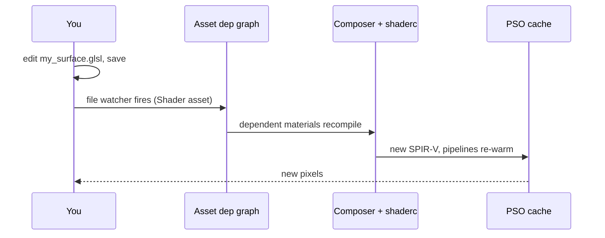

A **surface shader** is a fragment of GLSL that describes *what a surface looks like*: colors, textures, normals, emission. The engine wraps it in an adapter that owns everything else: vertex I/O, descriptor sets, lighting (Forward+ clustered, shadows, IBL), and the OpenPBR BRDF. You write one function. The engine turns it into full pipeline variants.

## 1 · Quick start

Right-click a folder in the Assets browser → **Create → Surface Shader**. This creates a *pair*: `NewSurface.glsl` (a commented, compiling template demonstrating every mechanism below) and `NewSurface.material` pre-wired to it. Drag the .material onto a mesh. It renders immediately. Then open the .glsl (the material inspector's **Open Surface Shader in Editor** button) and start editing. Saving recompiles and updates the scene.

## 2 · The contract

A surface shader defines exactly one entry point:

```glsl title="The one entry point a surface defines"
SurfaceOutput EvaluateSurface(SurfaceInput sIn)
{
    SurfaceOutput o = DefaultSurfaceOutput();
    o.baseColor = Mat.uBaseColor.rgb;
    o.metallic  = Mat.uParams0.x;   // "metallic" property
    o.roughness = Mat.uParams0.y;   // "roughness" property
    o.normalWS  = normalize(sIn.normalWS);
    return o;
}
```

The full `SurfaceInput` / `SurfaceOutput` field lists live in `Engine/Modules/Rendering/Shaders/Includes/surface_io.glsl`: the input carries UVs, world position/normal/tangent, view direction, vertex color, per-slot UV transforms. The output carries the complete OpenPBR surface (base/metallic/roughness/normal/emissive/opacity plus coat, sheen, fuzz, anisotropy, subsurface, transmission, thin-film lanes). Start from `DefaultSurfaceOutput()` and write only what you use.

:::caution[Rules]
No `#version`, no `layout(...)` declarations, no descriptor bindings: the adapter owns those. Read material parameters only through `Mat` (the per-instance material row the adapter fetches for you). Helper functions are fine. The file is included into the adapter as-is.
:::

### Where the file can live

The material's `surfaceShader` reference resolves in this order: **the material's own directory** → project root(s) → package shader directories → the engine shader tree. Dropping `my_surface.glsl` next to the .material and writing `"surfaceShader": "my_surface.glsl"` is all it takes. An authored reference that resolves nowhere is a *hard compile failure* that lists every searched root, never a silent fallback.

A surface's own `#include`s resolve against the including file's directory, then the project root(s), the package shader directories and the engine shader tree. The material's directory joins that list only when the material's surface or vertex modifier lives there, so a surface found through a root reads the same files whichever material uses it, and every material that uses it shares its compiled shaders. Keep a helper next to the surface that includes it, or include it by its path from a shader root; an include that resolves nowhere is logged as `NOT FOUND` with every directory searched.

## 3 · Textures

Declare the textures your surface samples with `@texture` comment tags at the top of the file:

```glsl title="Texture declarations at the top of the file"
// @texture albedoMap    srgb
// @texture dissolveMask linear
```

**Well-known names** keep their canonical slot and are sampled directly by name, `texture(albedoMap, uv)`:

| Name | Slot | Name | Slot |
|---|---|---|---|
| `albedoMap` | 0 | `aoMap` | 4 |
| `normalMap` | 1 | `coatNormalMap` | 5 |
| `metallicRoughnessMap` | 2 | `roughnessMap` | 6 |
| `emissiveMap` | 3 | `metallicMap` | 7 |

**User names** (anything else) are packed into the lowest free slots automatically and sampled via `GE_USER_TEXTURE(name)`:

```glsl title="Sample a user texture"
float mask = texture(GE_USER_TEXTURE(dissolveMask), uv).r;
```

The .material assigns them by the same name, `"textures": { "dissolveMask": { ... } }`. Unassigned slots fall back to 1×1 defaults, so a surface renders before any texture is hooked up. The window is **8 slots total**.

A surface that declares any `@texture` name owns its slot set: a name it does not declare, well-known or not, binds nothing, and a .material that assigns one gets an `unknown texture key` warning naming the valid keys. A surface with no declarations keeps the fixed slots in the table.

:::danger[Two hard-failure traps]
Both fail loudly at compile, never silently: a surface that declares user `@texture` names must not *also* read slots by raw ordinal (`GE_SLOT_TEX(2)` or the triplanar helpers), because the packed name would alias the ordinal. And a comment line whose first token is `@texture` IS a declaration: when quoting the syntax in prose, do not start the line with the tag.
:::

A slot name works with four sampling forms: `texture(name, uv)`; `textureLod(name, uv, lod)`; `textureGrad(name, uv, uvPerPixelX, uvPerPixelY)`, for a UV whose own screen derivatives are meaningless (a UV displaced per pixel, as the standard surface's parallax does), with the footprint in repeats per pixel; and `textureSize(name, lod)`, in texels.

Slot samples (the well-known names and `GE_USER_TEXTURE`) automatically receive the per-view TAAU texture-sharpness mip bias (the adapter's `texture()` overload adds `ge_mipBiasParams.x`; `textureGrad` scales the footprint by the same amount; `textureLod` takes the level as given). Raw-ordinal `GE_SLOT_TEX` sampling bypasses it. Pass the bias explicitly if the texture carries surface detail (see `GE_SampleTriplanarSlot`).

Per-slot tiling/offset authored on the material is applied with `GE_TransformUV`:

```glsl title="Apply the slot's tiling and offset"
vec2 uv = GE_TransformUV(sIn.uv0, sIn.textureST[0], sIn.textureST2[0]);
```

## 4 · Parameters

Declare each parameter your surface reads with a `@property` comment line at the top of the file. The name you declare is the GLSL spelling (`Props.<name>`), the `.material` key and the inspector row: one name, no mapping table, no engine edit:

```glsl title="Property declarations and their use"
// @property <type> <name> ["Display Name"] [default=…] [range=min,max] [group=Name] [visibleIf=…] [tooltip="…"] [hdr] [hidden]

// @property color tint        "Tint"        default=1,0.55,0.2 hdr
// @property float pulseSpeed  "Pulse Speed" default=2.0 range=0,8 group=Pulse tooltip="radians per second"
// @property vec2  scrollSpeed "Scroll"      default=0,0.2
// @property bool  wobble      "Wobble"      default=true
// @property enum  axis        "Axis"        values=UV,WorldY,Radial default=UV

SurfaceOutput EvaluateSurface(SurfaceInput sIn)
{
    SurfaceOutput o = DefaultSurfaceOutput();
    float pulse = 0.5 + 0.5 * sin(Light.uTimeParams.x * Props.pulseSpeed);
    o.baseColor = Props.tint * pulse;
    ...
}
```

| Type | GLSL (`Props.name`) | Inspector |
|---|---|---|
| `float` | `float` | drag field, or a slider with `range=min,max` |
| `vec2` `vec3` `vec4` | same | 2–4 float fields |
| `color` | `vec3`, or `vec4` with a 4-component default | color swatch; `hdr` adds an intensity control |
| `bool` | `bool` | checkbox |
| `int` | `int` | integer drag field |
| `enum` | `int` (the index) | dropdown from `values=A,B,C` |

`default=` is the single source of truth: the `.material` stores only what a material overrides, so a new material's file can have no `"properties"` at all. `group=` collects rows into a collapsible section (sections appear where their first member is declared). `visibleIf=name`, `visibleIf=name=value`, and `visibleIf=name!=value` hide a row against another property, `alphaMode`, or `lightingModel`. `hidden` stores a value without a row. The engine packs the storage (greedy first-fit into the 30-lane material block: 120 floats per surface; a following scalar takes a vec3's spare `.w`). Appending a declaration never moves an earlier property. Inserting or reordering repacks the surface, which the edit's recompile already covers.

Every declaration error (unknown type, malformed `range=`, the same name declared with two types, more than 120 floats, `Mat.<name>` where `Props.<name>` was meant) fails the compile with `your_file.glsl:<line>` in the Shader Errors panel and the material inspector. The material keeps its last good shader. A declared property the file never reads is a warning. Textures are still declared with `@texture` (§3), and `keyword=` on a bool is not wired yet: use `"keywords"` (§5).

### The deformation envelope of a vertex modifier

A vertex modifier that moves vertices declares the largest distance it can move one, so GPU culling keeps the mesh while its moved vertices are still on screen:

```glsl title="A wind modifier declares its envelope"
// @property float swayAmount "Sway" default=0.1 range=0,0.25
// @deformationEnvelope 1.9 scaledBy=swayAmount
```

- The first value is a distance in meters in the mesh's local space, at any time, on any instance. Culling widens each instance's bounding sphere by this distance times the instance's largest axis scale.
- `scaledBy=` names a property the displacement grows with. The distance is multiplied by the absolute value of a `float` property, or by the length of the first three components of a vector property.
- A modifier with no declaration culls on its mesh bounds alone. For a modifier that moves positions, `vec3 ModifyVertex(vec3 position, InstanceData inst)`, the log and the material inspector's **Deformation Envelope** row say so. A modifier that writes the whole vertex output belongs to a draw path that culls its own geometry, so neither reports it. A declaration that is negative, not a number, declared twice, or scaled by a `bool`, `int` or `enum` property or by a property the shader does not declare is refused with the fix in the message, and culling uses the mesh bounds alone. The shader still compiles.
- The envelope changes culling only. Level-of-detail selection keeps using the mesh bounds.

## 5 · Keywords (static variants)

A material enables named keywords; the surface consumes them as `GE_USER_<NAME>` defines:

```glsl title="A keyword on the material and in the surface"
// .material:  "keywords": ["PULSE"]
#ifdef GE_USER_PULSE
    ...
#endif
```

Names are sanitized to uppercase identifiers, reserved engine defines are rejected, and each material compiles *one* fixed set (max 8): no combinatorial variant explosion.

:::caution[Silent-typo caveat: this section's "keywords" list only]
Nothing yet cross-checks that a material keyword is consumed by the surface (or that an `#ifdef GE_USER_X` has a matching keyword), so a misspelled entry in the `.material` `"keywords"` array is a silent no-op: check the spelling on both sides. This is a different mechanism from `@property` declarations (§4), where a typo is a *hard compile error* with a `file:line` in the Shader Errors panel, including `keyword=` itself, which §4's parser rejects outright until the variant-key plumbing lands.
:::

## 6 · Built-in inputs

| Input | What it is |
|---|---|
| `Light.uTimeParams.x` | Elapsed time, seconds: pulses, sines, flipbooks |
| `Light.uTimeParams.y` | Bounded scroll clock: UV panners (keeps precision on long sessions) |
| `sIn.vertexColor` | Vertex color (white when the mesh has none) |
| `GE_DecodeTangentNormal(s)` | Normal-map decode (handles BC5 two-channel payloads) |
| `GE_EMISSION_PAPERWHITE_NITS` | 203: emission is physical: `o.emissive` of 1.0 == 203 nits on screen. Author luminous surfaces in nits via a scale param, not display-referred guesses. |

## 7 · The .material file

```jsonc title="A material that uses a surface shader"
{
  "schemaVersion": 3,
  "materialName": "DissolveCrystal",
  "lightingModel": "StandardPBR",
  "surfaceShader": "dissolve_pulse.glsl",   // resolves material-dir-first
  "alphaMode": "Mask",                       // Opaque | Mask (cutoff discard) | Blend
  "keywords": ["PULSE"],
  "properties": {                            // overrides only — declared defaults cover the rest
    "baseColor": [0.6, 0.8, 1.0, 1.0],
    "roughness": 0.4,
    "alphaCutoff": 0.5,
    "dissolveEdge": 0.35,
    "glow": [0.2, 1.4, 2.0]
  },
  "textures": {
    "albedoMap":    { "path": "Textures/crystal_albedo.png" },
    "dissolveMask": { "path": "Textures/noise_soft.png" }
  }
}
```

The editor writes GUID references alongside paths when you assign assets through the inspector. Hand-authored paths self-heal into GUIDs. `alphaMode` owns blending: the shader just writes `o.opacity` (`Mask` discards below the adapter's `alphaCutoff` property; declare it in your surface to expose the slider; `Blend` composites it). A key no declaration owns is stored but never reaches the shader. The inspector lists it with the nearest declared name.

## 8 · The iteration loop



Materials referencing your file recompile automatically on save: the file watcher's shader-source event invalidates every cached shader built from the file and recompiles the registered materials that use it (surface *and* vertex-modifier references; matched by filename). A failed compile keeps the *last good* shader on screen (your mesh never disappears mid-edit), and the failure lands in the **Shader Errors** panel (§9). Note the current blast radius: any shader edit still clears the whole pipeline cache, so a big scene re-warms more PSOs than strictly necessary. If an external edit is ever missed (network drives, tools that bypass change notifications), the material inspector's **Recompile Shader** button pushes the same lane manually.

**What "automatically" covers.** Two things match, and between them they reach every file a compile reads:

- **The material's authored references**: the `surfaceShader` and `vertexModifier` fields, matched by filename. This catches an edit to your own surface even for a material nothing has compiled yet.
- **Everything a build actually read.** Each successful build records its whole `#include` closure (the helpers your surface pulls in at any depth, the adapters, the engine `Includes/*.glsl`) against that material's source identity. Editing any of those files names the identity and queues its materials. So **editing a helper you `#include` recompiles on save**, and so does **editing the implicit default surface** (`Surfaces/standard_surface.glsl`) that a material with an empty `surfaceShader` compiles against: its closure row records the default's chain even though its authored reference is the empty string.

The second rule has one precondition: the material must have *compiled at least once this session*, because the closure is recorded by a build. Before that first build there is nothing for an include edit to match, and the manual **Recompile Shader** button is the way through. Authored references carry no such precondition.

A `.Cache/Shaders` purge is **not** part of the fix for a missed trigger: a stale trigger is not a stale cache. The disk cache key hashes the CONTENT of every file in a shader's `#include` closure (your surface, the helpers it pulls in, the adapters, the engine `Includes/*.glsl`, at any depth), so once a recompile does run (the button, a material re-register, or an editor restart) it cannot serve a package built from the old bytes. That holds even when the edit leaves the file's timestamp and byte length untouched, which is what a timestamp-preserving copy or sync produces. The old key covered only the top-level composed source and leaned on a timestamp comparison, so those edits could silently serve pre-edit SPIR-V. If you have been purging `.Cache/Shaders` after touching adapters or includes, that habit is no longer needed.

Recompiles are also *budgeted*: the drain runs a small fixed number of material recompiles per frame and carries the rest to following frames, so a surface shared by many materials spreads its cost instead of stalling one frame on every compile. Materials still awaiting their turn keep their last-good shader on screen.

## 9 · When it breaks

A material whose shader has *never* compiled draws nothing (the mesh is invisible, not magenta): the draw is skipped rather than fed a broken pipeline. A material that compiled before keeps its last good shader on screen while you fix the error. Where to look, and what you will see:

| Surface | Behavior |
|---|---|
| **Shader Errors panel** | Auto-opens (bottom dock, next to Script Errors) the moment any material shader compile fails, no selection needed. Rows carry the real `file:line`; selecting one previews your shader at the failing line, double-click opens it in the script editor (or your external editor, per the script-open preference). The row clears when a later compile of that material succeeds. |
| **Material inspector** | The **Shader Diagnostics** foldout auto-expands with the full error list when the selected material's compile failed (red dot in the header). |
| **Error lines** | Errors in your file report `your_file.glsl:<line>`: real file, real line. Errors at the adapter boundary (e.g. a missing or mis-signatured `EvaluateSurface`) report the real adapter file/line *plus a hint naming your surface file and the required signature*. |
| **Composed dump** | On failure, the exact composed source that was compiled is written to `.Cache/Shaders/Failed/<name>_composed.{vert,frag}` and the path is included in the error list; open it to see your file in context (injected defines, resolved includes, texture-slot macros). |
| **Log** | `ShaderComposer:` errors name the material and every searched root (unresolved surface path, rejected `@texture` sets); `ShaderCompilationCache` warnings carry the compile diagnostics. |

## 10 · The graph route

The Material Graph panel (NodeGraphPanel in Material mode) builds surfaces visually (Engine Input sources, ~77 library nodes, a Surface Output master stack) and saves the result *as a .glsl file* (tag block + compiled body) that plugs into the same `surfaceShader` field. Note the one-way round-trip: hand edits to the generated body are lost on the next graph re-save.

## 11 · If you have written surface shaders elsewhere

:::note
A surface shader is a lit shader graph written as text: `EvaluateSurface` is your graph, `SurfaceOutput` is the master stack, keywords are static feature branches, and the `@property` lines are the material's property block: a ranged float with a display name and a default is `// @property float foo "Foo" default=0.5 range=0,1`, read as `Props.foo`. Textures still come from `@texture` tags for now. The adapter (`adapter_forward.glsl`) is the lit pass library: lighting, shadows, instancing, and depth/shadow variants are inherited, never written.
:::
