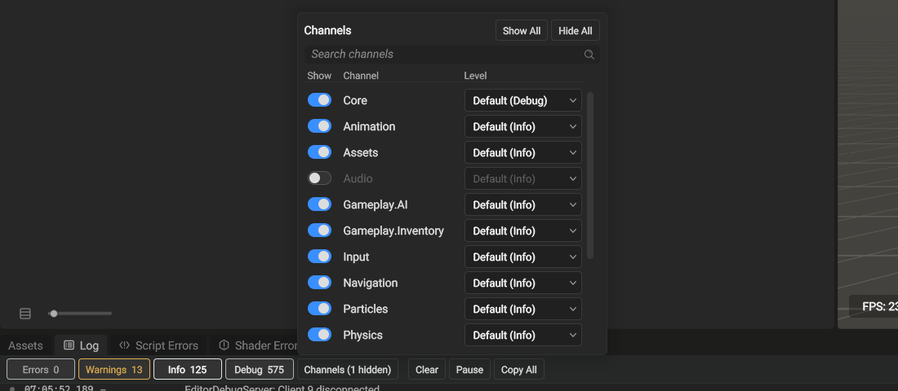

A log channel is a name for one part of a game or the engine, such as `Rendering` or `Inventory`. Each record carries its channel, the source file, the line, and the function that logged it. Each channel has its own level, so you can turn on Debug for one channel and keep the rest at Warning. The Log panel shows the channel of each line and can hide the lines of a channel.

## Declare a channel

Declare a channel once, in a header of the module that owns it. `GE_LOG_CHANNEL` takes the accessor's name, the channel's name, and the channel's default level without its scope. The header includes only `Logger/LogChannel.h`. That header needs `Logger/LogLevel.h`, `<cstdint>`, `<format>` and `<string_view>`, nothing more.

```cpp title="Inventory/InventoryLog.h"
#pragma once
#include "Logger/LogChannel.h"
namespace Inventory { GE_LOG_CHANNEL(InventoryLog, "Inventory", Info) }
```

The line defines the accessor `Inventory::InventoryLog()`. No `.cpp` file is necessary. The accessor is the name that the compiler checks at each call site. Give each accessor a name that no other channel uses in its namespace: the linker keeps one of two accessors with the same name and shows no error, so one channel then gets the records of both.

The channel registers when its accessor runs the first time. Nothing lists the channels in one place. Each DLL that calls the accessor registers the name again and gets the same channel. Two modules that declare the same name write to one channel, and the first declaration's default level applies. A process can register up to 256 channels.

## Log on a channel

`GE_LOG` takes the accessor, a level without its scope, and a `std::format` string with its arguments. The compiler checks the format string.

```cpp title="Log a warning on the Inventory channel"
#include "Inventory/InventoryLog.h"

GE_LOG(Inventory::InventoryLog, Warning, "slot {} holds {} items, the limit is {}", slot, count, limit);
```

When the channel does not pass the level, `GE_LOG` formats nothing and does not evaluate the arguments. Trace and Debug calls compile to nothing in a build that defines `NDEBUG`, such as Release.

`LOG_INFO`, `LOG_WARNING` and the other `LOG_` macros log on the `Core` channel with the same source information. They are in `Logger/LogChannel.h` too, so a file that only logs needs no other logger header. The `Logger::Log::Info` family of functions also logs on `Core`, without the source.

## The level of a channel

A record reaches the sinks when its level is at or above the channel's level:

- A channel that you set a level for uses that level. This is true also when the global level is stricter.
- A channel with no level of its own uses the stricter of the global level and its default level. A channel declared at Warning stays quiet while the global level is Info. `Core` has the default level Trace, so it follows the global level.
- When logging is off (before the logger starts, or after it stops), every channel is off.

Set or clear a channel's level from code with `Logger::Log::SetChannelLevel`:

:::::tabs
::::tab[C++]

```cpp title="Logger/Logger.h"
static void SetChannelLevel(std::uint16_t channel, std::optional<LogLevel> level);
```

```cpp title="Turn on Debug for one channel, then return it to the global level"
#include "Logger/Logger.h"

Logger::Log::SetChannelLevel(Inventory::InventoryLog().Index, Logger::LogLevel::Debug);
Logger::Log::SetChannelLevel(Inventory::InventoryLog().Index, std::nullopt);
```

::::
::::tab[C#]

:::caution[C# binding pending]
No managed call yet; tracked as [OpenEngine pull request #58](https://github.com/Game-Crafters-Guild/OpenEngine/pull/58). Scripts log on the `Core` channel through `Console.WriteLine`.
:::

::::
:::::

The change applies to the next log call on every thread.

## Filter the Log panel

Each line of the Log panel shows its channel after the time. A line on `Core` shows a dash in the channel column; the file log, the console and copied lines show no channel for `Core`. The **Channels** button opens the list of every registered channel, `Core` first and the others by name.

- Type in the search field at the top to list only the channels whose name contains the text. The line under the list counts them, for example **2 of 15 channels**. Escape clears the search; a second Escape closes the list.
- The toggle in the **Show** column shows or hides the lines of the channel. The button reads **Channels (1 hidden)** while a channel is hidden, and the counts beside the severity buttons leave out hidden lines. **Show All** and **Hide All** act on the channels the list shows.
- The **Level** column sets the level of the channel. **Default** removes the channel's own level, so the channel uses the stricter of the global level and its default level; the item shows that level, for example **Default (Info)**. **Trace** to **Off** set the channel's own level, as `SetChannelLevel` does.



*The Channels list with Audio hidden: its name and its level dim.*

The search field has a **Channel** scope that matches the channel name. When you select a line, the detail pane shows its channel beside the severity and the time, and the source button opens the file at the line that logged it.

The file log and the console print the channel name after the level for every channel except `Core`.
