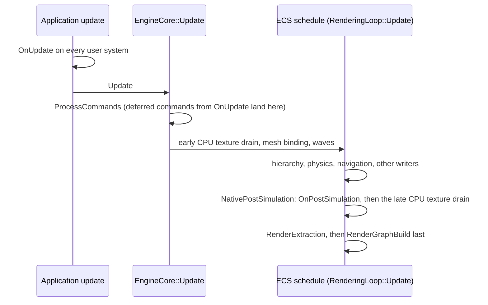

A native user system is a C++ struct deriving `ECS::SystemBase` in a project or package module. The build-time scanner generates its registration. `UserSystemAdapter<T>` forwards the hooks the struct declares to the engine-owned `UserSystemRegistry`. This page states where each hook runs in the frame, what it may touch, and how the late presentation hook `OnPostSimulation` is delivered.

## Authoring

```cpp title="The four hooks a user system may declare"
#include <GameSDK/System.h>

struct VisibilitySystem : ECS::SystemBase
{
    void OnStart(ECS::World& world);                     // play enters
    void OnUpdate(ECS::World& world, float dt);          // game logic, before the engine simulates
    void OnPostSimulation(ECS::World& world, float dt);  // presentation, after movement, before extraction
    void OnDestroy(ECS::World& world);                   // play exits
};
```

Every hook is optional. The adapter detects each one with a `requires` expression and forwards only what the struct declares. `EntitySystem<Self>` supplies `OnUpdate` from a `ForEach`. The other hooks may be added to it as usual.

## The order systems run in

Each hook visits the user systems in ascending `Order`, a `static constexpr int` the struct may declare; a system without one has order 0. Systems of equal order run by qualified name in character order (capital letters before lowercase, so `Zeta` runs before `alpha`), then by module name, so the order does not depend on which module loads or reloads first. Any other member named `Order` is a compile error that names the declaration to write.

`Order` orders the native user systems among themselves. It does not order them against C# systems or the engine's systems: [where each hook runs](#where-each-hook-runs) gives its place in the frame.

```cpp title="Damage after movement, within the same frame"
struct MovementSystem : ECS::SystemBase
{
    void OnUpdate(ECS::World& world, float dt);  // order 0
};

struct DamageSystem : ECS::SystemBase
{
    static constexpr int Order = 100;
    void OnUpdate(ECS::World& world, float dt);  // sees this frame's movement
};
```

| Rule | Detail |
|---|---|
| Every hook | `OnStart`, `OnUpdate`, `OnPostSimulation` and `OnDestroy` all visit the systems in the same order. |
| Across modules | The order spans every loaded module: a package's system at order 15 runs between the project's at 10 and 20. Reloading a module puts its systems back in their places. |
| Read once | The order is read when the module registers its systems; changing it takes a rebuild, as any edit does. |
| A disabled system | A system disabled by a hard fault keeps its place; the others do not move. |

## Where each hook runs

| Hook | Caller | Position in the frame | Thread |
|---|---|---|---|
| `OnStart` | `StartUserSystems` from the play-mode entry (editor) or player start | Once, after the play snapshot. In the Player, before the startup scene's meshes, bounds, `SkeletonRef` and `AnimatorRef` are bound: they arrive on later frames. In editor play mode they are already bound at `OnStart` | Main |
| `OnUpdate` | `TickUserSystems` from the application update (`PlayModeManager::Tick`, `PlayerApplication::Update`) | Before `EngineCore::Update`: before the deferred-command flush and before every scheduled ECS system, so navigation, physics and the transform hierarchy have not moved anything yet this frame | Main |
| `OnPostSimulation` | `NativePostSimulationSystem`, an engine-owned scheduled system | Inside the ECS schedule, after the transform hierarchy, morph targets, HLOD selection and the movement writers (navigation movement, physics write-back, character-controller write-back, ocean buoyancy when those modules exist); before mesh extraction, the scene TLAS refit and the render-graph build | Main, exclusive: no other scheduled system runs concurrently |
| `OnDestroy` | `StopUserSystems` on play exit | Before the play snapshot is restored | Main |



:::caution[Why a second hook exists]

Game logic belongs before the simulation: `OnUpdate` sets destinations, desired velocities, and inputs that navigation and physics consume in the same frame. A presentation publisher (a visibility mask, a renderer-membership decision) that reads positions in `OnUpdate` therefore sees last frame's movement while the renderer shows this frame's. `OnPostSimulation` is the point after the writers have finished and before extraction reads the world.

:::

## What the late hook may do

| Rule | Detail |
|---|---|
| Derive, do not simulate | Read the completed simulation and write presentation inputs: renderer membership (`MeshRenderer::RenderLayers`), CPU texture publications, parameter blocks. Do not advance gameplay state, replace the scene or rewrite camera, terrain or hierarchy inputs already consumed earlier in the schedule. |
| Direct writes reach extraction | Component writes through `GetComponentForWrite` / `GetForWrite` land before extraction runs. Deferred commands (`Entity::Set`, `AddComponent`) stay deferred and are played back at the next frame's flush; the hook is not a command flush. |
| Mesh binding is next frame | A `MeshRenderer` whose asset changes in the hook is bound on the main thread before the next frame's waves, so its new geometry appears one frame later. Membership changes appear in the same frame. |
| CPU textures | A lease created or published inside the hook drains in the same frame: the bridge observes the world scope and runs the CPU texture drain after the hook, before graph declaration. Sources unchanged since the early drain do not upload again. |
| Exclusive execution | The bridge system declares `RequiresExclusiveUpdate`: it runs on the thread calling `SystemManager::Update` with every other system of its wave joined before and after it. Arbitrary user world access needs no further locking. |
| Faults | The same guarded invocation as `OnUpdate`: a thrown exception is logged and the remaining systems still run; a hard fault disables the faulting system for the session. |

## Delivery

| Event | Behavior |
|---|---|
| One tick, one delivery | `TickUserSystems` records the world id, its lifecycle reset generation and the native delta. The next `NativePostSimulationSystem` update for that exact world and reset generation delivers the hook once, with that delta, and clears the record before any user code runs. A redraw without a native tick, another view of the world, an unrelated world, or a reentrant call delivers nothing. |
| Stop | `StopUserSystems` revokes the pending delivery before `OnDestroy`. |
| Module replacement | Clearing a module's registrations revokes the pending delivery; the replacement module receives the next tick's delivery. Registrations of other modules are untouched. |
| World reset | A reset before the tick completes, or inside `OnUpdate`, changes the lifecycle reset generation and revokes the delivery. A fresh tick publishes the current state. |
| Pause and edit mode | No native tick means no delivery. Existing publications stay valid. |

## Schedule effect

Mesh extraction declares the movement writers as optional dependencies and the bridge as a required one, so extraction runs after navigation movement, physics write-back, character-controller write-back, and ocean buoyancy whenever those systems exist. Objects those writers move are extracted from this frame's positions. The wave solver orders by declared edges only. `SystemPhase` and `Order` sort within a wave.

## ABI

`IUserSystem` carries `OnPostSimulation`, `HasPostSimulation` and `Order`, and `ECS::ISystem` carries `RequiresExclusiveUpdate`, so the native module ABI version is **3**. A module built against an earlier version is refused at load with `ABI version mismatch: module=2 host=3 — rebuild user scripts against this engine`, before any of its registrations replay. Engine, Editor, Player, the SDK and every native module are rebuilt together.

## Verification

`NativePostSimulationTests` covers adapter detection, once-per-tick delivery with the native delta, revocation on Stop, module replacement and reset, guarded faults, deferred-command semantics, exclusive execution in mixed and legacy parallel waves, and the assembled rendering, physics and navigation schedule placing the bridge after the writers and before extraction. `CpuTextureSourceTests` drives navigation movement followed by a hook that creates and publishes a lease and reads the pixels back in the same frame. `NativeModuleRejectionTests` loads an ABI-1 probe and checks it is refused before registration. `UserSystemOrderTests` covers the adapter reading `Order`, every hook visiting systems by order and then name, a module reload putting its systems back among another module's at distinct and at equal orders, and a disabled system keeping its place.
